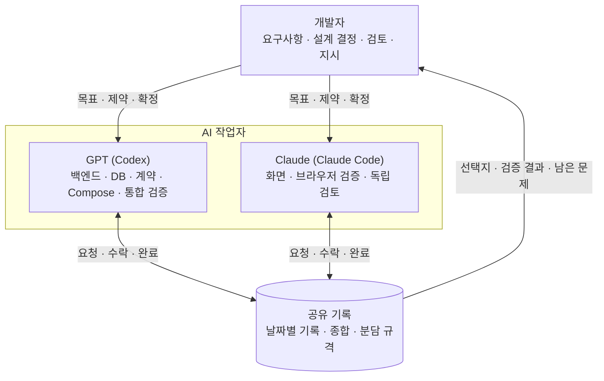

# AI 개발 운영 방식

## 개요

FactoryMES는 GPT(Codex)와 Claude(Claude Code)를 개발 작업자로 활용해 진행했습니다. 요구사항 정의, 설계 선택,
결과 검토와 다음 작업 지시는 직접 담당하고, 구현과 교차 검증을 두 AI에 나눠 맡겼습니다. 두 AI가 같은 맥락에서
작업하고 서로 결과를 넘겨받을 수 있도록 공유 기록, 파일 소유권, 요청·완료 규칙을 정해 운영했습니다.

```text
요구사항·제약 정의 → 분담 규격 작성(API·권한·상태·파일 담당)
  → 규격 검토·확정 → 파일 단위 병행 구현
  → 상대 구현 독립 검토 → 발견 사항 반영 여부 결정
  → 통합 검증·배포 → 결과 확인 후 다음 작업 지시
```

## 역할 분담



| 담당 | 역할 |
|---|---|
| 개발자 | 요구사항·범위 결정, 설계 선택지 비교 후 확정, 결과 검토와 재지시, 공개 전 점검 |
| GPT | 백엔드·DB·API 계약·Compose 구현, 통합 검증과 배포 |
| Claude | Blazor 화면·브라우저 검증, 상대 구현의 읽기 전용 독립 검토 |

## 운영 규칙

### 공유 기록

| 문서 | 내용 |
|---|---|
| 종합 | 현재 상태, 다음 작업, 결정·보류 사항과 이유 |
| 날짜별 기록 | 요청·수락·완료, 의견이 다를 때 각 의견과 결정 결과 |
| 분담 규격 | 기능별 API·권한·상태 규칙, 파일별 담당, 완료 조건 |

작업을 시작할 때 종합과 최근 기록을 먼저 읽고, 끝날 때 결정 사항과 이유를 남기도록 했습니다. 과거 기록은
수정하지 않고 정정 항목으로 추가합니다.

### 작업 요청과 소유권

- 요청은 `[GPT → Claude 요청]`, `[Claude → GPT 요청]` 머리글로 기록하고, 받는 쪽은 즉시 수락과 담당 파일을 기록
- 완료 시 결과·검증 범위·남은 문제를 함께 기록
- 같은 단계·같은 파일은 한쪽만 수정하고, 다른 담당 파일은 요청으로 전달
- 공통 빌드·컨테이너 재기동·DB 작업은 지정된 한쪽만 수행
- 감시 스크립트로 새 요청을 자동 감지해 수동 전달 없이 작업 연계

### 결정과 검증 기준

- 두 AI가 동의한 안도 검토 후 확정한 것만 설계 기준으로 사용
- 검증 결과는 실제 Oracle·브라우저·GPU 검사와 계약·단위 검사를 구분해 기록
- 유료 API 호출, 실제 외부 발송, 임의 DB 초기화 금지
- 비밀번호·토큰·키·접속 문자열·요청 본문·개인정보는 로그에 기록하지 않음
- 공개 저장소에는 개인 경로·실제 IP·비밀 파일을 포함하지 않음

## 적용 사례

| 상황 | 대응 |
|---|---|
| 두 AI가 같은 산출물(스키마, API 계약)을 각각 작성 | 비교표로 기준본을 정하고 다른 쪽 장점만 병합, 이후 한쪽 구현·한쪽 검토로 분담 |
| 한 AI가 분담 범위를 넘어 대부분을 처리 | 기록을 확인하고 파일 담당을 다시 나눠 지시 |
| 구현 중 범위 확장 제안 | 필요한 기능만 확정하고 나머지는 후속 범위로 기록 |
| 검증 결과 보고 | 검증한 범위와 하지 않은 범위를 나눠 기록하도록 지시 |
| 저장소 공개 | 비밀·개인 경로·실제 IP 포함 여부 감사 후 공개 |

교차 검토로 발견해 수정한 문제는 다음과 같습니다.

- API 계약과 DDL의 경보 심각도 값 불일치
- 1초 주기로 수집하는 설비에서 24시간 예약 분석이 입력 상한을 넘는 문제
- 전체 수집률을 온도 수집률로 사용해 온도 데이터가 오래된 경우를 구분하지 못하는 문제
- 메모리에만 먼저 기록한 수신 저널이 디스크 실패 후 잘못된 ACK를 만들 수 있는 문제

## 정리

- 구현 속도는 AI에 맡기고, 범위와 설계 선택, 검증 기준은 직접 결정하는 방식으로 운영
- 공유 기록과 파일 소유권으로 두 AI의 중복 작업과 충돌을 줄임
- 교차 검토를 통해 한쪽 AI만으로는 놓치기 쉬운 문제를 구현 단계 전후에 발견
