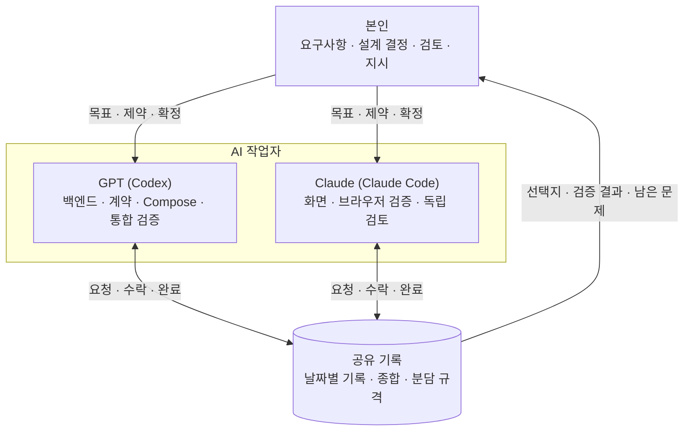
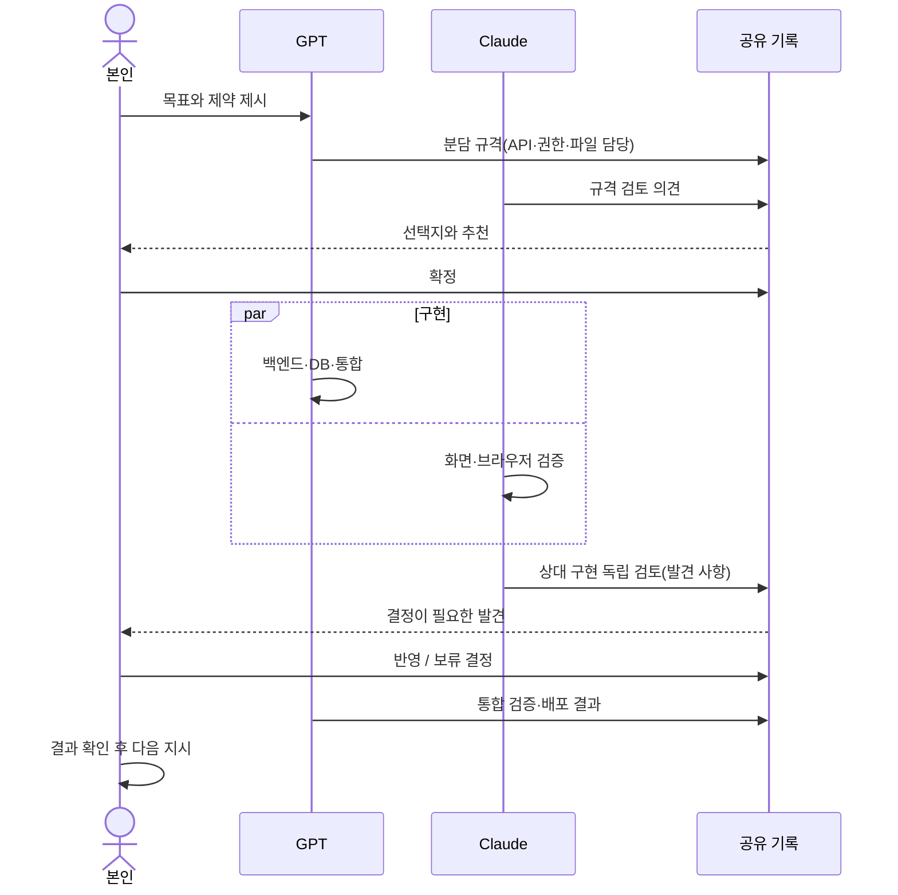

# AI 협업 운영 방식

이 프로젝트는 GPT(Codex)와 Claude(Claude Code) 두 AI와 함께 만들었습니다.
제가 맡은 일은 **요구사항을 정하고, 설계 선택지 중에서 결정하고, 결과를 확인해 다음 지시를 내리는 것**이었습니다.
두 AI에는 구현과 교차 검증을 나눠 맡겼습니다. 이 페이지는 그 운영 방식을 정리한 것입니다.

## 역할 분담

| 누가 | 하는 일 | 하지 않는 일 |
|---|---|---|
| **본인** | 무엇을 만들지, 범위를 어디까지 할지, 선택지 중 무엇을 고를지 결정. 결과를 보고 다음 단계 지시 | 직접 코드 작성은 최소화 |
| GPT | 주로 백엔드·DB·계약·Compose·통합 검증 구현 | 사용자 확정 없이 설계 변경 |
| Claude | 주로 화면·브라우저 검증, 상대 구현의 읽기 전용 독립 검토 | 남이 맡은 파일 수정 |

## 운영 규칙

제가 정하고 두 AI가 같이 따르게 한 규칙입니다.

### 1. 공유 기록
- 두 AI는 같은 폴더에 **날짜별 기록**과 **종합**을 남깁니다. 작업을 시작할 때 종합과 최근 기록을 먼저 읽고,
  끝날 때 결정·보류·이유를 적습니다.
- 과거 기록은 지우거나 덮어쓰지 않습니다. 틀린 내용은 다음 기록에 "정정"으로 남깁니다.
- 두 AI의 의견이 다르면 **누구 의견인지 표시**하고, 어느 쪽으로 정했는지 적습니다.

### 2. AI 합의와 사용자 확정을 구분
- 두 AI가 동의한 것은 **"AI 합의(사용자 미확정)"**로만 적습니다. 제가 확정해야 "사용자 확정"이 됩니다.
- 이 규칙은 설계 초기에 생겼습니다. 제가 보내지 않은 입력창 초안이 확정 사항처럼 전달된 일이 있었고,
  이후로 확정 여부를 반드시 나눠 적게 했습니다. ([설계 과정](design.md) 참고)

### 3. 소유권
- 같은 단계·같은 파일을 두 AI가 동시에 고치지 않습니다. 기능마다 **분담 규격 문서**를 먼저 만들어
  API·권한·상태 규칙과 **파일별 담당**을 적고 시작합니다.
- 남의 파일은 고치지 않고 요청으로 남깁니다. 공통 빌드·컨테이너 재기동·DB 작업은 담당 한쪽만 합니다.

### 4. 하네스(요청 주고받기)
- 요청은 공유 기록에 `[GPT → Claude 요청]` / `[Claude → GPT 요청]` 머리글로 남깁니다.
  받는 쪽은 시작하자마자 `[수락]`과 담당 파일을, 끝나면 `[완료]`와 결과·검증·남은 문제를 적습니다.
- Claude는 감시 스크립트로 새 요청을 자동으로 알아채고, GPT는 작업 시작·단계 종료 때 확인합니다.
  제가 매번 말을 옮기지 않아도 되게 하려는 것입니다.
- 11월 13~18일 기록에 요청 약 100건, 완료 약 95건이 남아 있습니다.

### 5. 지켜야 할 제약
- 유료 AI 호출, 실제 외부 메일·채팅 발송, 임의 DB 초기화는 하지 않습니다. 기존 업무 이력은 보존합니다.
- 비밀번호·토큰·키·접속 문자열·요청 본문 전체·개인정보는 로그에 남기지 않습니다.
- 공개 저장소에는 개인 경로·실제 IP·비밀 파일을 올리지 않습니다.

## 한 기능이 만들어지는 순서

## 제가 내린 결정들 (예)

| 시점 | 상황 | AI가 낸 선택지·추천 | 제 결정 |
|---|---|---|---|
| 설계 | 공정 시연, 수량, 정정, 역할 | 표로 정리한 4가지 결정과 추천 | 추천안대로 확정 + 기본값 승인 |
| 설계 | 테이블이 30개 가까이로 늘어남 | 실행 허가 테이블 유지 vs 축소 | **허가 테이블 빼고 1차 범위 축소** |
| 설계 | 두 AI가 스키마를 따로 만듦(31개/34개) | 비교표 | 실행 검증한 31개를 기준, 다른 쪽 장점 6개만 병합 |
| 설계 | API 계약도 두 벌 | 비교표, A 기준 추천 | A 기준 + B에만 있는 경로 병합, 원본 보존 |
| 구현 | 화면 기술 | 정적 페이지+JS / Blazor Server(인증 구조 변경 필요) / Blazor WASM(추천) | **Blazor WebAssembly**, 기존 쿠키·CSRF 그대로 사용 |
| 구현 | 작업자가 제출 전에 잘못 넣은 실적 | 후속으로 미루자는 의견 | **제출 전 본인 실적 역분개 허용**을 바로 구현 |
| 구현 | 다음 단계 범위 | 여러 후보 | 통계·대시보드, Mock AI, Outbox 재처리 세 가지만 하고 멈춤 |
| 확장 | 설비 통신 | Modbus TCP vs OPC UA 비교 | Modbus TCP FC03 먼저 |
| 확장 | AI | Mock만 / 로컬 모델 | 집 GPU로 로컬 모델, 예측이 아닌 근거 있는 점검 |
| 확장 | 알림 | Mock만 / 실제 통신 | 로컬 SMTP·웹훅으로 실제 통신, 외부 발송은 금지 |
| 구조 | 저장소 | 하나 유지 / 분리 | **회사처럼 서비스별 저장소**, 바뀐 서비스만 빌드·배포 |

## 확인하고 다시 지시한 것

- **분업이 무너질 때:** 한 AI가 분담을 넘어 대부분을 혼자 처리하는 일이 있었습니다. 그럴 때는 기록을 확인하고
  파일 담당을 다시 나눠 지시했습니다.
- **중복 작업:** 두 AI가 같은 산출물(스키마, API 계약)을 따로 만든 일이 두 번 있었습니다. 비교표를 받아 기준본을
  정하고, 이후로는 한쪽이 구현하면 다른 쪽은 검토만 하게 했습니다.
- **검증 범위:** "통과"라는 보고를 받으면 무엇을 검증했고 무엇은 안 했는지(실제 GPU·Oracle·브라우저 vs 계약 검사)를
  나눠 적게 했습니다. 각 기능 페이지의 "검증과 한계"가 그 결과입니다.
- **공개 전 점검:** 저장소를 공개하기 전에 비밀·개인 경로·실제 IP가 없는지 감사하게 했습니다.

## 돌아보며

- AI 두 개를 쓰면 속도는 빨라지지만, **누가 무엇을 확정했는지**가 흐려지기 쉽습니다. 기록에 확정 여부를
  나눠 적은 것이 가장 효과가 컸습니다.
- 교차 검토는 실제로 버그를 찾았습니다. 예: 경보 심각도 값이 DDL과 계약에서 달랐던 것, 1초 수집 설비에서
  24시간 예약 분석이 입력 상한을 넘던 것, 수집률과 온도 수집률을 구분하지 못하던 것.
- 결정은 제가 하되, 결정에 필요한 비교표와 근거는 AI에게 먼저 만들게 하는 방식이 잘 맞았습니다.
