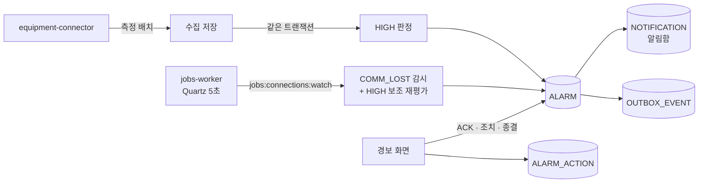
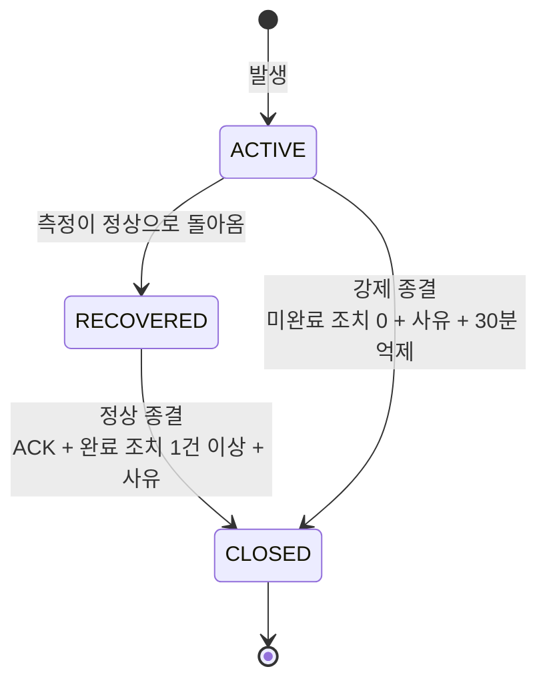
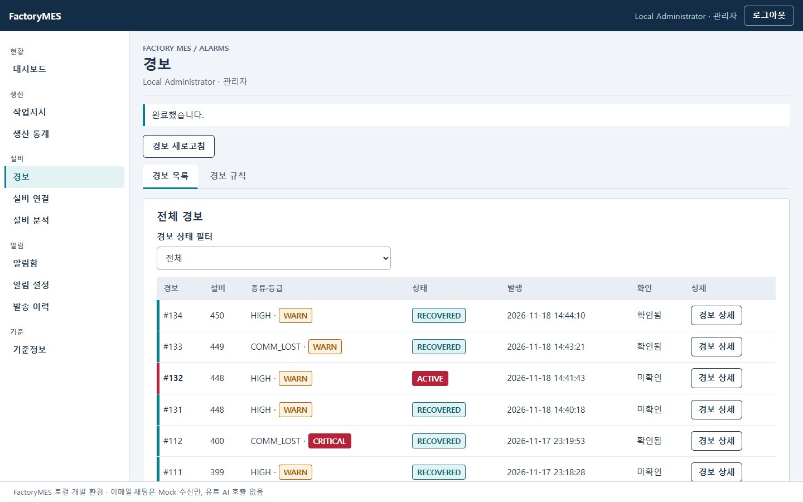
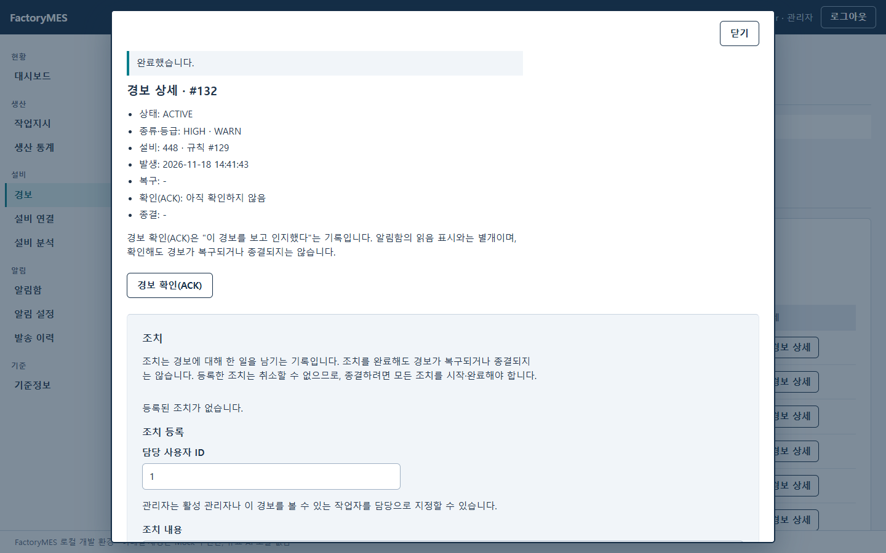

# 경보

두 가지 경보를 다룹니다. **통신 끊김(COMM_LOST)**은 유효한 데이터가 정해진 시간 넘게 들어오지 않을 때,
**상한 초과(HIGH)**는 온도 같은 측정값이 위험 범위에 머물 때 열립니다. 열린 경보는 확인(ACK) →
조치 → 종결 순서로 사람이 처리합니다.

## 구성도

## 상태 흐름

경보 상태와 별개로 **ACK(본 사람·시각)**와 **조치(OPEN → IN_PROGRESS → DONE)**가 따로 쌓입니다.

## 설계

### 문제
- 데이터가 아예 안 오면 "수신할 때 판정"하는 방식으로는 끊김을 알 수 없습니다.
- 값이 경계 근처에서 흔들리면 경보가 열렸다 닫혔다를 반복합니다.
- 센서 값이 돌아왔다고 해서 사람이 필요한 조치를 끝낸 것은 아닙니다.

### 검토한 안과 선택

| 고민 | 비교한 안 | 선택과 이유 |
|---|---|---|
| 끊김 감지 | 수신 시 판정 / **주기 감시** | 시간이 지나는 것 자체가 조건이라 Quartz가 5초마다 백엔드 내부 API를 부릅니다. 최대 한 주기만큼 늦게 감지합니다. |
| 감시 위치 | Jobs가 SQL 직접 / **백엔드 내부 API** | 규칙과 트랜잭션을 한 곳에 둡니다. Jobs를 다른 서버로 옮겨도 규칙이 갈라지지 않습니다. |
| HIGH 기준 | 임계값 하나 / **발생·복구 임계값 둘 + 유지 시간** | 예: 26.0℃ 이상 2초 → 발생, 25.8℃ 이하 2초 → 복구. 그 사이에서는 상태를 유지해 반복 전환을 줄입니다. |
| HIGH 판정 시점 | 5초 배치만 / **수집 저장 직후 + 배치 보조** | 배치 사이에 끝난 짧은 초과도 놓치지 않습니다. 대신 수집 트랜잭션에 판정 비용이 들어갑니다. |
| 연속 구간 기억 | 메모리 타이머 / **Oracle 측정 이력** | 재시작해도 근거가 남습니다. |
| 복구 처리 | 복구되면 자동 종결 / **ACK·조치·관리자 검토 후 종결** | 신호 복귀와 업무 완료를 분리합니다. |
| 강제 종결 | 복구로 처리 / **FORCED 이력 + 30분 억제** | 고장 신호가 남은 예외를 복구로 꾸미지 않고, 바로 반복되는 경보 폭주를 막습니다. |
| 알림 읽음과 ACK | 같은 것 / **별개** | 개인이 알림을 읽은 것과 업무상 경보를 확인한 것은 의미와 주인이 다릅니다. |

## 화면

### 경보 목록

행 왼쪽 색 띠와 상태 배지로 **아직 열린 경보(ACTIVE)**가 먼저 눈에 띄게 했습니다. 종류·등급·발생 시각과
함께 **확인 여부**를 따로 보여줘서 "복구됐지만 아무도 확인하지 않은 경보"를 찾을 수 있습니다.
작업자는 본인 담당 설비의 경보만 봅니다.

<a class="source-link" href="https://github.com/nkpFactoryMES/factorymes-web/blob/2d05837500b6de42f46230227fc593291856e0ff/services/web-client/Pages/Alarms.razor#L60-L163">소스 보기</a>

### 경보 상세와 조치

상세에는 발생·복구·확인·종결 시각을 따로 적고, **"ACK는 인지 기록일 뿐 복구·종결이 아니다"**,
**"조치를 완료해도 종결되지 않는다"**는 안내를 화면에 직접 넣었습니다. 사용자가 버튼 하나의 의미를
오해하지 않게 하려는 것입니다. 조치는 등록 → 시작 → 완료 순서로만 바뀌고, 등록한 조치는 취소할 수 없습니다.

<a class="source-link" href="https://github.com/nkpFactoryMES/factorymes-web/blob/2d05837500b6de42f46230227fc593291856e0ff/services/web-client/Components/AlarmActions.razor#L1-L172">소스 보기</a>
<a class="source-link" href="https://github.com/nkpFactoryMES/factorymes-backend/blob/35b21c06298e68430fe08a6b5c3cd4ab1a683cf6/services/mes-backend/Features/Alarms/AlarmService.Actions.cs#L86-L264">조치 API</a>

### 경보 규칙

규칙 화면 맨 위에 COMM_LOST와 HIGH의 판정 조건을 문장으로 적었습니다. 목록의 **억제** 열은 강제 종결 후
30분 동안 새 경보를 막고 있는 규칙을 보여줍니다. 경보가 열려 있는 동안에는 임계값을 바꿀 수 없게 해서,
이미 발생한 사건의 의미가 새 기준으로 바뀌지 않게 했습니다.

<a class="source-link" href="https://github.com/nkpFactoryMES/factorymes-web/blob/2d05837500b6de42f46230227fc593291856e0ff/services/web-client/Pages/Alarms.razor#L213-L432">소스 보기</a>

## 핵심 코드

COMM_LOST 감시: 마지막 유효 측정의 측정·수신 시각을 모두 보고, 억제 중이면 새 경보를 만들지 않습니다.

<a class="source-link" href="https://github.com/nkpFactoryMES/factorymes-backend/blob/35b21c06298e68430fe08a6b5c3cd4ab1a683cf6/services/mes-backend/Features/Alarms/AlarmService.Watch.cs#L79-L184">소스 보기</a>

HIGH 판정: 측정 이력에서 발생·복구 연속 구간을 복원합니다. 불량(BAD) 측정도 구간에 포함해 건너뛰지 않습니다.

<a class="source-link" href="https://github.com/nkpFactoryMES/factorymes-backend/blob/35b21c06298e68430fe08a6b5c3cd4ab1a683cf6/services/mes-backend/Features/Alarms/AlarmService.High.cs#L48-L184">소스 보기</a>

정상·강제 종결: 조건을 서버 트랜잭션 안에서 다시 검사합니다.

<a class="source-link" href="https://github.com/nkpFactoryMES/factorymes-backend/blob/35b21c06298e68430fe08a6b5c3cd4ab1a683cf6/services/mes-backend/Features/Alarms/AlarmService.Actions.cs#L291-L378">소스 보기</a>

## 검증과 한계

- 시뮬레이터를 멈춰 COMM_LOST 발생·복구, 온도를 올려 HIGH 발생·복구, ACK·조치·정상/강제 종결,
  강제 종결 뒤 억제 기간에 새 경보가 열리지 않는 것을 API와 브라우저로 확인했습니다.
  억제가 끝난 뒤 다시 열리는 장면은 따로 시연하지 않았습니다.
- 상세: [COMM_LOST·알림함](https://github.com/nkpFactoryMES/factorymes-system/blob/de9e542d9e362add9f5aec3293986d4744c13b12/docs/comm-lost-alarms-inbox.md),
  [HIGH 임계치](https://github.com/nkpFactoryMES/factorymes-system/blob/de9e542d9e362add9f5aec3293986d4744c13b12/docs/high-alarms-design.md),
  [조치·종결](https://github.com/nkpFactoryMES/factorymes-system/blob/de9e542d9e362add9f5aec3293986d4744c13b12/docs/alarm-actions-closure.md)
- 경보는 알림과 조치에만 씁니다. 작업을 자동으로 멈추거나 설비를 제어하지 않습니다.
- LOW·변화율·이상 탐지 경보와 조치 취소·재배정은 범위 밖입니다.
