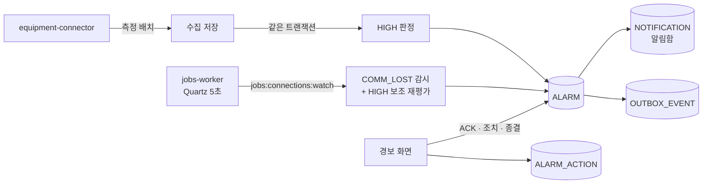
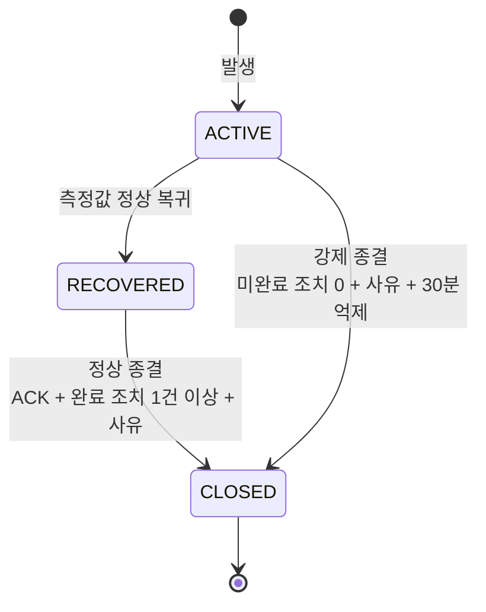
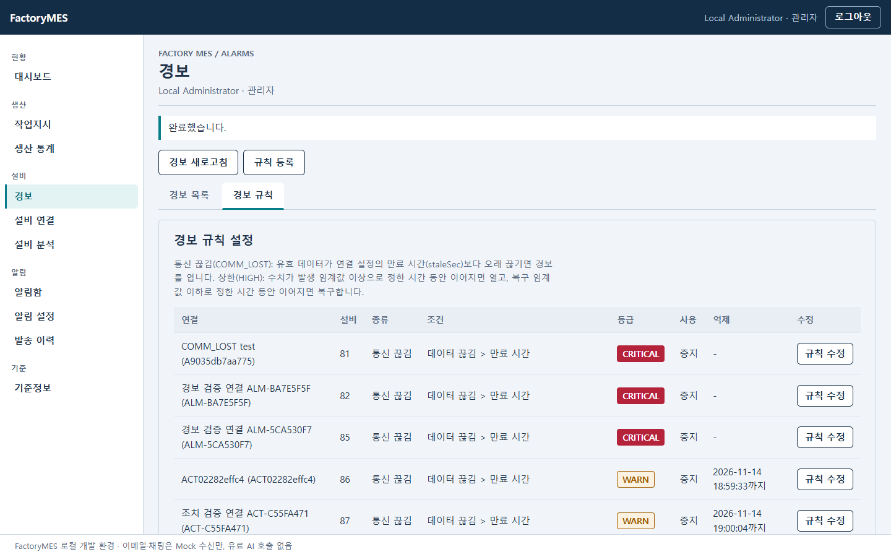

# 경보

## 개요

설비 경보는 두 종류입니다. 통신 끊김(COMM_LOST)은 유효한 측정이 정해진 시간 이상 들어오지 않을 때,
상한 초과(HIGH)는 온도 같은 측정값이 위험 범위에 머물 때 발생합니다. 발생한 경보는 확인(ACK), 조치,
종결을 각각 별도의 기록으로 관리하며, 경보 발생과 함께 알림함 알림과 Outbox 이벤트를 생성합니다.

```text
측정 저장 → HIGH 판정 ┐
Quartz 5초 감시 → COMM_LOST 판정 · HIGH 보조 재평가 ┘
  → ALARM(ACTIVE) + 알림함 + Outbox
  → 확인(ACK) → 조치(OPEN → IN_PROGRESS → DONE)
  → 복구(RECOVERED) → 관리자 정상 종결
  → 또는 관리자 강제 종결 + 30분 억제
```

## 구성



## 상태 전이



| 동작 | 조건 | 권한 |
|---|---|---|
| 조치 등록 | ACTIVE·RECOVERED, 내용 필수 | 관리자: 담당자 지정 / 작업자: 본인 |
| 조치 시작·완료 | OPEN → IN_PROGRESS → DONE 순서만 허용 | 관리자 또는 조치 담당 작업자 |
| 정상 종결 | RECOVERED, ACK 있음, 완료 조치 1건 이상, 미완료 0 | 관리자 |
| 강제 종결 | ACTIVE, 미완료 조치 0, 사유 필수 | 관리자 |

## 설계

### 통신 끊김 감지

데이터가 아예 들어오지 않는 상황은 수신 시점에 판정하는 방식으로는 발견할 수 없습니다. Quartz가 5초마다
백엔드 내부 API를 호출해 마지막 유효 측정의 측정 시각과 수신 시각을 모두 확인합니다. 감시 로직을 Jobs가 아닌
백엔드에 둔 것은 경보 규칙과 트랜잭션을 한곳에서 관리하기 위해서입니다. 최대 한 주기만큼 감지가 늦어질 수
있습니다.

### 상한 경보와 히스테리시스

임계값 하나로 발생과 복구를 함께 판정하면 값이 경계 근처에서 흔들릴 때 경보가 반복해서 열리고 닫힙니다.
발생 임계값과 복구 임계값, 각각의 유지 시간을 따로 두었습니다.

```text
발생: 값 ≥ 26.0℃ 상태가 2초 연속 → ACTIVE
복구: 값 ≤ 25.8℃ 상태가 2초 연속 → RECOVERED
그 사이 값: 현재 상태 유지
```

| 항목 | 검토한 방식 | 결정 |
|---|---|---|
| 연속 구간 판단 | 메모리 타이머 / Oracle 측정 이력 | 측정 이력에서 복원. 재시작 후에도 근거 유지 |
| 판정 시점 | 5초 배치만 / 수집 저장 직후 + 배치 보조 | 배치 사이에 끝난 짧은 초과도 감지. 수집 트랜잭션에 판정 비용 추가 |
| 불량 측정 | 제외하고 판정 / 연속 구간에 포함 | 불량 측정을 건너뛰어 정상 연속으로 오인하지 않음 |
| 경보 중 임계값 변경 | 허용 / ACTIVE 경보가 없을 때만 | 이미 발생한 경보의 의미가 새 기준으로 바뀌지 않음 |

### 확인·조치·종결의 분리

센서 값이 정상으로 돌아왔다고 해서 현장 조치가 끝난 것은 아닙니다. 복구 시 자동 종결하지 않고,
확인(ACK)·조치 완료·관리자 검토를 거쳐 종결하도록 했습니다. 고장 신호가 남은 상태를 복구로 처리하지 않도록
강제 종결은 FORCED 이력으로 남기고, 같은 규칙의 경보가 곧바로 다시 쏟아지지 않도록 30분간 억제합니다.
개인의 알림 읽음과 업무상 경보 확인도 의미와 주체가 달라 별도 상태로 관리합니다.

## 화면

<div class="screen" markdown="1">

### 경보 목록


행 왼쪽 색 띠와 상태 배지로 발생 중인 경보가 먼저 보이도록 하고, 확인 여부를 별도 열로 표시해 복구됐지만
아무도 확인하지 않은 경보를 찾을 수 있게 했습니다. 작업자는 담당 설비의 경보만 조회합니다.

<a class="source-link" href="https://github.com/nkpFactoryMES/factorymes-web/blob/2d05837500b6de42f46230227fc593291856e0ff/services/web-client/Pages/Alarms.razor#L60-L163">소스 보기</a>

</div>

<div class="screen" markdown="1">

### 경보 상세와 조치


발생·복구·확인·종결 시각을 따로 표시하고, ACK는 인지 기록일 뿐 복구나 종결이 아니며 조치를 완료해도
종결되지 않는다는 안내를 화면에 넣었습니다. 조치는 등록 → 시작 → 완료 순서로만 변경되고, 등록된 조치는
취소할 수 없습니다.

<a class="source-link" href="https://github.com/nkpFactoryMES/factorymes-web/blob/2d05837500b6de42f46230227fc593291856e0ff/services/web-client/Components/AlarmActions.razor#L1-L172">소스 보기</a>
<a class="source-link" href="https://github.com/nkpFactoryMES/factorymes-backend/blob/35b21c06298e68430fe08a6b5c3cd4ab1a683cf6/services/mes-backend/Features/Alarms/AlarmService.Actions.cs#L86-L264">조치 API</a>

</div>

<div class="screen" markdown="1">

### 경보 규칙



COMM_LOST와 HIGH의 판정 조건을 화면 상단에 설명하고, 억제 열에는 강제 종결 후 새 경보를 막고 있는 기간을
표시합니다. 경보가 발생 중인 동안에는 임계값을 변경할 수 없습니다.

<a class="source-link" href="https://github.com/nkpFactoryMES/factorymes-web/blob/2d05837500b6de42f46230227fc593291856e0ff/services/web-client/Pages/Alarms.razor#L213-L432">소스 보기</a>

</div>

## 주요 코드

<div class="screen" markdown="1">

COMM_LOST 감시: 마지막 유효 측정의 측정·수신 시각 확인, 억제 기간 중 신규 경보 생성 차단.

<a class="source-link" href="https://github.com/nkpFactoryMES/factorymes-backend/blob/35b21c06298e68430fe08a6b5c3cd4ab1a683cf6/services/mes-backend/Features/Alarms/AlarmService.Watch.cs#L79-L184">소스 보기</a>

</div>

<div class="screen" markdown="1">

HIGH 판정: 측정 이력에서 발생·복구 연속 구간 복원, 불량 측정 포함.

<a class="source-link" href="https://github.com/nkpFactoryMES/factorymes-backend/blob/35b21c06298e68430fe08a6b5c3cd4ab1a683cf6/services/mes-backend/Features/Alarms/AlarmService.High.cs#L48-L184">소스 보기</a>

</div>

<div class="screen" markdown="1">

정상·강제 종결: 종결 조건을 서버 트랜잭션 안에서 재검사.

<a class="source-link" href="https://github.com/nkpFactoryMES/factorymes-backend/blob/35b21c06298e68430fe08a6b5c3cd4ab1a683cf6/services/mes-backend/Features/Alarms/AlarmService.Actions.cs#L291-L378">소스 보기</a>

</div>

## 검증과 한계

- 시뮬레이터 중지에 따른 COMM_LOST 발생·복구, 온도 상승에 따른 HIGH 발생·복구 확인
- ACK·조치·정상 종결·강제 종결과 억제 기간 중 신규 경보 미생성 확인(API·브라우저)
- 상세 문서: [COMM_LOST·알림함](https://github.com/nkpFactoryMES/factorymes-system/blob/de9e542d9e362add9f5aec3293986d4744c13b12/docs/comm-lost-alarms-inbox.md),
  [HIGH 임계치](https://github.com/nkpFactoryMES/factorymes-system/blob/de9e542d9e362add9f5aec3293986d4744c13b12/docs/high-alarms-design.md),
  [조치·종결](https://github.com/nkpFactoryMES/factorymes-system/blob/de9e542d9e362add9f5aec3293986d4744c13b12/docs/alarm-actions-closure.md)
- 억제 만료 후 재발생은 별도 시연 미진행
- 작업 자동 중지·설비 제어, LOW·변화율·이상 탐지 경보, 조치 취소·재배정은 범위 밖
