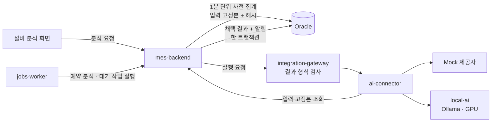
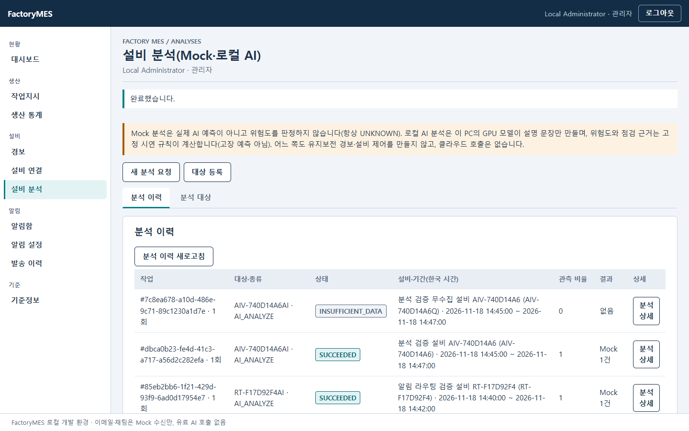
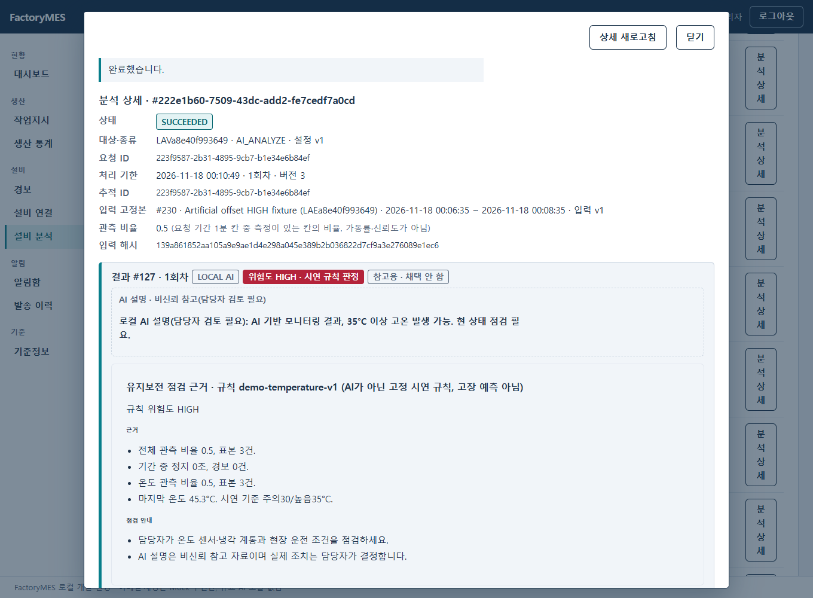

# AI 분석

관리자가 설비와 기간을 고르면 그 기간의 측정·정지·경보 이력을 요약해 분석합니다.
제공자는 **Mock**(API 키 없이 흐름 확인)과 **로컬 모델**(집 PC의 6GB GPU에서 Ollama + Qwen2.5 1.5B)
두 가지이고, 유료 클라우드 AI는 쓰지 않습니다. 예약 분석은 Quartz가 주기적으로 실행합니다.

## 구성도

## 흐름도

## 설계

### 문제
- LLM을 붙인다고 예지보전이 되는 것은 아닙니다. 고장 라벨이나 잔여수명 정답 데이터가 없었습니다.
- 모델이 낸 문장을 그대로 업무 판단으로 쓰면 근거를 설명할 수 없습니다.
- 추론은 느리고 실패할 수 있는데, 그동안 DB 잠금을 잡고 있으면 다른 업무가 막힙니다.
- 재시도 중에 이전 시도의 결과가 늦게 도착하면 결과가 두 개가 됩니다.

### 검토한 안과 선택

| 고민 | 비교한 안 | 선택과 이유 |
|---|---|---|
| 기능 범위 | 고장 확률 예측 / **근거 있는 상태 점검** | 정답 데이터가 없으므로 예측을 흉내 내지 않고, 지표별 근거와 점검 안내를 만듭니다. |
| 런타임 | llama.cpp 직접 / .NET 수치 모델 / **Ollama** | 6GB에 들어가는 모델, 기존 HTTP 커넥터 경계, 모델 파일 관리 부담을 기준으로 골랐습니다. 성능 대결로 고른 것은 아닙니다. |
| 위험도 판단 | 모델이 결정 / **고정 시연 규칙이 결정** | 모델은 설명 문장만 씁니다. 위험도는 규칙으로 계산하고 백엔드가 다시 계산해 대조합니다. 30/35℃ 경계는 제조사 기준이 아닌 시연 값이라고 화면에 적었습니다. |
| 입력 | 원시 측정 그대로 / **1분 사전 집계 + 고정본** | 24시간 1초 수집도 크기가 일정하고, 입력 해시로 나중에 같은 입력인지 확인할 수 있습니다. |
| 실행 중 잠금 | 트랜잭션 안에서 호출 / **잠금 밖에서 호출, 시도 번호로 대조** | 네트워크 호출 동안 잠금을 잡지 않습니다. 늦게 온 이전 시도 결과는 채택하지 않습니다. |
| 데이터 부족 | 그래도 분석 / **INSUFFICIENT_DATA** | 관측 비율 10% 미만이거나 측정 2건 미만이면 분석하지 않습니다. 온도 근거가 부족하면 UNKNOWN으로 둡니다. |

## 화면

### 분석 이력

화면 맨 위에 **"Mock은 예측이 아니고, 로컬 AI도 문장만 만들며 위험도는 고정 규칙이 계산한다"**는 안내를
넣었습니다. 보는 사람이 AI 결과를 과하게 믿지 않게 하려는 것입니다. 목록에는 상태와 함께 **관측 비율**을
보여줘서 결과가 얼마나 많은 데이터에 근거했는지 알 수 있게 했습니다.

<a class="source-link" href="https://github.com/nkpFactoryMES/factorymes-web/blob/2d05837500b6de42f46230227fc593291856e0ff/services/web-client/Pages/Analyses.razor#L110-L193">소스 보기</a>

### 분석 요청

기간은 과거 1분 이상 24시간 이하로 제한하고, 화면은 한국 시간이지만 서버에는 UTC로 보낸다고 적었습니다.
데이터가 부족하면 분석하지 않는다는 기준도 요청 전에 보여줍니다.

<a class="source-link" href="https://github.com/nkpFactoryMES/factorymes-web/blob/2d05837500b6de42f46230227fc593291856e0ff/services/web-client/Pages/Analyses.razor#L194-L296">소스 보기</a>
<a class="source-link" href="https://github.com/nkpFactoryMES/factorymes-backend/blob/35b21c06298e68430fe08a6b5c3cd4ab1a683cf6/services/mes-backend/Features/Analysis/AnalysisService.Input.cs#L46-L139">입력 고정본 만들기</a>

### 분석 상세 · Mock 결과

Mock 결과에는 **MOCK, 위험도 UNKNOWN·판정 안 함, 참고용·채택 안 함** 배지를 붙였습니다. 입력 고정본,
관측 비율, 입력 해시를 함께 보여줘서 어떤 데이터로 만든 결과인지 추적할 수 있습니다.

<a class="source-link" href="https://github.com/nkpFactoryMES/factorymes-web/blob/2d05837500b6de42f46230227fc593291856e0ff/services/web-client/Pages/Analyses.razor#L367-L511">소스 보기</a>

### 분석 상세 · 로컬 AI 결과

로컬 AI 결과는 **AI 설명(비신뢰 참고)**과 **유지보전 점검 근거(고정 규칙)**를 다른 상자에 나눴습니다.
문장은 AI가 썼지만 위험도 HIGH의 근거(관측 비율, 마지막 온도, 기준값)는 규칙이 계산한 것이고,
실제 조치는 담당자가 정한다고 적었습니다.

<a class="source-link" href="https://github.com/nkpFactoryMES/factorymes-ai-connector/blob/e676cffdde35c5ae0ec1e477238805b4bd326c4d/services/ai-connector/Providers/LocalAnalysisProvider.cs#L21-L197">소스 보기</a>

## 핵심 코드

게이트웨이 결과 검사: 같은 작업·시도·입력·설정이고 마감 안에 끝난 결과인지, Mock·Local 각각의 형식이 맞는지.

<a class="source-link" href="https://github.com/nkpFactoryMES/factorymes-integration-gateway/blob/fb8f2b008261f2a44e1d099cfbf447a82ee3472e/services/integration-gateway/AiExecutionEndpoints.cs#L185-L330">소스 보기</a>

백엔드 결과 채택: 시도 번호를 다시 대조하고, 결과·알림을 한 트랜잭션으로 저장합니다.
알림 원인 ID를 결과 ID로 정해서 같은 결과로 알림이 두 번 생기지 않습니다.

<a class="source-link" href="https://github.com/nkpFactoryMES/factorymes-backend/blob/35b21c06298e68430fe08a6b5c3cd4ab1a683cf6/services/mes-backend/Features/Analysis/AnalysisService.Execution.cs#L458-L707">소스 보기</a>

로컬 모델이 실제로 GPU에 올라가 있는지 확인하고, 아니면 실패로 처리합니다.

<a class="source-link" href="https://github.com/nkpFactoryMES/factorymes-ai-connector/blob/e676cffdde35c5ae0ec1e477238805b4bd326c4d/services/ai-connector/Providers/LocalAnalysisProvider.cs#L198-L236">소스 보기</a>

## 검증과 한계

- 실제 GTX 1660 Ti에서 모델을 실행하고 GPU 상주를 확인했습니다. 추론 컨테이너는 호스트 포트와 인터넷 없이
  내부망에서만 접근하고, 모델을 받을 때만 외부망을 잠깐 연결합니다.
- 모델 서버를 멈췄다가 살려도 같은 입력으로 재시도하고, 결과와 알림이 하나만 저장되는 것을 확인했습니다.
- 상세: [로컬 AI 비교·구현·검증](https://github.com/nkpFactoryMES/factorymes-system/blob/de9e542d9e362add9f5aec3293986d4744c13b12/docs/local-ai-maintenance-decision.md),
  [Mock 분석 설계](https://github.com/nkpFactoryMES/factorymes-system/blob/de9e542d9e362add9f5aec3293986d4744c13b12/docs/mock-analysis-design.md),
  [시계열 사전 집계](https://github.com/nkpFactoryMES/factorymes-system/blob/de9e542d9e362add9f5aec3293986d4744c13b12/docs/analysis-timeseries-preaggregation.md)
- 학습된 고장 예측이나 잔여수명 추정이 아닙니다. 실제 정상·고장 이력이 생기면 수치 모델과 비교해야 합니다.
- 예약 분석의 MEDIUM·HIGH 알림 경로는 코드와 단위 수준까지만 확인했고, 실제 예약 실행으로는 아직 검증하지 않았습니다.
