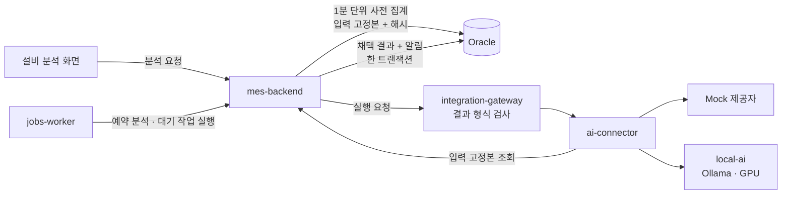
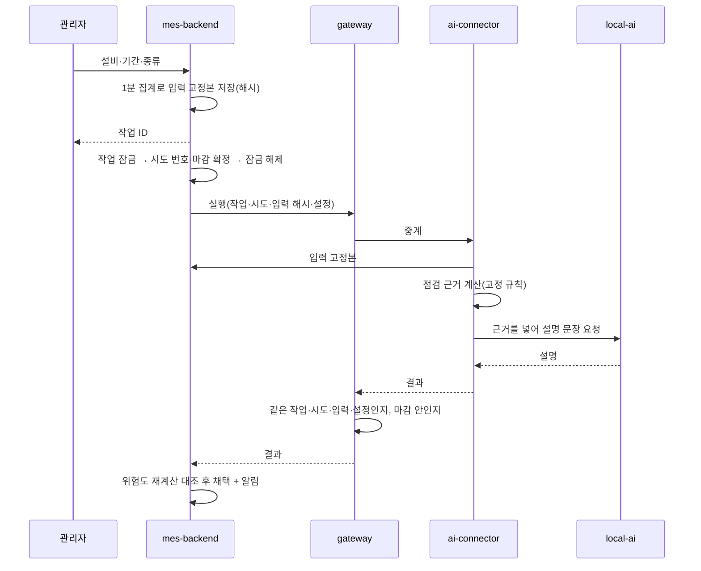
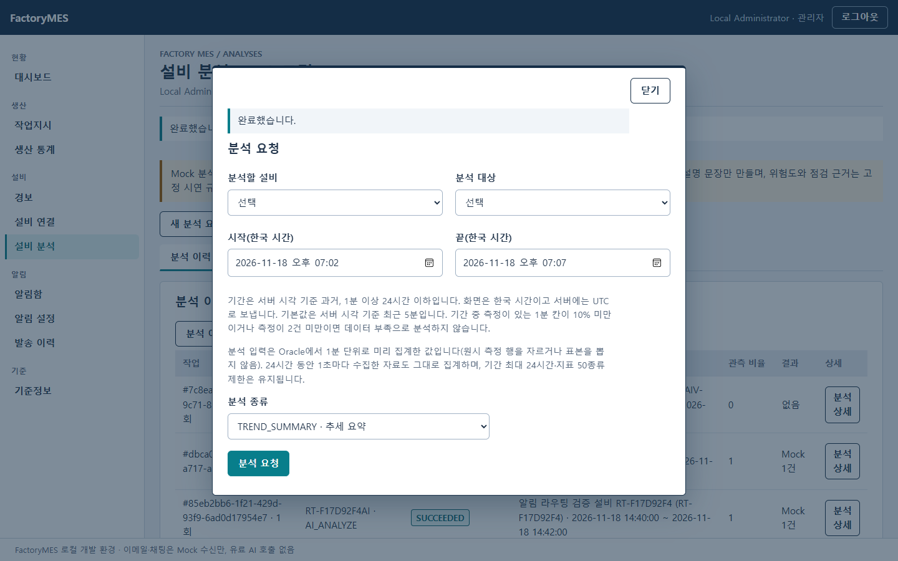
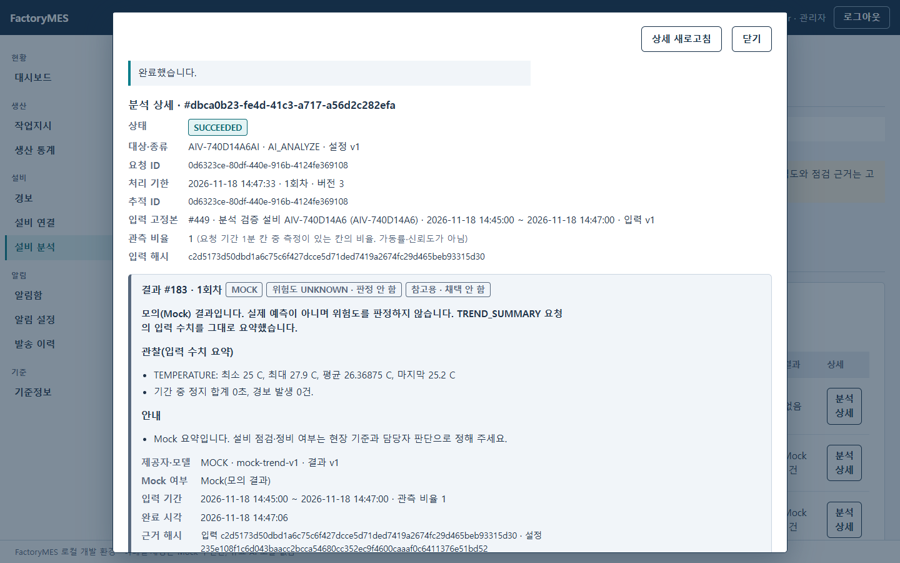

# AI 분석

## 개요

관리자가 설비와 기간을 선택하면 해당 기간의 측정·정지·경보 이력을 요약해 분석합니다. 분석 제공자는
API 키 없이 흐름을 확인하는 Mock과, 로컬 GPU(6GB)에서 실행하는 Ollama + Qwen2.5 1.5B 모델 두 가지이며,
예약 분석은 Quartz가 주기적으로 실행합니다. 위험도는 고정 규칙으로 계산하고, LLM은 그 근거를 설명하는
문장만 생성합니다.

```text
분석 요청 → 1분 단위 사전 집계 → 입력 고정본 + 해시 저장 → 작업 ID 반환
Jobs 실행 요청 → 작업 잠금·시도 번호 확정 → 게이트웨이 → AI 커넥터
  → 입력 고정본 조회 → 규칙 기반 점검 근거 계산 → LLM 설명 생성
  → 게이트웨이 결과 형식 검사 → 백엔드 위험도 재계산·채택 → 알림
```

## 구성



| 구성 | 역할 |
|---|---|
| mes-backend | 입력 고정본 생성, 실행 시도 관리, 위험도 재계산과 결과 채택 |
| integration-gateway | 작업·시도·입력·설정·마감 시각 일치 여부와 제공자별 결과 형식 검사 |
| ai-connector | 제공자 분기, 고정 규칙 기반 점검 근거 계산, 모델 호출 |
| local-ai | 내부망 전용 추론 서버(호스트 포트·인터넷 없음) |

## 처리 흐름



## 설계

### 분석 범위

수집 중인 온도·카운터와 정지·경보 이력은 있었지만 고장 라벨이나 잔여수명 정답 데이터는 없었습니다.
고장 확률을 예측하는 대신, 지표별 근거와 점검 안내를 제공하는 상태 점검 기능으로 범위를 정했습니다.

### 모델 실행 환경

| 항목 | 검토한 방식 | 결정 |
|---|---|---|
| 런타임 | llama.cpp 직접 실행 / .NET 수치 모델 / Ollama | Ollama. 기존 HTTP 커넥터 경계를 그대로 사용하고 모델 파일 관리 부담이 적음 |
| 모델 | 6GB VRAM 내 실행 가능 모델 | Qwen2.5 1.5B Q4 |
| 네트워크 | 상시 인터넷 연결 / 내부망 전용 | 내부망 전용, 모델 다운로드 때만 외부망 연결 |
| GPU 확인 | 응답만 확인 / 모델의 VRAM 상주 확인 | 모델이 GPU에 올라가 있지 않으면 실패 처리 |

### 판단과 설명의 분리

LLM의 문장을 그대로 업무 판단으로 사용하면 결과의 근거를 설명할 수 없습니다. 위험도는 고정된 시연 규칙으로
계산하고, 백엔드가 같은 입력으로 다시 계산해 반환된 결과와 대조합니다. LLM은 계산된 근거를 바탕으로 설명
문장만 생성하며, 30/35℃ 경계는 제조사 기준이 아닌 시연용 값임을 화면에 명시했습니다.

분석 과정에서 전체 수집률이 온도 수집률을 의미하지 않는 문제를 발견했습니다. 카운터는 정상이고 온도만
오래된 경우를 구분하기 위해 지표별 표본 수·관측 비율·마지막 시각을 입력에 추가했고, 온도 근거가 부족하면
위험도를 UNKNOWN으로 둡니다.

### 실행과 결과 채택

| 상황 | 처리 |
|---|---|
| 추론 중 DB 잠금 | 네트워크 호출 전에 잠금을 해제하고 시도 번호로 대조 |
| 재시도 후 이전 시도 결과 도착 | 시도 번호가 달라 채택하지 않음 |
| 같은 결과로 알림 중복 | 알림 원인 ID를 결과 ID로 지정 |
| 데이터 부족 | 관측 비율 10% 미만 또는 측정 2건 미만이면 INSUFFICIENT_DATA |
| 장기간 입력 | 1분 단위 사전 집계로 24시간 1초 수집도 일정한 크기로 처리 |

## 화면

<div class="screen" markdown="1">

### 분석 이력


화면 상단에 Mock은 예측이 아니며, 로컬 AI도 설명 문장만 생성하고 위험도는 고정 규칙이 계산한다는 안내를
표시했습니다. 목록에는 상태와 함께 관측 비율을 보여줘 결과가 얼마나 많은 데이터에 근거했는지 확인할 수
있습니다.

<a class="source-link" href="https://github.com/nkpFactoryMES/factorymes-web/blob/2d05837500b6de42f46230227fc593291856e0ff/services/web-client/Pages/Analyses.razor#L110-L193">소스 보기</a>

</div>

<div class="screen" markdown="1">

### 분석 요청



분석 기간은 과거 1분 이상 24시간 이하로 제한하고, 화면은 한국 시간으로 입력받아 서버에는 UTC로 전달합니다.
데이터 부족 기준과 사전 집계 방식도 요청 전에 표시합니다.

<a class="source-link" href="https://github.com/nkpFactoryMES/factorymes-web/blob/2d05837500b6de42f46230227fc593291856e0ff/services/web-client/Pages/Analyses.razor#L194-L296">소스 보기</a>
<a class="source-link" href="https://github.com/nkpFactoryMES/factorymes-backend/blob/35b21c06298e68430fe08a6b5c3cd4ab1a683cf6/services/mes-backend/Features/Analysis/AnalysisService.Input.cs#L46-L139">입력 고정본 생성</a>

</div>

<div class="screen" markdown="1">

### Mock 분석 결과



Mock 결과에는 MOCK, 위험도 UNKNOWN, 참고용 배지를 붙여 실제 판정과 구분했습니다. 입력 고정본, 관측 비율,
입력 해시를 함께 표시해 어떤 데이터로 만든 결과인지 추적할 수 있습니다.

<a class="source-link" href="https://github.com/nkpFactoryMES/factorymes-web/blob/2d05837500b6de42f46230227fc593291856e0ff/services/web-client/Pages/Analyses.razor#L367-L511">소스 보기</a>

</div>

<div class="screen" markdown="1">

### 로컬 AI 분석 결과


AI 설명과 유지보전 점검 근거를 별도 영역으로 나눴습니다. 위험도 HIGH의 근거(관측 비율, 마지막 온도, 기준값)는
규칙이 계산한 값이며, 실제 조치는 담당자가 판단한다는 점을 함께 표시합니다.

<a class="source-link" href="https://github.com/nkpFactoryMES/factorymes-ai-connector/blob/e676cffdde35c5ae0ec1e477238805b4bd326c4d/services/ai-connector/Providers/LocalAnalysisProvider.cs#L21-L197">소스 보기</a>

</div>

## 주요 코드

<div class="screen" markdown="1">

게이트웨이 결과 검사: 작업·시도·입력·설정·마감 시각 일치와 Mock·Local별 결과 형식.

<a class="source-link" href="https://github.com/nkpFactoryMES/factorymes-integration-gateway/blob/fb8f2b008261f2a44e1d099cfbf447a82ee3472e/services/integration-gateway/AiExecutionEndpoints.cs#L185-L330">소스 보기</a>

</div>

<div class="screen" markdown="1">

결과 채택: 시도 번호 재대조, 결과·알림의 단일 트랜잭션 저장, 결과 ID 기반 알림 중복 방지.

<a class="source-link" href="https://github.com/nkpFactoryMES/factorymes-backend/blob/35b21c06298e68430fe08a6b5c3cd4ab1a683cf6/services/mes-backend/Features/Analysis/AnalysisService.Execution.cs#L458-L707">소스 보기</a>

</div>

<div class="screen" markdown="1">

로컬 모델의 GPU 상주 확인.

<a class="source-link" href="https://github.com/nkpFactoryMES/factorymes-ai-connector/blob/e676cffdde35c5ae0ec1e477238805b4bd326c4d/services/ai-connector/Providers/LocalAnalysisProvider.cs#L198-L236">소스 보기</a>

</div>

## 검증과 한계

- GTX 1660 Ti에서 모델 실행과 GPU 상주 확인
- 모델 서버 중지·복구 후 같은 입력으로 재시도, 결과와 알림 1건만 저장되는 것 확인
- 상세 문서: [로컬 AI 비교·구현·검증](https://github.com/nkpFactoryMES/factorymes-system/blob/de9e542d9e362add9f5aec3293986d4744c13b12/docs/local-ai-maintenance-decision.md),
  [Mock 분석 설계](https://github.com/nkpFactoryMES/factorymes-system/blob/de9e542d9e362add9f5aec3293986d4744c13b12/docs/mock-analysis-design.md),
  [시계열 사전 집계](https://github.com/nkpFactoryMES/factorymes-system/blob/de9e542d9e362add9f5aec3293986d4744c13b12/docs/analysis-timeseries-preaggregation.md)
- 학습된 고장 예측·잔여수명 추정은 아니며, 정상·고장 이력 확보 후 수치 모델 비교 필요
- 예약 분석의 MEDIUM·HIGH 알림 경로는 실제 예약 실행으로 미검증
