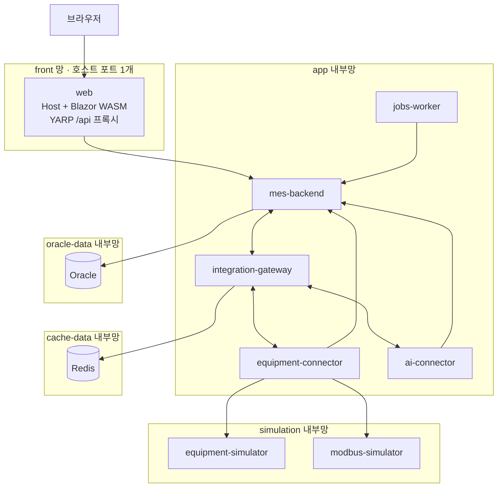
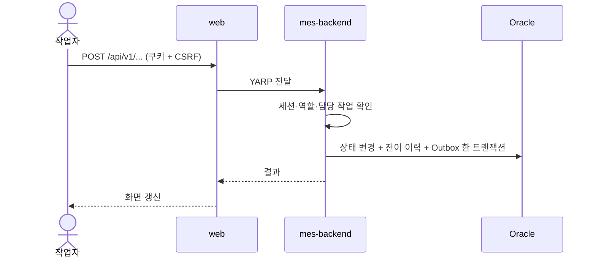
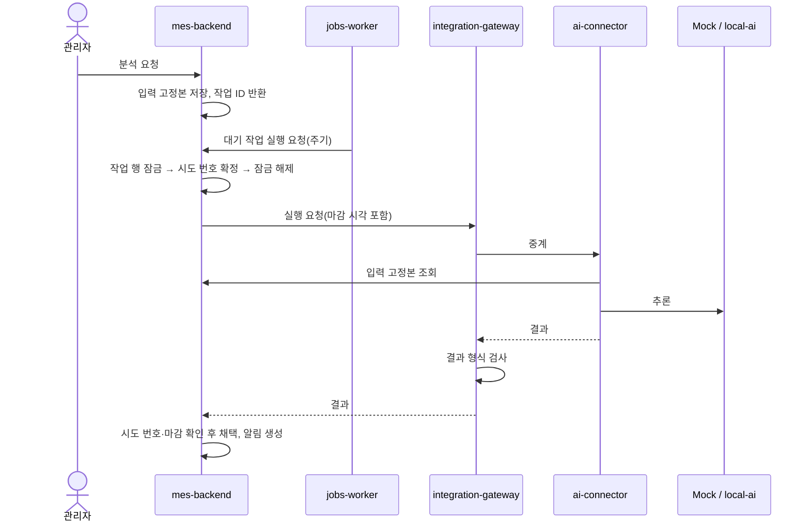

# 서비스 아키텍처 및 요청 흐름

## 개요

FactoryMES는 업무 처리와 외부 연동을 분리한 구조입니다. 작업지시·실적·경보·알림처럼 서로 묶인 업무는
업무 백엔드 하나가 트랜잭션으로 처리하고, 느리거나 끊길 수 있는 설비·AI 연동은 연동 게이트웨이와
커넥터가 담당합니다. 배치 작업은 Jobs Worker가 백엔드 내부 API를 호출하는 방식으로 실행합니다.

```text
브라우저 → web(YARP /api) → mes-backend → Oracle
                              ↕
                     integration-gateway ↔ Redis
                       ↙               ↘
          equipment-connector       ai-connector
            ↓                          ↓
   HTTP·Modbus 시뮬레이터          Mock / local-ai

jobs-worker(Quartz) → mes-backend 내부 API
```

## 구성도



Docker 네트워크를 용도별로 나눠 Oracle은 백엔드만, Redis는 게이트웨이만, 시뮬레이터는 설비 커넥터만
접근하도록 구성했습니다. 호스트에 노출되는 포트는 web 하나입니다.

## 서비스 책임

| 서비스 | 담당 | 담당하지 않음 |
|---|---|---|
| web | 화면 제공, 로그인 쿠키, `/api` 요청을 백엔드로 전달 | 업무 판단, DB 접근 |
| mes-backend | 로그인·역할, 작업지시·실적·경보·알림·AI 작업, 설정 원본, 내부 API | 설비 프로토콜, AI 호출 |
| integration-gateway | 서비스 인증 확인, 설정 캐시, 커넥터 선택·중계, AI 결과 형식 검사 | Oracle 직접 접근 |
| equipment-connector | HTTP·Modbus 수집, 재접속, 측정값 표준화, ACK 전 재전송 | 경보 판정, 집계 |
| ai-connector | Mock·Local 제공자 분기, 점검 근거 계산, 모델 호출 | 결과 채택 판단 |
| jobs-worker | Outbox 전달, 발송 재처리, 통계 집계, 연결 감시, 예약 분석 | DB 직접 접근 |

## 설계 판단

| 항목 | 결정 | 이유 |
|---|---|---|
| 업무 서비스 | 모듈형 단일 업무 백엔드 | 작업지시·실적·경보가 서로 묶여 있어, 나누면 하나의 업무가 여러 서비스 트랜잭션에 걸침 |
| 연동 서비스 | 게이트웨이 + 프로토콜별 커넥터 | 설비·AI 장애가 업무 처리를 막지 않도록 격리 |
| 게이트웨이 데이터 접근 | 백엔드 내부 API만 사용 | 연동 계층이 업무 스키마에 의존하지 않도록 함 |
| 설정 저장 | Oracle 원본 + Redis 캐시 | 이력·권한·감사는 원본에서, 조회 부하는 캐시에서 처리 |
| 배치 | Quartz는 실행 시점만, 업무 처리는 백엔드 | DB 소유권과 업무 규칙을 한곳에 유지 |
| web의 YARP | 같은 출처의 `/api`만 백엔드로 전달 | 브라우저 쿠키·CSRF를 하나의 출처로 유지 |

<div class="screen" markdown="1">

`/api/{**catch-all}` 요청만 백엔드로 전달하고, 나머지 요청은 Blazor 화면으로 처리합니다.

<a class="source-link" href="https://github.com/nkpFactoryMES/factorymes-web/blob/2d05837500b6de42f46230227fc593291856e0ff/services/web/Program.cs#L9-L35">소스 보기</a>

</div>

## 인증 경계

| 구간 | 방식 | 범위 제한 |
|---|---|---|
| 사용자 → 백엔드 | 세션 쿠키 + `X-CSRF-TOKEN` | Admin / Worker 정책, 작업자는 담당 작업·설비만 |
| 서비스 → 서비스 | client 자격 증명으로 백엔드가 RS256 토큰 발급 | 대상(aud) 1개, scope 단위 API 허용, 수명 5분 |
| 수집 데이터 | 수집 임대 때 발급한 짧은 증명 JWT | 대상·수집 인스턴스·설정 버전·해시 일치 |

서비스 토큰만으로는 측정값이 어떤 설정 버전으로 수집됐는지 확인할 수 없기 때문에, 수집 데이터에는
별도의 수집 증명을 붙이도록 했습니다. 설비 커넥터는 `telemetry:write` 권한은 있지만 AI 결과를 쓸 수는
없는 것처럼, 서비스별 권한은 코드에 고정했습니다.

<div class="screen" markdown="1">

관리자·작업자 정책. 작업자 정책은 관리자 역할이 있으면 거절합니다.

<a class="source-link" href="https://github.com/nkpFactoryMES/factorymes-backend/blob/35b21c06298e68430fe08a6b5c3cd4ab1a683cf6/services/mes-backend/Program.cs#L108-L128">소스 보기</a>

</div>

<div class="screen" markdown="1">

서비스별 허용 대상과 scope, 5분 수명의 서명 토큰 발급.

<a class="source-link" href="https://github.com/nkpFactoryMES/factorymes-backend/blob/35b21c06298e68430fe08a6b5c3cd4ab1a683cf6/services/mes-backend/Auth/ServiceTokenIssuer.cs#L95-L212">소스 보기</a>

</div>

<div class="screen" markdown="1">

수집 증명 검증. 대상·수집 인스턴스·설정 버전과 해시가 일치해야 측정값을 받습니다.

<a class="source-link" href="https://github.com/nkpFactoryMES/factorymes-platform/blob/780e15fd0415236d874774429b3904ef085f3b25/shared/FactoryMES.Foundation/CollectionProof.cs#L7-L40">소스 보기</a>

</div>

## 요청 흐름

### 사용자 요청



### 설비 수집


### AI 분석



네트워크 호출 동안에는 DB 잠금이나 트랜잭션을 유지하지 않습니다. 결과가 돌아오면 시도 번호를 다시
대조해, 그 사이 다른 시도로 넘어간 작업의 늦은 결과는 채택하지 않습니다.

### 배치

Jobs Worker는 DB에 직접 접근하지 않고 백엔드 내부 API만 호출합니다. Outbox 전달, 발송 재처리,
일별 집계, 연결 감시, 예약 분석이 모두 같은 구조로 동작하며, Jobs를 다른 서버로 옮겨도 업무 규칙이
나뉘지 않습니다.

## 검증과 한계

- CSRF 없는 요청, 작업자의 관리자 API 호출, 잘못된 수집 증명과 다른 인스턴스의 증명 거절 확인
- Oracle 스키마는 서비스 간 공유 상태이며 서비스별 DB 분리는 미적용
- 게이트웨이·커넥터는 인스턴스 1개 기준으로 검증
