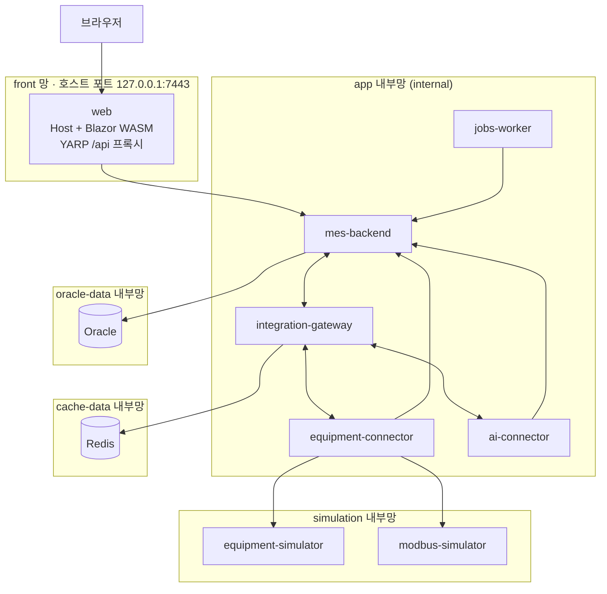
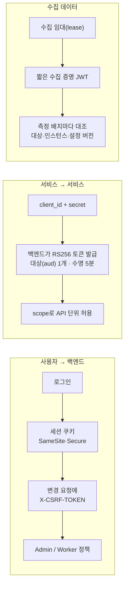
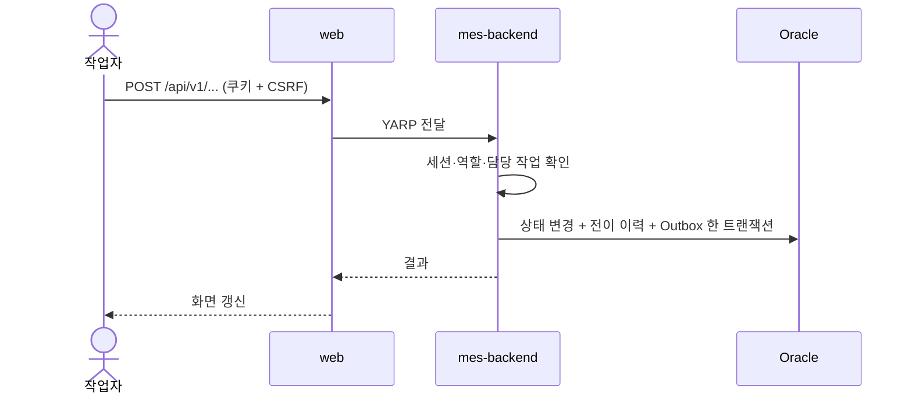
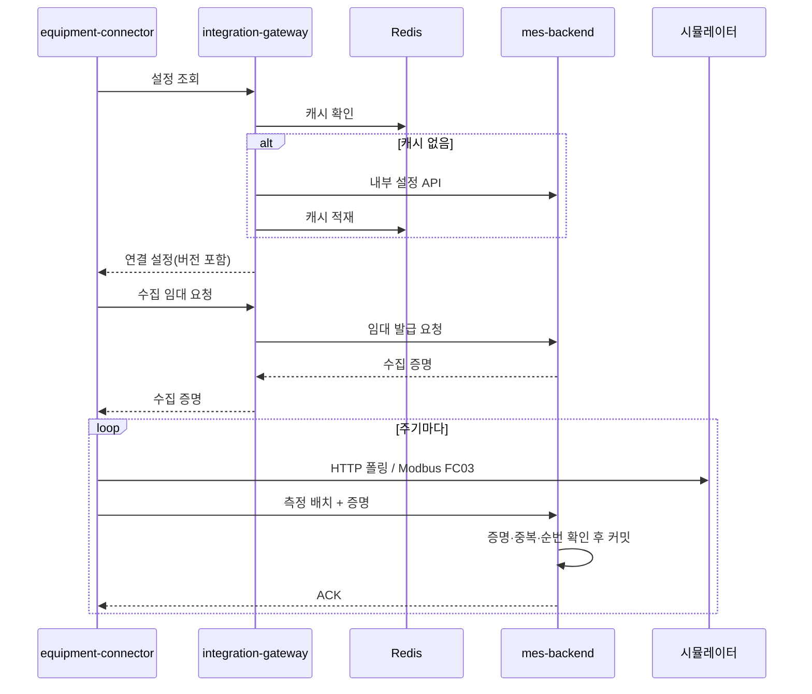
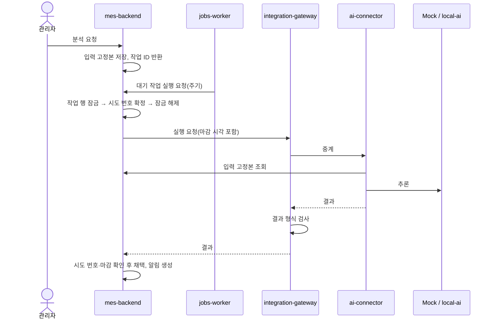

# 서비스 아키텍처와 요청 흐름

## 구성도

- 서비스마다 **붙을 수 있는 망을 나눴습니다.** Oracle은 백엔드만, Redis는 게이트웨이만,
  시뮬레이터는 설비 커넥터만 닿습니다.
- 호스트에 열린 포트는 web 하나입니다. 개발 중 DB 확인용 Oracle 포트도 127.0.0.1에만 엽니다.

## 서비스별 책임

| 서비스 | 맡는 일 | 맡지 않는 일 |
|---|---|---|
| web | 화면, 로그인 쿠키, `/api` 요청을 백엔드로 전달 | 업무 판단, DB 접근 |
| mes-backend | 로그인·역할, 작업지시·실적·경보·알림·AI 작업, 설정 원본, 내부 API | 설비 프로토콜, AI 호출 |
| integration-gateway | 서비스 인증 확인, 설정 캐시, 커넥터 선택·중계 | Oracle 직접 접근 |
| equipment-connector | HTTP·Modbus 수집, 재접속, 측정값 표준화, ACK 전 재전송 | 경보 판정, 집계 |
| ai-connector | Mock·Local 제공자 분기, 응답 검증, 결과 콜백 | 결과 채택 판단 |
| jobs-worker | Outbox 전달, 발송 재처리, 통계 집계, 보관 기간 정리, 연결 감시, 예약 분석 | 초 단위 수집 |

## 설계: 왜 이 구조인가

### 문제
처음 요구는 "설비 데이터를 모으고, 이상이 생기면 알리고, AI로 분석하는 MES"였습니다.
설비 수집과 AI 호출은 느리거나 끊길 수 있는데, 이것이 작업지시·실적 같은 업무 처리를
막으면 안 됐습니다.

### 검토한 안

| 안 | 내용 | 판단 |
|---|---|---|
| WPF + SQLite 단일 앱 | 처음 구상. 한 PC에서 모두 처리 | 권한별 화면·알림·배치 요구가 커지면서 제외 |
| YARP 진입 게이트웨이 + 서비스들 | AI가 처음 제안한 앞단 게이트웨이 구조 | 제가 원한 "게이트웨이"는 앞단이 아니라 업무 뒤의 연동 중계여서 보완 |
| **업무 백엔드 → 연동 게이트웨이 → 커넥터** | 업무는 백엔드 하나, 외부 연동만 게이트웨이 뒤로 분리 | **확정** |

### 선택한 이유
- **업무는 한 곳에서** 처리합니다. 작업지시·실적·경보는 서로 묶여 있어서 쪼개면 트랜잭션이
  여러 서비스에 걸칩니다. 그래서 업무 백엔드는 모듈형 단일 API로 두었습니다.
- **느리고 불안정한 것만 분리**했습니다. 설비와 AI는 커넥터로 빼서 끊겨도 백엔드는 계속 동작합니다.
- **게이트웨이는 DB를 모릅니다.** 설정은 백엔드 내부 API로만 받아 Redis에 캐시합니다.
  커넥터가 업무 스키마에 묶이지 않게 하려는 선택입니다.
- web의 YARP는 "같은 출처에서 `/api`를 백엔드로 넘기는" 역할만 합니다. 쿠키·CSRF를
  브라우저 기준 한 출처로 유지하려고 남겼습니다.

`/api/{**catch-all}` 요청만 백엔드로 넘기고 나머지는 화면을 그립니다.

<a class="source-link" href="https://github.com/nkpFactoryMES/factorymes-web/blob/2d05837500b6de42f46230227fc593291856e0ff/services/web/Program.cs#L9-L35">소스 보기</a>

## 인증 경계

- **사용자:** 세션 쿠키 + CSRF 헤더. 역할은 관리자(ADMIN)와 작업자(WORKER) 두 개뿐이고,
  관리자 계정이 작업자 화면 정책으로 들어오지 못하게 막았습니다.
- **서비스:** 서비스마다 호출할 수 있는 대상과 scope를 코드에 고정했습니다.
  예를 들어 설비 커넥터는 `telemetry:write`는 되지만 AI 결과를 쓸 수는 없습니다.
- **수집 데이터:** 서비스 토큰만으로는 "어느 설정 버전으로 측정했는지"를 알 수 없어서,
  수집 임대 때 받은 증명을 측정값과 함께 보내게 했습니다.

관리자·작업자 정책. 작업자 정책은 관리자 역할이 있으면 거절합니다.

<a class="source-link" href="https://github.com/nkpFactoryMES/factorymes-backend/blob/35b21c06298e68430fe08a6b5c3cd4ab1a683cf6/services/mes-backend/Program.cs#L108-L128">소스 보기</a>

서비스별 허용 대상과 scope, 5분짜리 서명 토큰 발급.

<a class="source-link" href="https://github.com/nkpFactoryMES/factorymes-backend/blob/35b21c06298e68430fe08a6b5c3cd4ab1a683cf6/services/mes-backend/Auth/ServiceTokenIssuer.cs#L95-L212">소스 보기</a>

수집 증명 검증. 대상·수집 인스턴스·설정 버전과 해시가 맞아야 측정값을 받습니다.

<a class="source-link" href="https://github.com/nkpFactoryMES/factorymes-platform/blob/780e15fd0415236d874774429b3904ef085f3b25/shared/FactoryMES.Foundation/CollectionProof.cs#L7-L40">소스 보기</a>

## 요청 흐름

### 1. 사용자 요청 (예: 작업 시작)

### 2. 설비 수집

### 3. AI 분석

네트워크 호출 동안에는 DB 잠금이나 트랜잭션을 잡지 않습니다. 결과가 돌아오면 시도 번호를 다시
대조해서, 그 사이 다른 시도로 넘어간 작업의 늦은 결과는 채택하지 않습니다.

### 4. 배치

jobs-worker는 직접 DB를 만지지 않고 백엔드 내부 API만 부릅니다. Outbox 전달, 발송 재처리,
일별 집계, 연결 감시, 보관 기간 정리, 예약 분석이 모두 같은 방식입니다.

## 검증과 한계

- CSRF 없는 요청 거절, 작업자의 관리자 API 거절, 잘못되거나 다른 인스턴스의 수집 증명 거절은
  통합 검증 도구로 확인했습니다.
- Oracle 스키마는 서비스들이 아직 **공유**합니다. 서비스별 DB 분리는 하지 않았습니다.
- 게이트웨이·커넥터는 인스턴스 1개 기준으로만 검증했습니다.
