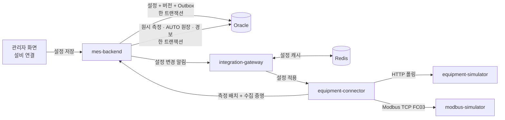
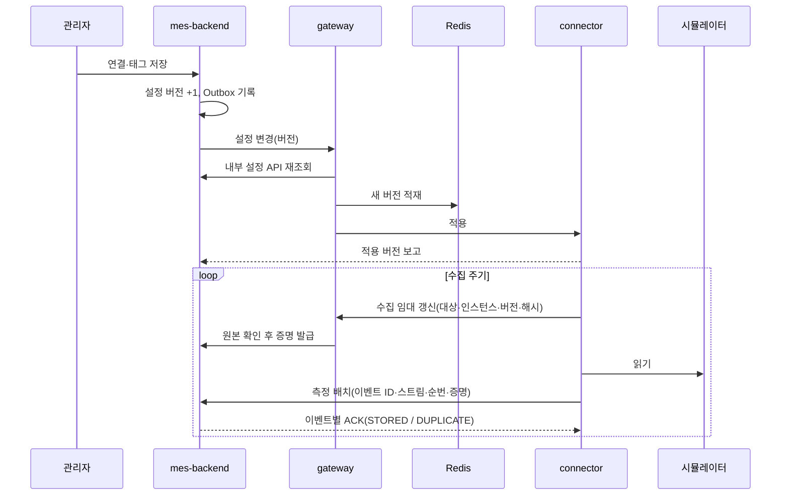
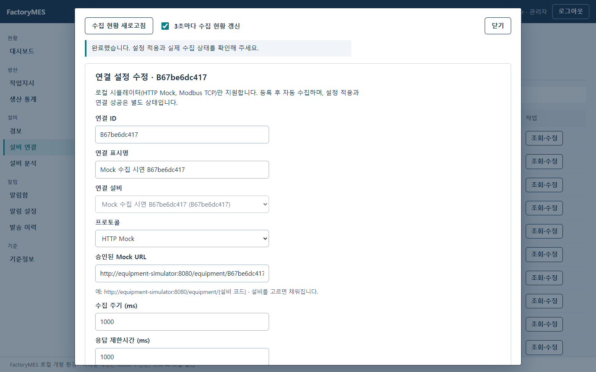

# 설비 연결·수집

## 개요

관리자가 등록한 설비 연결 설정은 Oracle에 버전과 함께 저장되고, 연동 게이트웨이가 Redis에 캐시한 뒤
설비 커넥터에 적용합니다. 커넥터는 HTTP 또는 Modbus TCP로 설비 값을 읽어 백엔드로 보내며, 백엔드는
측정값·AUTO 생산실적·경보 판정을 한 트랜잭션으로 저장한 뒤 ACK를 반환합니다.

```text
관리자 설정 저장 → Oracle(설정 + 버전 + Outbox)
  → 게이트웨이 설정 재조회 → Redis 적재 → 커넥터 적용 → 적용 버전 보고

커넥터 수집 임대 → 설비 읽기 → 측정 배치 전송
  → 백엔드 검증·커밋 → ACK → (ACK 없으면 같은 이벤트 재전송)
```

## 구성



| 구성 | 역할 | 맡지 않는 일 |
|---|---|---|
| mes-backend | 설정 원본·버전, 수집 증명 발급, 측정 검증·저장 | 실제 설비 호출, Redis 관리 |
| integration-gateway | 설정 캐시·복구, 설정 적용 중계, 임대 요청 중계 | Oracle 직접 접근, 임의 URL 호출 |
| equipment-connector | 주기 수집, 자료형·단위 변환, 이벤트 생성·재전송, 상태 보고 | DB·Redis 직접 접근, 실적 계산 |
| Redis | 재생성 가능한 설정 복사본 | 설정 원본, 인증 정보 보관 |

## 처리 흐름



## 설계

### 설정 원본과 캐시

| 항목 | 검토한 방식 | 결정 |
|---|---|---|
| 설정 저장 | Redis만 사용 / Oracle 원본 + Redis 캐시 | Oracle 원본. 이력·제약·권한·감사를 트랜잭션으로 함께 관리 |
| 캐시 미스·장애 | 수집 중단 / 백엔드 내부 API 재조회 | 내부 API로 다시 읽어 캐시 재구성 |
| 변경 반영 | TTL 만료 대기 / Outbox 기반 무효화 | 설정 저장과 Outbox를 같은 트랜잭션에 기록하고 게이트웨이가 새 버전 적재 |
| 버전 역전 | 마지막 도착 우선 / 버전 비교 | 오래된 버전으로 캐시를 덮어쓰지 않음 |

화면에는 설정 버전과 적용 버전을 함께 표시해, 저장된 설정이 커넥터에 실제로 적용됐는지 확인할 수 있게
했습니다.

### 사용중지 설정의 수집 차단

캐시 TTL만으로는 설비 연결을 사용중지해도 일정 시간 동안 옛 설정으로 수집이 이어질 수 있습니다.
커넥터는 수집 전에 수집 임대를 갱신하고, 백엔드는 원본의 사용 여부·설정 버전·해시를 확인한 뒤 짧은 수명의
서명 증명을 발급합니다. 사용중지되거나 버전이 바뀌면 다음 임대에서 수집이 중단됩니다. 실행 허가를
테이블에 저장하는 방식은 5초마다 행이 쌓이는 문제가 있어 서명 토큰으로 대체했습니다.

### 중복과 재전송

| 상황 | 처리 |
|---|---|
| ACK를 받지 못함 | 같은 이벤트 ID·같은 증명으로 재전송, 허용 시간이 지나면 폐기 |
| 이미 저장된 같은 이벤트 | 저장하지 않고 DUPLICATE 응답 |
| 같은 (대상, 스트림, 순번)에 다른 값 | 거절 |
| 저장 중 오류 | 원시 측정·AUTO 원장·경보 판정 전체 롤백 |

### 프로토콜 선택

필요한 값은 누적 카운터와 온도였습니다. OPC UA는 정보 모델·구독·보안 구성이 장점이지만, 이를 검증할
장치 모델이 없는 상태에서 세션·구독·인증서 운영까지 함께 다뤄야 했습니다. Modbus TCP의 FC03 읽기를 먼저
구현하고, 설정에는 0 기준 레지스터 주소·자료형·바이트/워드 순서를 명시하도록 했습니다.

무료 라이브러리 NModbus를 사용하면서 별도 TCP 서버로 비정상 응답을 보내 확인한 결과, 잘못된 MBAP
프로토콜 ID와 응답 뒤에 남는 바이트를 그대로 받아들이는 경우가 있었습니다. 클라이언트 전체를 새로
만들지 않고 FC03 응답 프레임 검사만 보강했습니다.

## 화면

<div class="screen" markdown="1">

### 설비 연결 목록


설정이 Oracle → Redis → 게이트웨이 → 커넥터 → 시뮬레이터로 전달되는 경로를 제목 아래에 표시하고,
목록에는 설정 버전과 적용 버전을 나란히 보여줍니다. 연결 상태는 3초 주기로 갱신할 수 있습니다.

<a class="source-link" href="https://github.com/nkpFactoryMES/factorymes-web/blob/2d05837500b6de42f46230227fc593291856e0ff/services/web-client/Pages/EquipmentConnections.razor#L1-L103">소스 보기</a>

</div>

<div class="screen" markdown="1">

### 연결 설정 수정



프로토콜은 HTTP Mock과 Modbus TCP 중에서 선택하고, 주소는 승인된 시뮬레이터 형식만 받습니다. 임의 URL로
내부망 밖에 요청을 보내지 못하도록 하기 위한 제한입니다. Modbus는 태그마다 레지스터 주소, 자료형,
바이트·워드 순서를 지정합니다.

<a class="source-link" href="https://github.com/nkpFactoryMES/factorymes-web/blob/2d05837500b6de42f46230227fc593291856e0ff/services/web-client/Pages/EquipmentConnections.razor#L104-L365">소스 보기</a>

</div>

## 주요 코드

<div class="screen" markdown="1">

게이트웨이 설정 캐시: 캐시에 없으면 백엔드 내부 API로 다시 읽어 적재하고, 오래된 버전은 덮어쓰지 않습니다.

<a class="source-link" href="https://github.com/nkpFactoryMES/factorymes-integration-gateway/blob/fb8f2b008261f2a44e1d099cfbf447a82ee3472e/services/integration-gateway/ConfigurationCache.cs#L80-L221">소스 보기</a>

</div>

<div class="screen" markdown="1">

수집 임대: 원본의 사용 여부·버전·해시를 확인하고 수집 증명을 발급합니다.

<a class="source-link" href="https://github.com/nkpFactoryMES/factorymes-backend/blob/35b21c06298e68430fe08a6b5c3cd4ab1a683cf6/services/mes-backend/Features/Collection/CollectionService.Telemetry.cs#L16-L77">소스 보기</a>

</div>

<div class="screen" markdown="1">

측정 저장: 중복 이벤트 응답, 증명·스트림 순번 검증, 측정·AUTO 원장·경보의 단일 트랜잭션 저장.

<a class="source-link" href="https://github.com/nkpFactoryMES/factorymes-backend/blob/35b21c06298e68430fe08a6b5c3cd4ab1a683cf6/services/mes-backend/Features/Collection/CollectionService.Telemetry.cs#L78-L307">소스 보기</a>

</div>

<div class="screen" markdown="1">

커넥터 재전송: ACK를 받지 못한 배치를 같은 이벤트로 재전송하고 허용 시간이 지나면 폐기합니다.

<a class="source-link" href="https://github.com/nkpFactoryMES/factorymes-equipment-connector/blob/2246447569e0cb1fdaa9debe31874afe42d06697/services/equipment-connector/EquipmentCollector.cs#L143-L304">소스 보기</a>

</div>

<div class="screen" markdown="1">

Modbus FC03 응답 프레임 검사(MBAP 프로토콜 ID, 길이, 잔여 바이트).

<a class="source-link" href="https://github.com/nkpFactoryMES/factorymes-equipment-connector/blob/2246447569e0cb1fdaa9debe31874afe42d06697/services/equipment-connector/Protocols/StrictModbusTcpTransport.cs#L10-L86">소스 보기</a>

</div>

## 검증과 한계

- Redis 비움·중지, 설정 변경·사용중지, 재전송, 시뮬레이터 중지·재기동을 실제 컨테이너로 확인
- 시뮬레이터 중지 시 새 정상 값 대신 재시도 상태 표시 확인
- Modbus 단계에서 프레임·변환, 실제 수집·장애·실적, 화면, 기존 회귀 포함 422개 검사 통과
- 상세 문서: [Redis·Mock 수집 설계](https://github.com/nkpFactoryMES/factorymes-system/blob/de9e542d9e362add9f5aec3293986d4744c13b12/docs/redis-mock-collection-design.md),
  [설비 통신 방식 비교](https://github.com/nkpFactoryMES/factorymes-system/blob/de9e542d9e362add9f5aec3293986d4744c13b12/docs/equipment-protocol-decision.md)
- 실제 PLC 대신 로컬 시뮬레이터 사용, 제조사별 호환·고부하·TLS·OPC UA는 미검증
- 커넥터 재전송 버퍼는 메모리에 있어 프로세스 종료 시 ACK 전 측정 유실 가능
