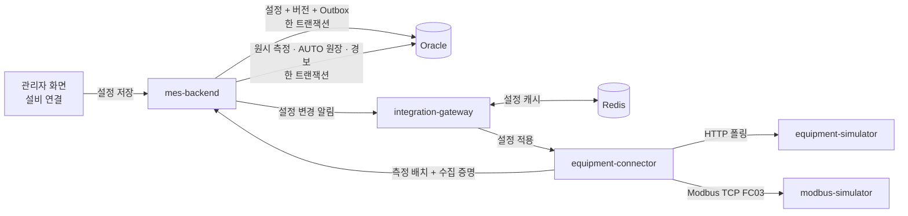
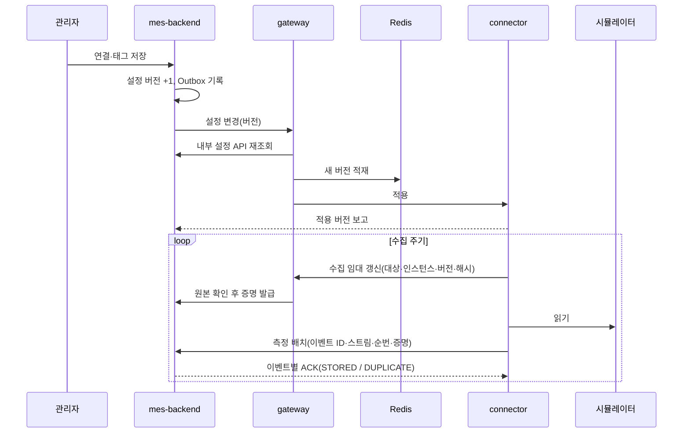
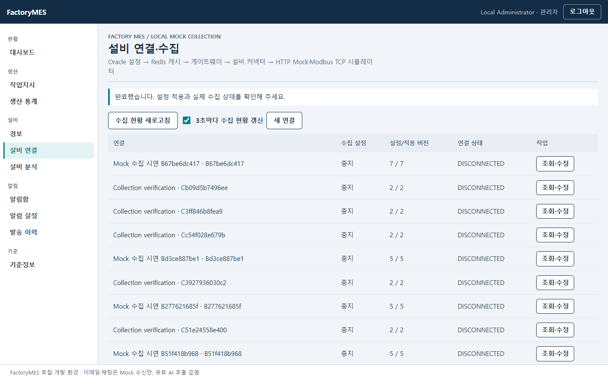

# 설비 연결·수집

관리자가 화면에서 설비 연결을 등록하면, 그 설정이 Oracle → Redis → 연동 게이트웨이를 거쳐
설비 커넥터에 반영되고, 커넥터가 수집한 값이 경보·AUTO 생산실적·통계로 이어집니다.
설비는 로컬 시뮬레이터 두 종류(HTTP, Modbus TCP)로 대신했습니다.

## 구성도

## 흐름도

## 설계

### 문제
- 설비 설정을 Redis에만 두면 이력·권한·감사가 남지 않고, Oracle에만 두면 커넥터가 업무 DB에 묶입니다.
- 설정을 바꾸거나 사용을 끈 뒤에도 커넥터가 옛 설정으로 계속 수집할 수 있습니다.
- 네트워크가 끊기면 같은 측정을 다시 보내게 되는데, 이게 두 번 저장되면 생산 수량이 늘어납니다.

### 검토한 안과 선택

| 고민 | 비교한 안 | 선택과 이유 |
|---|---|---|
| 설정 원본 | Redis만 / **Oracle 원본 + Redis 캐시** | Oracle에 버전과 함께 저장. Redis는 지워져도 다시 만들 수 있는 복사본입니다. |
| 사용중지 반영 | 캐시 TTL만 / **수집 임대 + 서명 증명** | 수집할 때마다 원본의 사용 여부·버전을 확인한 짧은 증명을 받습니다. 사용을 끄면 다음 임대에서 막힙니다. |
| 실행 허가 저장 | 허가 테이블 / **서명 토큰** | 5초마다 행이 쌓이는 테이블 대신 서명 토큰으로 대체했습니다(설계 단계 결정). |
| 중복 방지 | 시각 기준 / **이벤트 ID + (대상, 스트림, 순번)** | 재전송이면 기존 결과를 DUPLICATE로 돌려주고, 같은 순번에 다른 값이면 거절합니다. |
| 재전송 | 새 이벤트로 다시 수집 / **원래 이벤트 그대로 재전송** | ACK를 못 받으면 같은 이벤트 ID·증명으로 다시 보내고, 허용 시간이 지나면 버립니다. |
| 프로토콜 | OPC UA / **Modbus TCP FC03** | 필요한 값은 누적 카운터·온도였고 UA의 정보 모델·구독·인증서까지 검증할 장치가 없었습니다. 무료 .NET 구현이 있어서 비용 때문에 뺀 것은 아니고, 필요해지면 다시 검토합니다. |

Modbus는 무료 라이브러리(NModbus)를 썼는데, 직접 만든 TCP 서버로 비정상 응답을 보내 보니
**잘못된 MBAP 프로토콜 ID나 남는 바이트를 그대로 받아들이는 경우**가 있었습니다. 클라이언트를
새로 만들지 않고 FC03 응답 프레임 검사만 보강했습니다.

## 화면

### 설비 연결 목록

제목 아래에 **설정이 어디를 거쳐 설비까지 가는지**(Oracle → Redis → 게이트웨이 → 커넥터 → 시뮬레이터)를
적어 두었습니다. 목록에는 **설정 버전과 적용 버전**을 나란히 보여줍니다. 저장했다고 끝이 아니라
커넥터가 실제로 적용했는지가 중요하기 때문입니다. 연결 상태는 3초마다 갱신할 수 있습니다.

<a class="source-link" href="https://github.com/nkpFactoryMES/factorymes-web/blob/2d05837500b6de42f46230227fc593291856e0ff/services/web-client/Pages/EquipmentConnections.razor#L1-L103">소스 보기</a>

### 연결 설정 수정

프로토콜은 **HTTP Mock과 Modbus TCP만** 고를 수 있고, 주소는 승인된 시뮬레이터 형식만 받습니다.
임의 URL을 넣어 내부망 밖으로 요청을 보내지 못하게 하려는 것입니다. Modbus를 고르면 레지스터 주소(0 기준),
자료형, 바이트·워드 순서를 태그마다 지정합니다.

<a class="source-link" href="https://github.com/nkpFactoryMES/factorymes-web/blob/2d05837500b6de42f46230227fc593291856e0ff/services/web-client/Pages/EquipmentConnections.razor#L104-L365">소스 보기</a>

## 핵심 코드

게이트웨이 설정 캐시: Redis에 없으면 백엔드 내부 API로 다시 읽어 적재하고, 오래된 버전은 덮어쓰지 않습니다.

<a class="source-link" href="https://github.com/nkpFactoryMES/factorymes-integration-gateway/blob/fb8f2b008261f2a44e1d099cfbf447a82ee3472e/services/integration-gateway/ConfigurationCache.cs#L80-L221">소스 보기</a>

수집 임대: 원본의 사용 여부·버전·해시를 확인하고 짧은 수집 증명을 발급합니다.

<a class="source-link" href="https://github.com/nkpFactoryMES/factorymes-backend/blob/35b21c06298e68430fe08a6b5c3cd4ab1a683cf6/services/mes-backend/Features/Collection/CollectionService.Telemetry.cs#L16-L77">소스 보기</a>

측정 저장: 이미 저장된 같은 이벤트는 DUPLICATE로 응답하고, 새 이벤트는 증명과 스트림 순번을 확인한 뒤
원시 측정·AUTO 원장·경보를 한 트랜잭션으로 커밋한 다음 ACK를 돌려줍니다.

<a class="source-link" href="https://github.com/nkpFactoryMES/factorymes-backend/blob/35b21c06298e68430fe08a6b5c3cd4ab1a683cf6/services/mes-backend/Features/Collection/CollectionService.Telemetry.cs#L78-L307">소스 보기</a>

커넥터 재전송: ACK를 못 받은 배치는 같은 이벤트로 다시 보내고, 허용 시간이 지나면 버립니다.

<a class="source-link" href="https://github.com/nkpFactoryMES/factorymes-equipment-connector/blob/2246447569e0cb1fdaa9debe31874afe42d06697/services/equipment-connector/EquipmentCollector.cs#L143-L304">소스 보기</a>

Modbus FC03 응답 프레임 검사 보강(MBAP 프로토콜 ID, 길이, 남는 바이트).

<a class="source-link" href="https://github.com/nkpFactoryMES/factorymes-equipment-connector/blob/2246447569e0cb1fdaa9debe31874afe42d06697/services/equipment-connector/Protocols/StrictModbusTcpTransport.cs#L10-L86">소스 보기</a>

## 검증과 한계

- Redis를 비우거나 멈춘 상태, 설정 변경·사용중지, 재전송, 시뮬레이터 정지·재기동을 실제 컨테이너로
  확인했습니다. 시뮬레이터가 멈추면 새 정상 값을 만들지 않고 재시도 상태로 표시합니다.
- Modbus 단계에서 프레임·변환, 실제 수집·장애·실적, 화면, 기존 회귀를 합쳐 422개 검사를 통과했습니다.
- 상세: [Redis·Mock 수집 설계](https://github.com/nkpFactoryMES/factorymes-system/blob/de9e542d9e362add9f5aec3293986d4744c13b12/docs/redis-mock-collection-design.md),
  [설비 통신 방식 비교](https://github.com/nkpFactoryMES/factorymes-system/blob/de9e542d9e362add9f5aec3293986d4744c13b12/docs/equipment-protocol-decision.md)
- 실제 PLC가 아니라 로컬 시뮬레이터입니다. 제조사별 호환, 고부하, TLS, OPC UA는 검증하지 않았습니다.
- 커넥터의 재전송 버퍼는 메모리에 있어서, 프로세스가 죽으면 ACK 전 측정은 잃을 수 있습니다.
