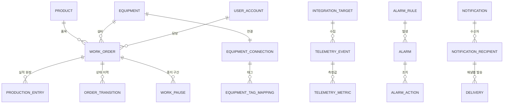

# 설계

## 개요

소규모 생산 라인에서 작업지시부터 생산실적, 설비 이상, 조치, 통계까지 한 흐름으로 다루는 것을 목표로
설계했습니다. 구현 전에 요구사항, 업무 규칙, 서비스 경계, 데이터 모델, API·이벤트 계약을 먼저 확정하고,
DDL과 계약 문서는 실제 Oracle과 스키마 검사기로 검증한 뒤 구현에 들어갔습니다.

```text
요구사항 정리
  → 업무 범위·규칙 결정(공정 방식, 수량 기준, 정정 범위, 역할)
  → 서비스 경계 결정(업무 백엔드 / 연동 게이트웨이 / 커넥터)
  → 화면·권한·상태 전이
  → Oracle ERD·DDL 실행 검증
  → OpenAPI·이벤트 스키마 계약
  → 인증·DB 매핑·Compose 구성
```

## 요구사항

| 영역 | 요구 |
|---|---|
| 생산 | 관리자·작업자 권한별 화면, 실제 입력하는 작업지시·실적 업무 |
| 설비 | 설비·연결 정보 등록, 주기 수집, 통신 상태 감시 |
| 경보·알림 | 이상 감지, 공통 알림함, 이메일·채팅 전달 |
| 분석 | 설비 데이터 분석, 예약 분석, 클라우드·로컬 AI 공통 연동 구조 |
| 배치 | Quartz 기반 집계·재처리·감시 |
| 실행 환경 | Oracle·백엔드·프론트를 Docker로 한 번에 실행 |
| 비용 | 유료 API·실제 외부 발송 없이 로컬에서 재현 가능 |

초기에는 WPF와 SQLite 기반의 단일 데스크톱 앱을 검토했지만, 권한별 화면·공통 알림·배치·외부 연동까지
담기 위해 웹 기반의 서비스 분리 구조로 설계를 바꿨습니다.

## 업무 범위와 규칙

| 항목 | 검토한 선택지 | 결정 | 근거 |
|---|---|---|---|
| 공정 시연 방식 | 한 지시의 순차 공정 / 설비별 독립 작업 동시 실행 / 배치별 공정 이동 | 설비별 독립 작업 동시 실행 | 여러 설비가 동시에 가동돼야 대시보드·경보를 보여줄 수 있고, 배치 이동 테이블 없이 구현 가능 |
| 생산 수량 기준 | EA 정수 전부 수동 / EA 정수 + 작업별 AUTO·MANUAL / kg·L 소수 포함 | EA 정수 + 작업별 AUTO·MANUAL | 설비 자동 수집과 작업자 입력을 모두 다루되 한 작업 안에서 출처를 섞지 않음 |
| 정정 범위 | 마감 전 실적 정정 / 마감 후 정정 포함 / 실제 재작업 포함 | 마감 전 실적 정정 | 역분개로 이력을 남기고, 마감된 실적은 변경하지 않음 |
| 역할·배정 | 2역할·담당 1명 / 복수·교대 담당 / 관리자 세분화 | 관리자·작업자 2역할, 작업별 담당 1명 | 권한표가 단순해 검증이 쉽고, 복수 담당은 배정 이력 테이블로 확장 가능 |

주요 기본 규칙은 다음과 같습니다.

- 수집 주기 5초, 유효 샘플이 20초 이상 없으면 통신 끊김(COMM_LOST)
- 경보는 알림과 조치에만 사용하며, 작업 자동 중지나 설비 제어는 하지 않음
- 강제 종결은 사유 필수, 30분 억제 후에도 이상이면 새 경보
- 관리자의 대리 생산 입력, 작업자의 본인 작업 마감은 불가
- 시각은 UTC로 저장하고 화면은 한국 시간으로 표시
- 원천 측정 데이터 7일 보관, 진행 중인 작업에 필요한 이력은 보존

## 서비스 경계

| 안 | 구성 | 판단 |
|---|---|---|
| 단일 데스크톱 앱 | WPF + SQLite | 권한별 화면·알림·배치 요구를 담기 어려움 |
| 진입 게이트웨이 중심 | YARP 앞단 게이트웨이 + 서비스 분리 | 연동 대상(설비·AI)의 장애 격리와 설정 관리가 핵심 문제와 맞지 않음 |
| 업무 백엔드 + 연동 게이트웨이 | 업무는 백엔드 하나, 설비·AI 연동만 게이트웨이와 커넥터로 분리 | 채택 |

- 작업지시·실적·경보는 서로 강하게 묶여 있어 하나의 업무 백엔드에서 트랜잭션으로 처리합니다.
- 느리거나 끊길 수 있는 설비·AI 연동만 커넥터로 분리해, 연동 장애가 업무 처리를 막지 않게 했습니다.
- 연동 게이트웨이는 Oracle에 접근하지 않고 백엔드 내부 API로만 설정을 받아 Redis에 캐시합니다.
- 설정 원본은 Oracle, Redis는 언제든 다시 만들 수 있는 캐시로 둡니다.

[서비스 아키텍처 및 요청 흐름](architecture.md)

## 화면과 권한

| 기능 | 관리자 | 작업자 |
|---|---|---|
| 작업지시 작성·배포·취소·마감 | O | - |
| 작업 시작·중지·재개·실적 입력·제출 | - | 본인 담당 작업 |
| 실적 정정 요청·확인 | O | 요청받은 정정 처리 |
| 경보 조회·확인(ACK)·조치 | 전체 | 담당 설비 |
| 경보 종결·강제 종결, 경보 규칙 | O | - |
| 설비 연결, AI 분석, 발송 이력, 생산 통계 | O | - |
| 기준정보·사용자 관리 | O | - |
| 알림함·알림 설정 | 본인 | 본인(설정은 조회만) |

메뉴 노출과 별개로 모든 권한은 서버 정책에서 다시 검사합니다.

## 데이터 모델

화면·권한·상태 전이와 ERD는 네 차례 개정했습니다. 범위가 커지면서 테이블이 30개 가까이 늘었을 때,
5초마다 갱신되는 실행 허가 테이블은 설비 하나당 하루 약 1.7만 행이 쌓이고 원천 데이터 정리 순서도
복잡해지는 문제가 있었습니다. 이 테이블을 제거하고 백엔드가 서명한 단기 토큰으로 대체해 1차 범위를
31개 테이블로 줄였습니다. 구현 과정에서 AUTO 카운터 상태와 알림 수신 설정이 추가되어 현재는 33개입니다.

| 영역 | 주요 테이블 | 핵심 규칙 |
|---|---|---|
| 사용자·권한 | USER_ACCOUNT, USER_ROLE | 계정당 단일 역할 |
| 생산 | PRODUCT, LINE, EQUIPMENT, WORK_ORDER, PRODUCTION_ENTRY, WORK_PAUSE, CORRECTION_REQUEST, ORDER_TRANSITION | 같은 설비의 RUNNING·PAUSED 작업은 하나, 실적은 원장 누적 |
| 설정 | INTEGRATION_TARGET, EQUIPMENT_CONNECTION, EQUIPMENT_TAG_MAPPING, CONNECTOR_RUNTIME | 설정 버전과 적용 버전 분리 |
| 수집 | TELEMETRY_EVENT, TELEMETRY_METRIC | 이벤트 ID, (대상, 스트림, 순번) 유일 |
| 경보·알림 | ALARM_RULE, ALARM, ALARM_ACTION, NOTIFICATION, NOTIFICATION_RECIPIENT, DELIVERY | 경보 확인·알림 읽음·조치·발송을 별도 상태로 관리 |
| AI | AI_PROVIDER_CONFIG, ANALYSIS_SNAPSHOT, INTEGRATION_JOB, AI_ANALYSIS_RESULT | 작업당 채택 결과 1건 |
| 운영 | OUTBOX_EVENT, AUDIT_EVENT, JOB_RUN, DAILY_PRODUCTION | 업무 변경과 Outbox를 같은 트랜잭션에 저장 |



DDL은 Oracle Free 23 컨테이너에서 실행해 오류와 INVALID 객체가 없는지 확인했고, 업무 규칙 테스트
25건(다른 설비 동시 RUNNING 허용, 같은 설비 두 번째 RUNNING 거부, 사유 없는 취소 거부, EA 외 단위 거부 등)으로
제약 조건을 검증했습니다.

## API·이벤트 계약

- OpenAPI 3.1로 공개 API와 서비스 간 내부 API를 서비스별 파일로 분리
- JSON Schema로 이벤트(수집, 설정 변경, 작업 상태, 경보, 알림, 분석) 정의
- 오류 형식은 RFC 9457 Problem Details
- 상태 변경은 `expectedVersion` 낙관적 잠금과 409 충돌 응답
- 멱등 키는 저장 근거가 있는 곳(실적 입력, 분석 요청)에만 적용
- 계약 enum과 DDL CHECK 제약을 대조해 불일치(경보 심각도 값)를 구현 전에 수정

## 인증 경계

| 구간 | 방식 |
|---|---|
| 사용자 → 백엔드 | 세션 쿠키 + CSRF 헤더, 관리자·작업자 정책 |
| 서비스 → 서비스 | 백엔드가 발급한 RS256 토큰, 대상(aud)·scope 제한, 수명 5분 |
| 수집 데이터 | 수집 임대 때 받은 짧은 증명을 측정 배치에 첨부 |

DB는 DDL을 먼저 적용한 뒤 EF Core로 매핑하고 자동 마이그레이션은 사용하지 않습니다.
Compose는 서비스별 내부망과 secret 파일로 구성하고, 호스트에는 web만 노출합니다.
