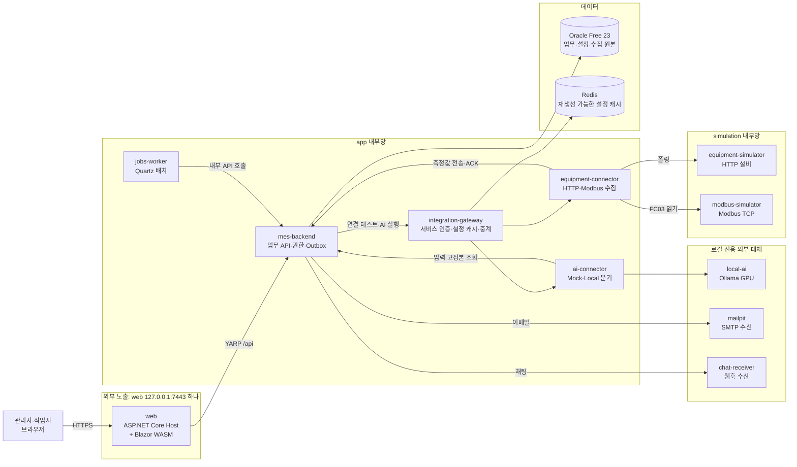

# FactoryMES

혼합·가열·충전 설비가 있는 작은 생산 라인을 가정하고 만든 **미니 MES와 설비 모니터링 시스템**입니다.
작업지시 → 실적 입력 → 설비 수집 → 경보 → 알림 → AI 분석 → 생산 통계까지
한 흐름으로 이어지게 C#(.NET 10)으로 구현했고, 서비스별 공개 저장소 11개로 나눠 관리합니다.

## 전체 아키텍처

- 브라우저는 **web 하나만** 볼 수 있습니다. 나머지 서비스는 외부 포트가 없는 내부망에 있습니다.
- **Oracle이 원본, Redis는 캐시**입니다. Redis가 비거나 죽어도 원본에서 다시 만들 수 있게 했습니다.
- 서비스끼리는 서명된 서비스 토큰으로 호출하고, 서비스마다 호출할 수 있는 API를 나눴습니다.
- 유료 API와 실제 외부 발송은 쓰지 않습니다. AI는 Mock·로컬 모델, 메일·채팅은 로컬 수신기로 대체했습니다.

[서비스 아키텍처와 요청 흐름 자세히 보기 →](architecture.md)

## 이렇게 만들었습니다

| 항목 | 내용 |
|---|---|
| 언어·런타임 | C#, .NET 10, ASP.NET Core, Blazor WebAssembly |
| 데이터 | Oracle Free 23(33개 테이블), Redis 7 |
| 배치 | Quartz.NET |
| 설비 연동 | HTTP 시뮬레이터, Modbus TCP 시뮬레이터(FC03) |
| AI | Mock 제공자, Ollama 로컬 모델 |
| 배포 | Docker Compose 13개 실행 서비스, GitHub Actions CI, GHCR 이미지 |
| 협업 | 요구사항·설계 결정·검토는 본인, 구현·교차 검증은 GPT와 Claude가 분담 |

## 설계부터 시작했습니다

주제 선정 → WPF 단일 앱 구상 → 웹·서비스 분리로 전환 → 화면·권한·상태 전이·ERD를
네 번 고친 과정과, 그 과정에서 **AI가 제안한 것과 제가 확정한 것**을 나눠 정리했습니다.

[설계 과정 보기 →](design.md)

## 기능별 상세

### 작업지시·생산실적
- 작업지시 하나에 작업 하나, 담당자 한 명. 여러 지시를 독립적으로 동시에 진행합니다.
- 작성 → 배포 → 진행 ⇄ 중지 → 제출 → 마감 상태 전이와 실적 정정을 이력으로 남기고, 마감 전에만 정정합니다.
- 수량은 EA 정수, 작업별로 자동 수집(AUTO)과 수동 입력(MANUAL) 중 하나만 씁니다.

[작업지시·생산실적 →](orders.md)

### 설비 연결·수집
- 설비 연결 설정은 Oracle에 버전으로 저장하고, 게이트웨이가 Redis에 캐시합니다.
- 커넥터는 HTTP·Modbus TCP로 수집하고, 백엔드가 커밋한 뒤 ACK를 받아야 다음으로 넘어갑니다.
- 이벤트 ID와 스트림 순번으로 중복·역순 데이터를 막습니다.

[설비 연결·수집 →](collection.md)

### 경보
- 측정값이 규칙을 넘으면 경보가 열리고, 경보 상태(발생·회복·종결)와 확인·조치를 따로 관리합니다.
- 통신이 끊긴 것(COMM_LOST)과 설비 이상을 구분하고, 강제 종결은 사유를 남깁니다.

[경보 →](alarms.md)

### AI 분석
- 분석 요청 시 입력 스냅샷을 먼저 저장하고 작업 ID를 돌려준 뒤 비동기로 실행합니다.
- Mock·로컬 모델을 바꿔 써도 결과 형식은 같고, 늦게 온 결과는 채택하지 않습니다.

[AI 분석 →](analysis.md)

### 알림·발송
- 공통 알림함과 이메일·채팅 발송을 Outbox로 분리해 발송이 실패해도 업무 처리는 끝나게 했습니다.
- 사용자마다 이벤트 종류별로 이메일·채팅 수신 방식을 고르고, 알림을 만든 순간의 설정으로 발송합니다.

[알림·발송 →](notifications.md)

### 생산 통계·대시보드
- Quartz 배치가 일별 생산 실적을 집계하고, 대시보드는 집계 결과와 현재 상태를 함께 보여줍니다.

[생산 통계·대시보드 →](reporting.md)

### 기준정보·계정
- 제품·라인·설비 기준정보와 관리자·작업자 두 역할의 계정을 관리합니다.

[기준정보·계정 →](master-data.md)

## 구조 개선과 운영

- [레포 분리 리팩터링](refactoring.md): 하나의 저장소를 서비스별 11개 공개 저장소로 나눈 과정과 Before/After
- [AI 협업 운영 방식](ai-collaboration.md): 제가 지시·확인하고 두 AI가 구현·교차 검증한 방식
- [한계와 다음 단계](limits.md): 아직 검증하지 못한 것과 다음에 할 일

## 공개 저장소

| 저장소 | 역할 |
|---|---|
| [factorymes-system](https://github.com/nkpFactoryMES/factorymes-system) | Oracle 스키마, Docker Compose, 통합 검증 |
| [factorymes-platform](https://github.com/nkpFactoryMES/factorymes-platform) | 공통 계약·기반 NuGet 패키지 |
| [factorymes-web](https://github.com/nkpFactoryMES/factorymes-web) | 웹 Host + Blazor WASM 화면 |
| [factorymes-backend](https://github.com/nkpFactoryMES/factorymes-backend) | 업무 API |
| [factorymes-integration-gateway](https://github.com/nkpFactoryMES/factorymes-integration-gateway) | 연동 중계 |
| [factorymes-equipment-connector](https://github.com/nkpFactoryMES/factorymes-equipment-connector) | 설비 수집 |
| [factorymes-ai-connector](https://github.com/nkpFactoryMES/factorymes-ai-connector) | AI 실행 |
| [factorymes-jobs-worker](https://github.com/nkpFactoryMES/factorymes-jobs-worker) | Quartz 배치 |
| [factorymes-equipment-simulator](https://github.com/nkpFactoryMES/factorymes-equipment-simulator) | HTTP 설비 시뮬레이터 |
| [factorymes-modbus-simulator](https://github.com/nkpFactoryMES/factorymes-modbus-simulator) | Modbus TCP 시뮬레이터 |
| [factorymes-chat-receiver](https://github.com/nkpFactoryMES/factorymes-chat-receiver) | 로컬 채팅 웹훅 수신기 |
