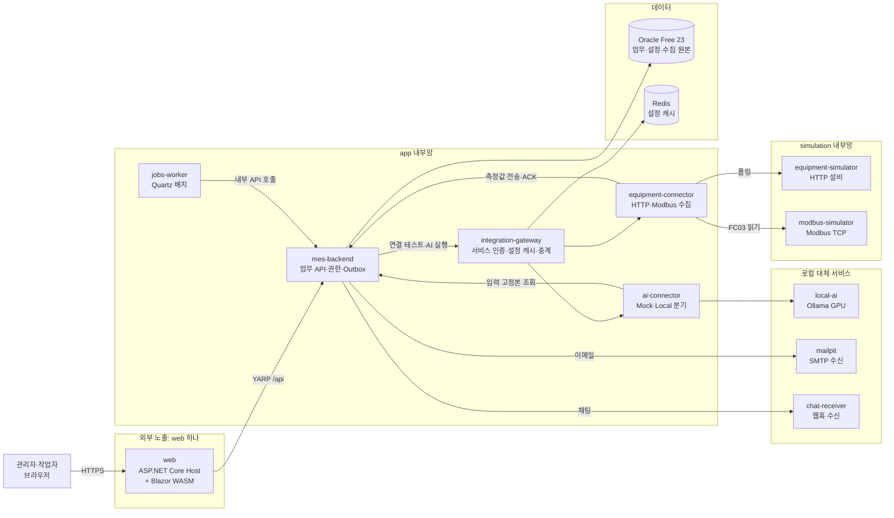

# FactoryMES

혼합·가열·충전 설비가 있는 소규모 생산 라인을 대상으로 한 MES·설비 모니터링 시스템입니다.
작업지시와 생산실적, 설비 데이터 수집, 경보, 알림, AI 분석, 생산 통계를 하나의 흐름으로 연결하며,
C#(.NET 10) 기반의 서비스 6개와 시뮬레이터 3개로 구성됩니다.

설계부터 구현, 검증, 서비스별 저장소 분리까지 개인 프로젝트로 진행했습니다.
실제 설비·외부 메일·유료 AI 대신 로컬 시뮬레이터, 로컬 수신 서버, 로컬 GPU 모델을 사용합니다.

> 화면 이미지는 로컬 실행 환경에서 캡처했으며, 작업·설비 이름은 검증 과정에서 생성된 데이터입니다.

## 주요 내용

- 업무 백엔드와 설비·AI 연동 계층의 책임 분리
- Oracle 원본과 Redis 캐시 기반의 설비 연결 설정 관리
- HTTP·Modbus TCP 수집과 이벤트 순번 기반 중복 방지
- 원장 기반 생산실적과 역분개 정정
- 통신 끊김·상한 초과 경보와 조치·종결 이력
- 트랜잭셔널 Outbox 기반 알림과 이메일·채팅 전달
- 로컬 LLM 연동과 규칙 기반 점검 근거 분리
- 서비스별 저장소 분리와 버전 패키지 기반 빌드

## 전체 구성도

[서비스 아키텍처 및 요청 흐름](architecture.md)

## 기술 스택

| 구분 | 내용 |
|---|---|
| Backend | C#, .NET 10, ASP.NET Core, EF Core, Quartz.NET |
| Frontend | Blazor WebAssembly, YARP |
| Data | Oracle Free 23(33개 테이블), Redis 7 |
| 연동 | HTTP, Modbus TCP(NModbus), MailKit, Ollama(Qwen2.5 1.5B) |
| 인프라 | Docker Compose(13개 컨테이너), GitHub Actions, GHCR |

## 설계

- 요구사항 정리와 화면·권한·상태 전이 설계
- 업무 백엔드 → 연동 게이트웨이 → 커넥터 구조 결정
- Oracle ERD, OpenAPI·이벤트 계약, 인증 경계 설계

[설계](design.md)

## 주요 기능

**작업지시·생산실적**

- 작업지시 상태 전이(작성 → 배포 → 진행 ⇄ 중지 → 제출 → 마감)와 전이 이력 관리
- 설비 행 잠금으로 같은 설비의 동시 작업 방지
- 클라이언트 UUID와 본문 해시로 실적 중복 전송 방지
- 수정·삭제 대신 역분개로 실적 정정, 설비 카운터 증분 원장으로 AUTO 집계

[작업지시·생산실적 설계](orders.md)

**설비 연결·수집**

- Oracle 설정 원본과 버전, Redis 캐시, 게이트웨이 경유 커넥터 적용 구조 구현
- 수집 임대와 서명 증명으로 사용중지·구버전 설정의 수집 차단
- 이벤트 ID와 (대상, 스트림, 순번) 키로 재전송 중복 방지
- Modbus TCP FC03 어댑터와 응답 프레임 검사 보강

[설비 연결·수집 설계](collection.md)

**경보**

- Quartz 주기 감시 기반 통신 끊김(COMM_LOST) 경보
- 발생·복구 임계값과 유지 시간을 분리한 상한(HIGH) 경보
- 확인(ACK)·조치·정상 종결·강제 종결 이력 분리

[경보 설계](alarms.md)

**AI 분석**

- 1분 단위 사전 집계로 분석 입력 고정본과 해시 생성
- Mock·로컬 LLM 제공자 분기와 게이트웨이 결과 검증
- 위험도는 고정 규칙, 설명 문장만 LLM이 생성하는 구조
- 시도 번호 대조로 늦게 도착한 결과 채택 방지

[AI 분석 설계](analysis.md)

**알림·발송**

- 업무 저장과 같은 트랜잭션의 알림함·Outbox 생성
- 사용자·이벤트별 이메일·채팅 수신 설정과 생성 시점 스냅샷 적용
- MailKit SMTP, 웹훅 어댑터와 자동·수동 재시도

[알림·발송 설계](notifications.md)

**생산 통계·대시보드**

- 마감 작업 원장 기준의 한국 영업일 집계
- 집계 요청 선저장과 날짜 단위 재계산
- 역할별 범위가 다른 현황 대시보드

[생산 통계·대시보드 설계](reporting.md)

**기준정보·계정**

- 품목·라인·설비·사용자 관리와 낙관적 잠금
- 미완료 작업이 참조하는 기준정보의 비활성화 차단
- 역할 변경 시 기존 세션 무효화, 로그인 실패 잠금

[기준정보·계정 설계](master-data.md)

## 구조 개선

**서비스별 저장소 분리**

- 단일 저장소를 서비스별 공개 저장소 11개로 분리
- 공통 코드를 버전 NuGet 패키지로 전환하고 SHA-256으로 고정
- 서비스별 Dockerfile·CI로 변경된 서비스만 빌드

[레포 분리 리팩터링](refactoring.md)

**AI 개발 운영 방식**

- 요구사항·설계 결정·검토와 구현·교차 검증의 역할 분리
- 공유 기록과 파일 소유권 기반의 작업 분담

[AI 개발 운영 방식](ai-collaboration.md)

[한계와 다음 단계](limits.md)

## 공개 저장소

| 저장소 | 역할 |
|---|---|
| [factorymes-system](https://github.com/nkpFactoryMES/factorymes-system) | Oracle 스키마, Docker Compose, 통합 검증 |
| [factorymes-platform](https://github.com/nkpFactoryMES/factorymes-platform) | 공통 계약·기반 NuGet 패키지 |
| [factorymes-web](https://github.com/nkpFactoryMES/factorymes-web) | 웹 Host + Blazor WASM 화면 |
| [factorymes-backend](https://github.com/nkpFactoryMES/factorymes-backend) | 업무 API |
| [factorymes-integration-gateway](https://github.com/nkpFactoryMES/factorymes-integration-gateway) | 연동 중계 |
| [factorymes-equipment-connector](https://github.com/nkpFactoryMES/factorymes-equipment-connector) | 설비 수집 |
| [factorymes-ai-connector](https://github.com/nkpFactoryMES/factorymes-ai-connector) | AI 실행 |
| [factorymes-jobs-worker](https://github.com/nkpFactoryMES/factorymes-jobs-worker) | Quartz 배치 |
| [factorymes-equipment-simulator](https://github.com/nkpFactoryMES/factorymes-equipment-simulator) | HTTP 설비 시뮬레이터 |
| [factorymes-modbus-simulator](https://github.com/nkpFactoryMES/factorymes-modbus-simulator) | Modbus TCP 시뮬레이터 |
| [factorymes-chat-receiver](https://github.com/nkpFactoryMES/factorymes-chat-receiver) | 로컬 채팅 웹훅 수신기 |
