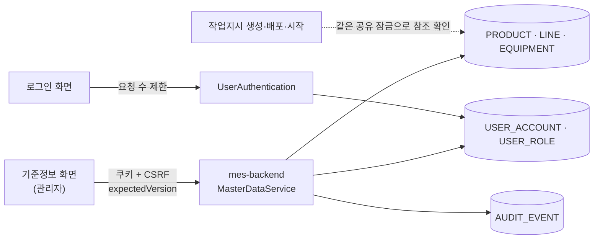
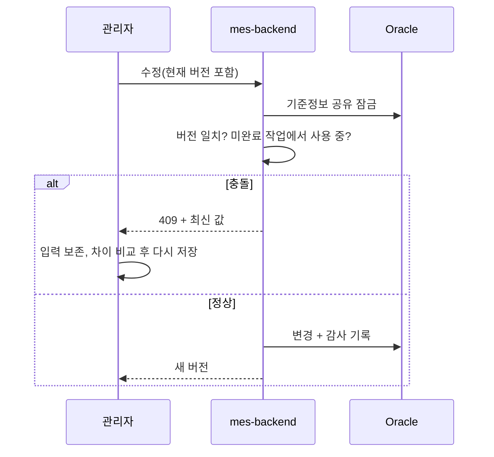
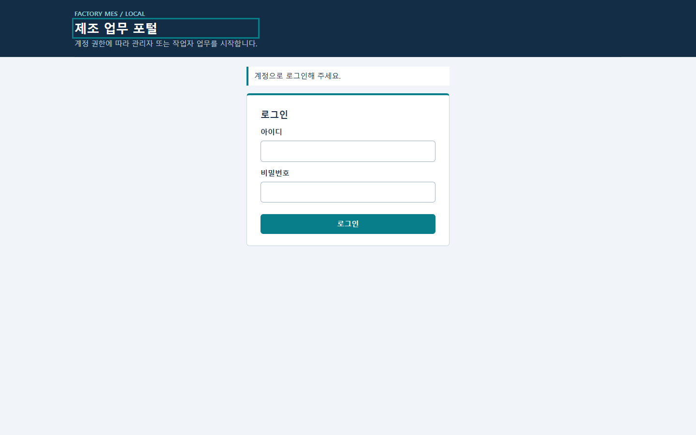
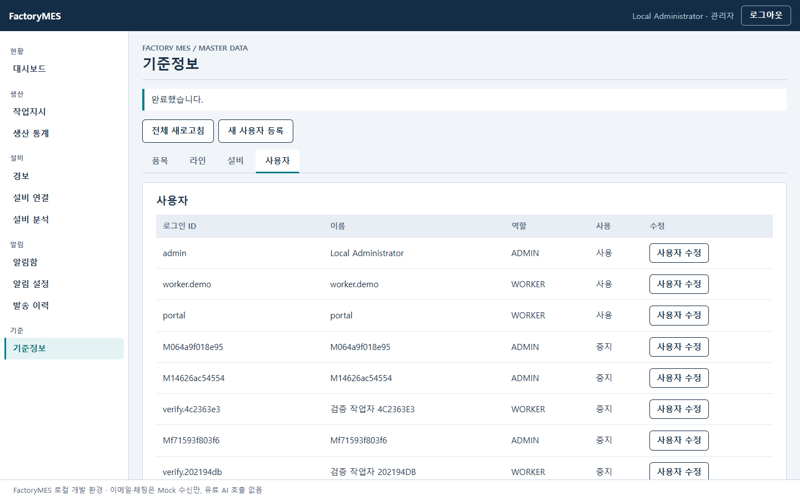

# 기준정보·계정

관리자는 품목·라인·설비·사용자를 등록·수정·비활성화합니다. 역할은 관리자(ADMIN)와 작업자(WORKER)
두 개뿐입니다. 기준정보는 지우지 않고 사용 여부만 바꿉니다.

## 구성도

## 흐름도

## 설계

### 문제
- 진행 중인 작업이 쓰는 품목이나 설비를 비활성화하면 작업이 깨집니다.
- 두 관리자가 같은 항목을 동시에 고치면 한 사람의 변경이 조용히 사라집니다.
- 역할을 바꿨는데 이미 로그인한 쿠키가 옛 권한을 계속 쓰면 안 됩니다.

### 검토한 안과 선택

| 고민 | 비교한 안 | 선택과 이유 |
|---|---|---|
| 삭제 | 물리 삭제 / **비활성화만** | 과거 작업·실적이 참조하는 기준정보가 사라지지 않게 합니다. |
| 사용 중 항목 | 화면에서만 막기 / **서버에서 미완료 작업 참조 확인** | 작업 생성·배포·시작과 같은 공유 잠금을 써서 확인과 변경 사이에 끼어드는 경우를 막습니다. |
| 동시 수정 | 마지막 저장 우선 / **낙관적 잠금(버전) + 409** | 충돌 시 입력을 보존하고 최신 값과 비교한 뒤 명시적으로 다시 저장합니다. |
| 권한 변경 반영 | 쿠키 만료까지 대기 / **세션 stamp 변경** | 역할·사용 여부가 바뀌면 기존 쿠키가 바로 무효가 됩니다. |
| 마지막 관리자 | 허용 / **마지막 활성 관리자 제거 금지** | 시스템을 관리할 사람이 없어지는 상태를 막습니다. |
| 로그인 보호 | 제한 없음 / **분당 요청 제한 + 5회 실패 시 15분 잠금** | 비밀번호 대입을 늦춥니다. 초기 비밀번호는 12자 이상이고 응답·감사·로그에 남기지 않습니다. |

## 화면

### 로그인

아이디·비밀번호만 받고, 역할은 로그인 뒤 서버가 정합니다. 화면은 관리자·작업자가 같고 메뉴와 API 범위만
달라집니다.

<a class="source-link" href="https://github.com/nkpFactoryMES/factorymes-backend/blob/35b21c06298e68430fe08a6b5c3cd4ab1a683cf6/services/mes-backend/Auth/UserAuthentication.cs#L55-L205">소스 보기</a>
<a class="source-link" href="https://github.com/nkpFactoryMES/factorymes-backend/blob/35b21c06298e68430fe08a6b5c3cd4ab1a683cf6/services/mes-backend/Program.cs#L130-L135">요청 수 제한</a>

### 품목

품목·라인·설비·사용자를 탭 하나로 묶었습니다. 단위는 설계 단계에서 정한 대로 EA만 씁니다. 사용 열은
비활성화 여부이고, 삭제 버튼은 일부러 두지 않았습니다.

<a class="source-link" href="https://github.com/nkpFactoryMES/factorymes-web/blob/2d05837500b6de42f46230227fc593291856e0ff/services/web-client/Pages/MasterData.razor#L54-L151">소스 보기</a>
<a class="source-link" href="https://github.com/nkpFactoryMES/factorymes-backend/blob/35b21c06298e68430fe08a6b5c3cd4ab1a683cf6/services/mes-backend/Features/Orders/MasterDataService.cs#L368-L442">수정 API</a>

### 사용자

계정마다 역할은 하나(ADMIN 또는 WORKER)입니다. 권한 세분화(생산·설비·시스템 관리자)는 설계 단계에서 후속
범위로 미뤘습니다. 역할이나 사용 여부를 바꾸면 그 사용자의 기존 로그인 세션이 바로 끊깁니다.

<a class="source-link" href="https://github.com/nkpFactoryMES/factorymes-web/blob/2d05837500b6de42f46230227fc593291856e0ff/services/web-client/Pages/MasterData.razor#L361-L541">소스 보기</a>
<a class="source-link" href="https://github.com/nkpFactoryMES/factorymes-backend/blob/35b21c06298e68430fe08a6b5c3cd4ab1a683cf6/services/mes-backend/Features/Orders/MasterDataService.cs#L741-L977">사용자 API</a>

## 검증과 한계

- 기준정보 단계에서 새 Oracle API 71개, 브라우저 22개(조회 실패·충돌·응답 유실 포함)와 기존 회귀를 합쳐
  265개 항목을 통과했습니다.
- 상세: [기준정보·작업지시 초안](https://github.com/nkpFactoryMES/factorymes-system/blob/de9e542d9e362add9f5aec3293986d4744c13b12/docs/master-data-workflow.md),
  [인증 초기 설정](https://github.com/nkpFactoryMES/factorymes-system/blob/de9e542d9e362add9f5aec3293986d4744c13b12/docs/auth-bootstrap.md)
- 비밀번호 재설정 메일, 다중 인증, 외부 SSO는 없습니다.
