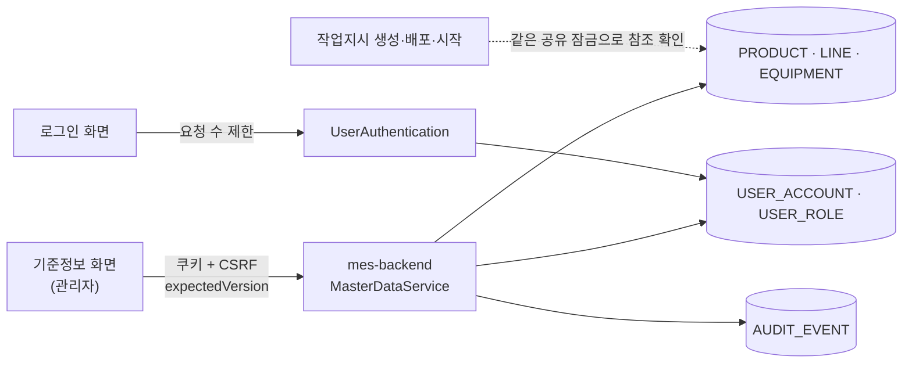
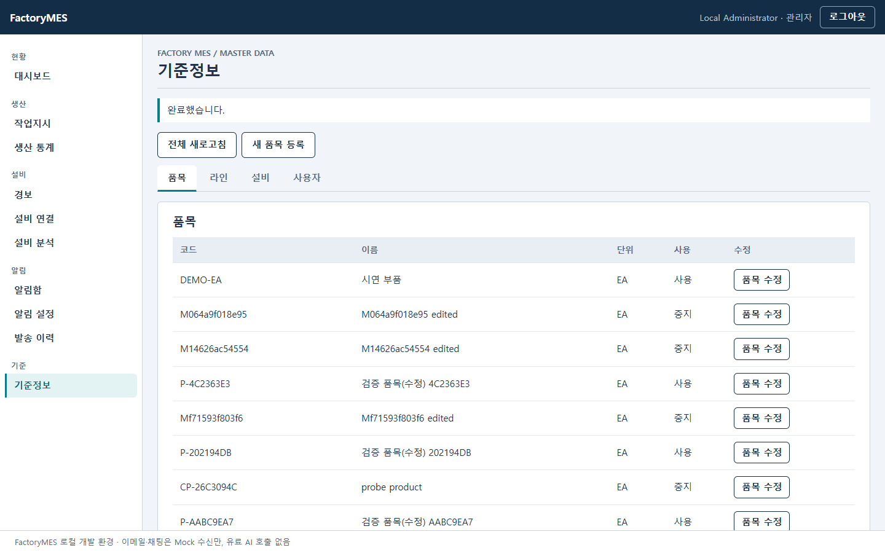

# 기준정보·계정

## 개요

관리자는 품목·라인·설비·사용자를 등록하고 수정합니다. 역할은 관리자(ADMIN)와 작업자(WORKER) 두 가지이며,
기준정보는 삭제하지 않고 사용 여부만 변경합니다. 모든 변경은 버전으로 충돌을 확인하고 감사 기록을 함께
저장합니다.

```text
관리자 수정 요청(expectedVersion)
  → 기준정보 공유 잠금 → 버전 일치·미완료 작업 참조 확인
  → 변경 + 감사 기록 → 새 버전 반환
  (충돌 시 409 + 최신 값 → 입력 보존 후 비교·재저장)
```

## 구성



## 설계

### 기준정보 변경 규칙

| 항목 | 검토한 방식 | 결정 |
|---|---|---|
| 삭제 | 물리 삭제 / 비활성화 | 비활성화만 허용. 과거 작업·실적이 참조하는 기준정보 보존 |
| 사용 중 항목 | 화면에서만 차단 / 서버에서 미완료 작업 참조 확인 | 서버 확인. 작업 생성·배포·시작과 같은 공유 잠금으로 확인과 변경 사이의 경합 방지 |
| 동시 수정 | 마지막 저장 우선 / 버전 기반 낙관적 잠금 | 버전 불일치 시 409, 화면은 입력을 보존하고 최신 값과 비교 후 재저장 |
| 이력 있는 항목 | 코드·소속 라인 자유 변경 / 변경 제한 | 이력이 생긴 뒤에는 코드와 설비의 라인 변경 차단 |

### 계정과 세션

| 항목 | 결정 |
|---|---|
| 역할 | 계정당 ADMIN 또는 WORKER 하나 |
| 권한 변경 반영 | 역할·사용 여부 변경 시 세션 stamp 변경으로 기존 쿠키 즉시 무효화 |
| 마지막 관리자 | 마지막 활성 관리자의 비활성화·역할 변경 차단 |
| 로그인 보호 | 분당 20회 요청 제한, 5회 실패 시 15분 잠금 |
| 초기 비밀번호 | 12자 이상, 응답·감사·로그에 기록하지 않음 |

## 화면

<div class="screen" markdown="1">

### 로그인


아이디와 비밀번호만 입력받고 역할은 로그인 후 서버가 결정합니다. 관리자와 작업자는 같은 화면을 사용하며,
메뉴와 API 범위만 달라집니다.

<a class="source-link" href="https://github.com/nkpFactoryMES/factorymes-backend/blob/35b21c06298e68430fe08a6b5c3cd4ab1a683cf6/services/mes-backend/Auth/UserAuthentication.cs#L55-L205">소스 보기</a>
<a class="source-link" href="https://github.com/nkpFactoryMES/factorymes-backend/blob/35b21c06298e68430fe08a6b5c3cd4ab1a683cf6/services/mes-backend/Program.cs#L130-L135">요청 수 제한</a>

</div>

<div class="screen" markdown="1">

### 품목



품목·라인·설비·사용자를 탭으로 묶었습니다. 단위는 EA로 고정하고, 사용 열로 비활성화 여부를 표시하며 삭제
기능은 제공하지 않습니다.

<a class="source-link" href="https://github.com/nkpFactoryMES/factorymes-web/blob/2d05837500b6de42f46230227fc593291856e0ff/services/web-client/Pages/MasterData.razor#L54-L151">소스 보기</a>
<a class="source-link" href="https://github.com/nkpFactoryMES/factorymes-backend/blob/35b21c06298e68430fe08a6b5c3cd4ab1a683cf6/services/mes-backend/Features/Orders/MasterDataService.cs#L368-L442">수정 API</a>

</div>

<div class="screen" markdown="1">

### 사용자


계정마다 하나의 역할을 가지며, 역할이나 사용 여부를 변경하면 해당 사용자의 기존 로그인 세션이 바로
종료됩니다. 생산·설비·시스템 관리자 같은 권한 세분화는 확장 범위로 두었습니다.

<a class="source-link" href="https://github.com/nkpFactoryMES/factorymes-web/blob/2d05837500b6de42f46230227fc593291856e0ff/services/web-client/Pages/MasterData.razor#L361-L541">소스 보기</a>
<a class="source-link" href="https://github.com/nkpFactoryMES/factorymes-backend/blob/35b21c06298e68430fe08a6b5c3cd4ab1a683cf6/services/mes-backend/Features/Orders/MasterDataService.cs#L741-L977">사용자 API</a>

</div>

## 검증과 한계

- 신규 Oracle API 71개, 조회 실패·충돌·응답 유실을 포함한 브라우저 22개, 기존 회귀를 합쳐 265개 항목 통과
- 상세 문서: [기준정보·작업지시 초안](https://github.com/nkpFactoryMES/factorymes-system/blob/de9e542d9e362add9f5aec3293986d4744c13b12/docs/master-data-workflow.md),
  [인증 초기 설정](https://github.com/nkpFactoryMES/factorymes-system/blob/de9e542d9e362add9f5aec3293986d4744c13b12/docs/auth-bootstrap.md)
- 비밀번호 재설정 메일, 다중 인증, 외부 SSO는 미적용
