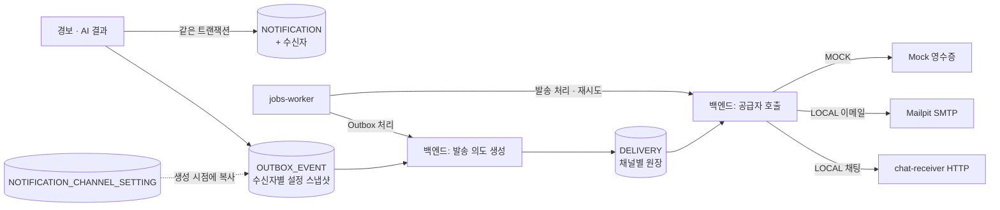
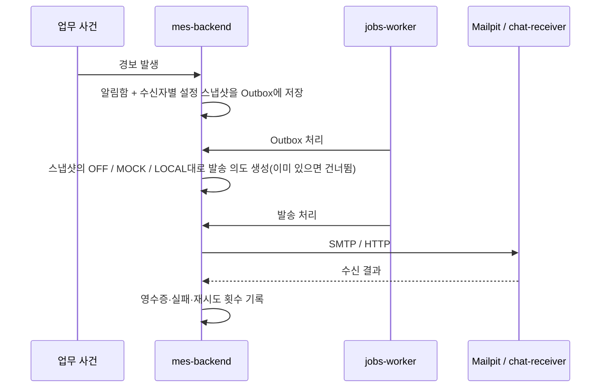
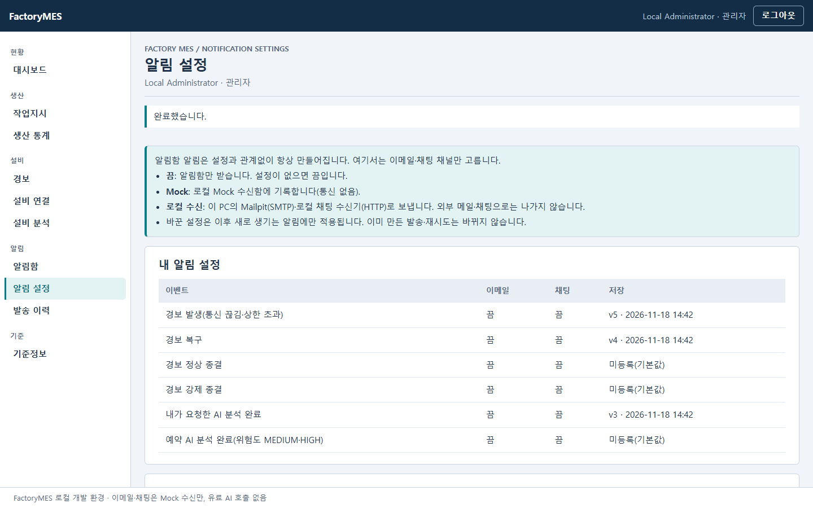
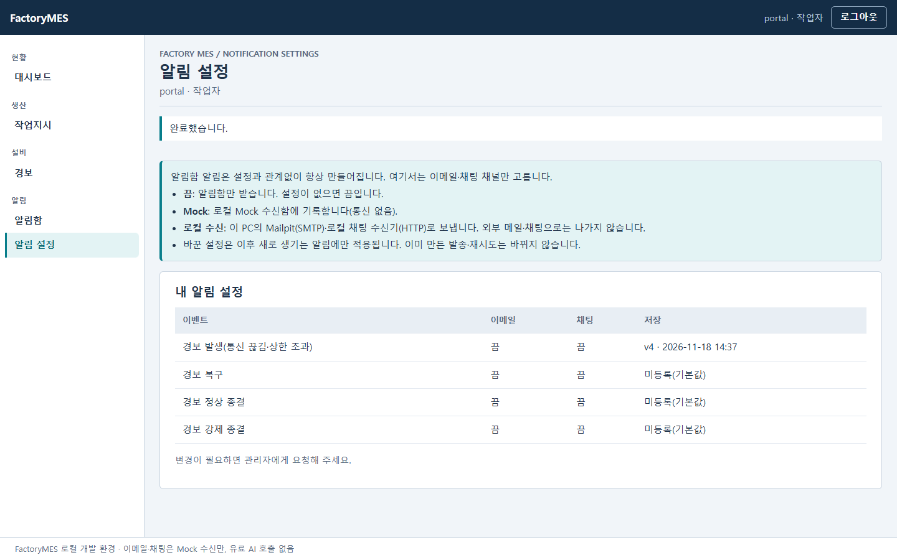

# 알림·발송

경보·AI 분석 같은 업무 사건이 생기면 **알림함 알림은 항상** 만들고, 사용자가 켠 경우에만 이메일·채팅으로
보냅니다. 외부로 실제 발송은 하지 않고, 이메일은 로컬 Mailpit(SMTP), 채팅은 직접 만든 로컬 웹훅 수신기로
받습니다. "성공을 돌려준 메서드"와 "다른 서버가 실제로 받은 메시지"를 구분하려는 것입니다.

## 구성도

## 흐름도

## 설계

### 문제
- 업무 처리 도중 메일 서버를 직접 부르면, 메일 서버가 느리거나 죽었을 때 경보 저장도 실패합니다.
- 사용자가 알림 설정을 바꾸면 이미 만들어진 알림까지 바뀌어야 하는지 애매합니다.
- 같은 메시지가 두 번 발송될 수 있는 지점이 여러 곳(DB 원장, HTTP 재전송, SMTP)에 있습니다.

### 검토한 안과 선택

| 고민 | 비교한 안 | 선택과 이유 |
|---|---|---|
| 발송 시점 | 요청 중 직접 호출 / CDC / Kafka / **트랜잭셔널 Outbox** | 업무 저장과 외부 장애를 분리합니다. Oracle 추가 권한이나 브로커 없이 로컬에서 재현됩니다. |
| Jobs 역할 | DB 직접 갱신 / **백엔드 내부 API 호출만** | DB 소유권은 백엔드 하나에 둡니다. |
| Mock 결과 표시 | 성공을 SENT로 저장 / **PENDING 유지 + 영수증** | 실제로 나가지 않은 것을 "발송됨"으로 보이지 않게 합니다. |
| 설정 적용 시점 | 발송할 때 현재 설정 읽기 / **알림을 만든 순간 스냅샷** | 설정을 바꾸면 그 뒤의 새 알림에만 적용됩니다. 이미 만든 발송·재시도는 바뀌지 않습니다. |
| 이메일 | 소켓으로 SMTP 직접 구현 / **MailKit + Mailpit** | 검증된 라이브러리로 MIME·취소·상태 코드를 처리하고 업무 로직에 집중합니다. |
| 채팅 | Slack 무료 플랜 / Zulip·Rocket.Chat 자체 운영 / **Slack 웹훅 형식 + 직접 만든 수신기** | 채팅 제품 운영까지 범위를 늘리지 않았습니다. 실제 Slack 발송을 검증한 것은 아닙니다. |
| 재시도 | 무제한 / **일시 오류 3회, 영구 오류는 수동 재시도** | 실패를 원장에 남기고, 관리자가 재시도할 때도 식별자·입력 해시·버전으로 대조합니다. |

중복은 한 가지로 묶지 않았습니다. DB 원장은 행 잠금과 기존 수신 기록으로, 로컬 채팅 수신기는 같은 ID·같은
본문을 기존 기록으로 받아서 막습니다. 반면 **SMTP Message-ID는 수신 쪽 중복 제거를 보장하지 않아서**,
ACK를 잃거나 커밋이 실패하면 같은 메일이 두 번 올 수 있습니다. 이 한계를 그대로 기록했습니다.

## 화면

### 알림함

알림함은 사용자 본인 것만 보입니다. 화면에 **"읽음 표시를 해도 경보 확인(ACK)은 되지 않는다"**고 적고,
경보 알림에는 관련 경보로 가는 링크를 붙였습니다. 읽음은 개인 상태, ACK는 업무 상태로 나눴기 때문입니다.

<a class="source-link" href="https://github.com/nkpFactoryMES/factorymes-web/blob/2d05837500b6de42f46230227fc593291856e0ff/services/web-client/Pages/Inbox.razor#L1-L69">소스 보기</a>

### 알림 설정 (관리자)

이벤트 6종(경보 발생·복구·정상 종결·강제 종결, 내가 요청한 AI 분석, 예약 AI 분석)마다 이메일·채팅을
**끔 / Mock / 로컬 수신** 중에서 고릅니다. 각 값이 무엇을 뜻하는지와 **"바꾼 설정은 이후 새 알림에만
적용된다"**는 점을 표 위에 적었습니다. 관리자는 아래 영역에서 다른 사용자 설정도 사유와 함께 바꿀 수 있습니다.

<a class="source-link" href="https://github.com/nkpFactoryMES/factorymes-web/blob/2d05837500b6de42f46230227fc593291856e0ff/services/web-client/Pages/NotificationSettings.razor#L43-L213">소스 보기</a>

### 알림 설정 (작업자)

작업자는 경보 4종만 보고 **읽기 전용**입니다. 변경은 관리자에게 요청하게 했습니다. AI 분석은 관리자 기능이라
작업자 표에는 나오지 않고, 서버에서도 작업자에게 AI 설정을 저장하면 거절합니다.

<a class="source-link" href="https://github.com/nkpFactoryMES/factorymes-backend/blob/35b21c06298e68430fe08a6b5c3cd4ab1a683cf6/services/mes-backend/Features/Notifications/NotificationSettingsService.cs#L86-L130">소스 보기</a>

### 발송 이력

맨 위 주황 안내에 **"Mock 수신 완료는 실제 발송(SENT)이 아니다"**, **"로컬 수신 확인은 이 PC 안의 서버가
받았다는 뜻"**이라고 적었습니다. 시연용 시나리오(첫 시도 성공, 자동 재시도 후 성공, 3회 실패, 관리자 재시도 등)를 골라 직접 알림을 만들어
재시도 동작을 볼 수 있습니다.

<a class="source-link" href="https://github.com/nkpFactoryMES/factorymes-web/blob/2d05837500b6de42f46230227fc593291856e0ff/services/web-client/Pages/Deliveries.razor#L41-L271">소스 보기</a>

### 로컬 수신 내용

로컬 채팅 수신기가 **실제로 받은 기록**(수신 시각, 수신 ID, 본문 해시)을 보여줍니다. 발송 행의 상태는 그대로
PENDING이라고 적어서, 로컬 수신을 외부 발송 성공으로 착각하지 않게 했습니다.

<a class="source-link" href="https://github.com/nkpFactoryMES/factorymes-web/blob/2d05837500b6de42f46230227fc593291856e0ff/services/web-client/Pages/Deliveries.razor#L521-L556">소스 보기</a>

## 핵심 코드

알림 생성: 수신자별 설정을 읽어 Outbox 데이터에 `eventKind`와 `routing[]` 스냅샷을 넣습니다.

<a class="source-link" href="https://github.com/nkpFactoryMES/factorymes-backend/blob/35b21c06298e68430fe08a6b5c3cd4ab1a683cf6/services/mes-backend/Features/Notifications/InboxService.cs#L24-L210">소스 보기</a>

스냅샷 읽기와 검증: 수신자 목록과 스냅샷이 정확히 맞지 않으면 거절하고 발송 의도를 만들지 않습니다.

<a class="source-link" href="https://github.com/nkpFactoryMES/factorymes-backend/blob/35b21c06298e68430fe08a6b5c3cd4ab1a683cf6/services/mes-backend/Features/Notifications/NotificationRouting.cs#L33-L96">소스 보기</a>

스냅샷대로 발송 의도 만들기: OFF는 건너뛰고, MOCK·LOCAL은 채널별 대상으로, 이미 있으면 다시 만들지 않습니다.

<a class="source-link" href="https://github.com/nkpFactoryMES/factorymes-backend/blob/35b21c06298e68430fe08a6b5c3cd4ab1a683cf6/services/mes-backend/Features/Notifications/DeliveryService.Local.cs#L174-L228">소스 보기</a>

Outbox·발송 배치 처리.

<a class="source-link" href="https://github.com/nkpFactoryMES/factorymes-backend/blob/35b21c06298e68430fe08a6b5c3cd4ab1a683cf6/services/mes-backend/Features/Notifications/DeliveryService.Dispatch.cs#L16-L127">소스 보기</a>

## 검증과 한계

- 경보 발생 → 관리자 이메일 로컬 수신(Mailpit), 복구 → 채팅 Mock, 설정 변경은 새 알림에만 반영, 수동 AI 분석 →
  이메일 Mock + 채팅 로컬 웹훅을 실제 스택에서 확인했습니다. 결과 하나당 알림 하나만 생깁니다.
- 어댑터 단계에서 공급자·수신기 독립 검사, 실제 SMTP·HTTP·Oracle 검사, 화면, 기존 회귀를 합쳐 334개를 통과했습니다.
  Mailpit이 디코딩한 메시지와 다른 프로세스의 채팅 기록을 직접 대조했습니다.
- 상세: [Outbox·Mock 발송](https://github.com/nkpFactoryMES/factorymes-system/blob/de9e542d9e362add9f5aec3293986d4744c13b12/docs/outbox-mock-delivery-design.md),
  [Outbox 재처리](https://github.com/nkpFactoryMES/factorymes-system/blob/de9e542d9e362add9f5aec3293986d4744c13b12/docs/outbox-operator-retry.md),
  [이메일·채팅 어댑터 비교](https://github.com/nkpFactoryMES/factorymes-system/blob/de9e542d9e362add9f5aec3293986d4744c13b12/docs/email-chat-adapters-decision.md)
- 실제 외부 목적지, TLS·OAuth, 반송 처리는 하지 않았습니다.
- 예약 AI 알림 경로는 실제 예약 실행으로 아직 검증하지 않았습니다.
