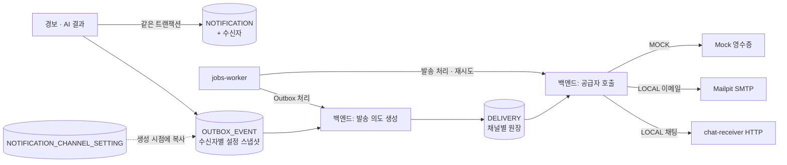
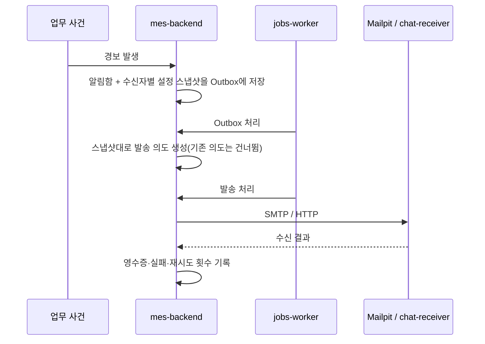
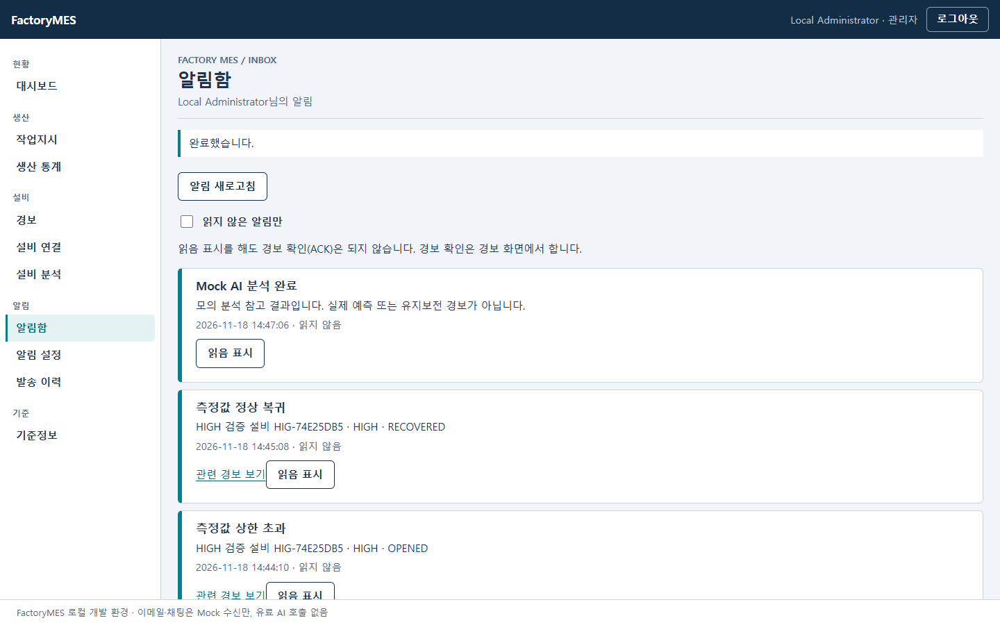
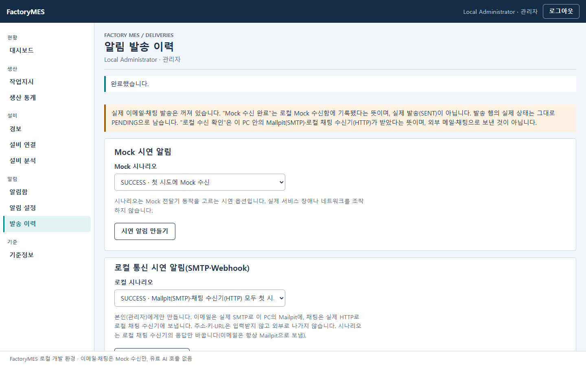
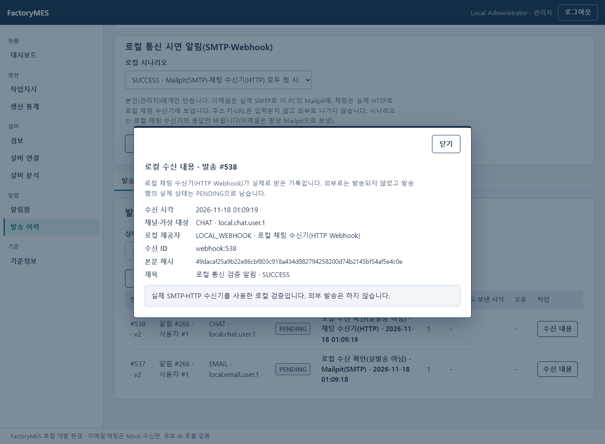

# 알림·발송

## 개요

경보 발생·복구·종결, AI 분석 완료 같은 업무 사건이 생기면 알림함 알림은 항상 생성하고, 사용자가 설정한
경우에만 이메일·채팅으로 전달합니다. 알림 생성은 업무 저장과 같은 트랜잭션에서 Outbox로 기록하고, 실제
전달은 Jobs Worker가 별도로 처리합니다. 외부 발송 대신 이메일은 Mailpit(SMTP), 채팅은 직접 구현한
웹훅 수신 서버로 실제 통신을 검증합니다.

```text
업무 사건 → 알림함 + 수신자 + Outbox(수신자별 설정 스냅샷) [같은 트랜잭션]
Jobs: Outbox 처리 → 스냅샷의 OFF / MOCK / LOCAL에 따라 채널별 발송 원장 생성
Jobs: 발송 처리 → SMTP / HTTP → 영수증·실패·재시도 기록
```

## 구성



| 테이블 | 역할 |
|---|---|
| NOTIFICATION / NOTIFICATION_RECIPIENT | 알림 본문과 수신자별 읽음 상태 |
| OUTBOX_EVENT | 업무 변경과 함께 저장되는 전달 이벤트, 수신자별 설정 스냅샷 포함 |
| DELIVERY | 수신자·채널별 발송 원장과 재시도 횟수 |
| NOTIFICATION_CHANNEL_SETTING | 사용자·이벤트별 이메일·채팅 수신 방식과 버전 |

## 처리 흐름



## 설계

### 업무 처리와 발송의 분리

| 항목 | 검토한 방식 | 결정 |
|---|---|---|
| 발송 시점 | 요청 처리 중 직접 호출 / CDC / Kafka / 트랜잭셔널 Outbox | Outbox. 메일 서버 장애가 경보 저장을 실패시키지 않고, 추가 인프라 없이 로컬에서 재현 가능 |
| 배치 역할 | Jobs가 DB 직접 갱신 / 백엔드 내부 API 호출 | 내부 API. DB 소유권을 백엔드에 유지 |
| Mock 결과 상태 | 성공을 SENT로 저장 / PENDING 유지 + 영수증 | 실제로 나가지 않은 메시지를 발송 완료로 표시하지 않음 |
| 재시도 | 무제한 / 일시 오류 3회 + 영구 오류 수동 재시도 | 실패를 원장에 남기고, 수동 재시도 시 식별자·입력 해시·버전으로 대조 |

### 수신 설정 적용 시점

사용자가 알림 설정을 바꿨을 때 이미 생성된 알림까지 달라지면 발송 결과를 설명할 수 없습니다. 알림을 만드는
순간 수신자별 설정을 Outbox 데이터에 스냅샷으로 저장하고, 발송 의도는 이 스냅샷으로만 만듭니다. 설정 변경은
이후 생성되는 알림에만 적용되고, 스냅샷과 수신자 목록이 정확히 일치하지 않으면 발송 의도를 만들지 않습니다.

```json
{
  "eventKind": "ALARM_OPENED",
  "routing": [
    {
      "userId": "1",
      "settingVersion": 5,
      "emailMode": "LOCAL",
      "chatMode": "MOCK"
    }
  ]
}
```

### 전달 수단

이메일은 MIME·취소·SMTP 상태 처리를 직접 구현하지 않고 MailKit과 로컬 Mailpit을 사용했습니다. 채팅은 Slack
무료 플랜의 제약과 Zulip·Rocket.Chat 자체 운영 부담을 비교한 뒤, Slack Incoming Webhook 형식의 HTTP 어댑터와
별도의 수신 서버를 구현하는 방식으로 정했습니다.

### 중복 전달

| 구간 | 처리 |
|---|---|
| DB 발송 원장 | 행 잠금과 기존 수신 기록으로 중복 생성 방지 |
| 로컬 채팅 수신 서버 | 같은 ID·같은 본문은 기존 기록으로 응답 |
| SMTP | Message-ID가 수신 측 중복 제거를 보장하지 않아, ACK 유실·커밋 실패 시 중복 수신 가능(한계로 기록) |

## 화면

<div class="screen" markdown="1">

### 알림함



본인 알림만 조회하며, 읽음 표시는 경보 확인(ACK)이 아니라는 안내와 관련 경보로 이동하는 링크를 함께
제공합니다. 개인의 읽음 상태와 업무상 확인을 구분하기 위한 구성입니다.

<a class="source-link" href="https://github.com/nkpFactoryMES/factorymes-web/blob/2d05837500b6de42f46230227fc593291856e0ff/services/web-client/Pages/Inbox.razor#L1-L69">소스 보기</a>

</div>

<div class="screen" markdown="1">

### 알림 설정(관리자)


경보 발생·복구·정상 종결·강제 종결, 요청한 AI 분석 완료, 예약 AI 분석 완료의 6가지 이벤트마다 이메일과
채팅을 끔·Mock·로컬 수신 중에서 선택합니다. 각 값의 의미와 변경 설정이 이후 생성되는 알림에만 적용된다는
점을 표 위에 표시했습니다. 다른 사용자의 설정은 사유와 함께 변경합니다.

<a class="source-link" href="https://github.com/nkpFactoryMES/factorymes-web/blob/2d05837500b6de42f46230227fc593291856e0ff/services/web-client/Pages/NotificationSettings.razor#L43-L213">소스 보기</a>

</div>

<div class="screen" markdown="1">

### 알림 설정(작업자)


작업자는 경보 이벤트 4가지만 조회하며 변경은 관리자에게 요청합니다. AI 분석은 관리자 기능이므로 작업자
표에 표시하지 않고, 서버에서도 작업자의 AI 설정 저장을 거절합니다.

<a class="source-link" href="https://github.com/nkpFactoryMES/factorymes-backend/blob/35b21c06298e68430fe08a6b5c3cd4ab1a683cf6/services/mes-backend/Features/Notifications/NotificationSettingsService.cs#L86-L130">소스 보기</a>

</div>

<div class="screen" markdown="1">

### 발송 이력



Mock 수신 완료는 실제 발송(SENT)이 아니며 로컬 수신 확인은 로컬 서버가 메시지를 받았다는 뜻임을 상단에
표시했습니다. 첫 시도 성공, 자동 재시도 후 성공, 3회 실패, 관리자 재시도 등의 시나리오로 시연 알림을 만들어
재시도 동작을 확인할 수 있습니다.

<a class="source-link" href="https://github.com/nkpFactoryMES/factorymes-web/blob/2d05837500b6de42f46230227fc593291856e0ff/services/web-client/Pages/Deliveries.razor#L41-L271">소스 보기</a>

</div>

<div class="screen" markdown="1">

### 로컬 수신 내용



로컬 채팅 수신 서버가 실제로 받은 수신 시각, 수신 ID, 본문 해시를 표시합니다. 발송 원장의 상태는 PENDING으로
유지해 로컬 수신을 외부 발송 성공으로 오해하지 않도록 했습니다.

<a class="source-link" href="https://github.com/nkpFactoryMES/factorymes-web/blob/2d05837500b6de42f46230227fc593291856e0ff/services/web-client/Pages/Deliveries.razor#L521-L556">소스 보기</a>

</div>

## 주요 코드

<div class="screen" markdown="1">

알림 생성: 수신자별 설정을 읽어 Outbox 데이터에 `eventKind`와 `routing[]` 스냅샷 저장.

<a class="source-link" href="https://github.com/nkpFactoryMES/factorymes-backend/blob/35b21c06298e68430fe08a6b5c3cd4ab1a683cf6/services/mes-backend/Features/Notifications/InboxService.cs#L24-L210">소스 보기</a>

</div>

<div class="screen" markdown="1">

스냅샷 검증: 수신자 목록과 정확히 일치하지 않으면 거절.

<a class="source-link" href="https://github.com/nkpFactoryMES/factorymes-backend/blob/35b21c06298e68430fe08a6b5c3cd4ab1a683cf6/services/mes-backend/Features/Notifications/NotificationRouting.cs#L33-L96">소스 보기</a>

</div>

<div class="screen" markdown="1">

발송 의도 생성: OFF 제외, MOCK·LOCAL은 채널별 대상으로 생성, 기존 의도는 재생성하지 않음.

<a class="source-link" href="https://github.com/nkpFactoryMES/factorymes-backend/blob/35b21c06298e68430fe08a6b5c3cd4ab1a683cf6/services/mes-backend/Features/Notifications/DeliveryService.Local.cs#L174-L228">소스 보기</a>

</div>

<div class="screen" markdown="1">

Outbox 배치 처리.

<a class="source-link" href="https://github.com/nkpFactoryMES/factorymes-backend/blob/35b21c06298e68430fe08a6b5c3cd4ab1a683cf6/services/mes-backend/Features/Notifications/DeliveryService.Dispatch.cs#L16-L127">소스 보기</a>

</div>

## 검증과 한계

- 경보 발생 → 관리자 이메일 로컬 수신, 복구 → 채팅 Mock, 설정 변경의 신규 알림 반영, 수동 AI 분석 →
  이메일 Mock + 채팅 로컬 웹훅을 실제 스택에서 확인
- 공급자·수신 서버 독립 검사, 실제 SMTP·HTTP·Oracle 검사, 화면, 기존 회귀 포함 334개 검사 통과
- Mailpit의 디코딩 메시지와 채팅 수신 서버 기록을 직접 대조
- 상세 문서: [Outbox·Mock 발송](https://github.com/nkpFactoryMES/factorymes-system/blob/de9e542d9e362add9f5aec3293986d4744c13b12/docs/outbox-mock-delivery-design.md),
  [Outbox 재처리](https://github.com/nkpFactoryMES/factorymes-system/blob/de9e542d9e362add9f5aec3293986d4744c13b12/docs/outbox-operator-retry.md),
  [이메일·채팅 어댑터 비교](https://github.com/nkpFactoryMES/factorymes-system/blob/de9e542d9e362add9f5aec3293986d4744c13b12/docs/email-chat-adapters-decision.md)
- 실제 외부 목적지, TLS·OAuth, 반송 처리는 미적용
- 예약 AI 알림 경로는 실제 예약 실행으로 미검증
