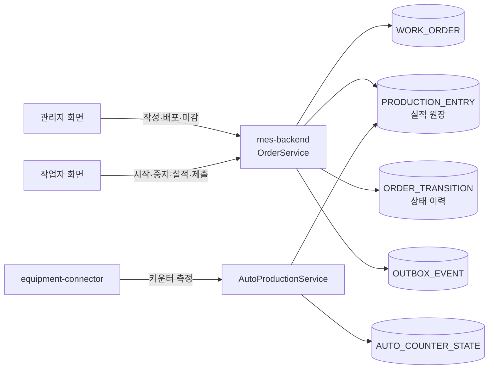
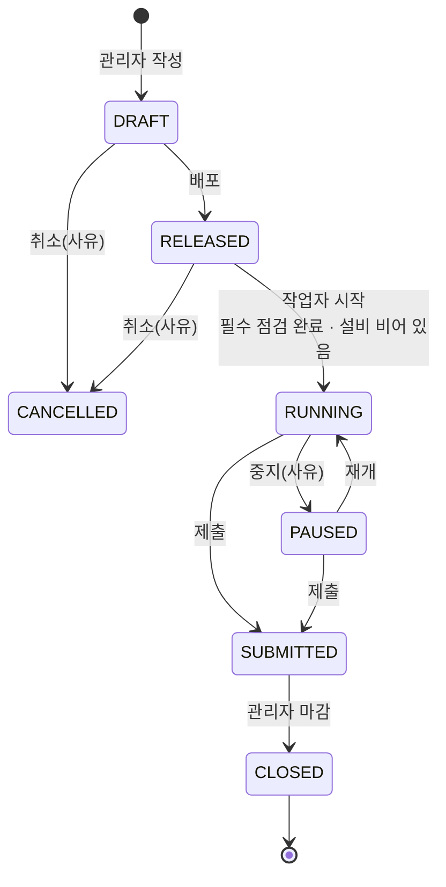
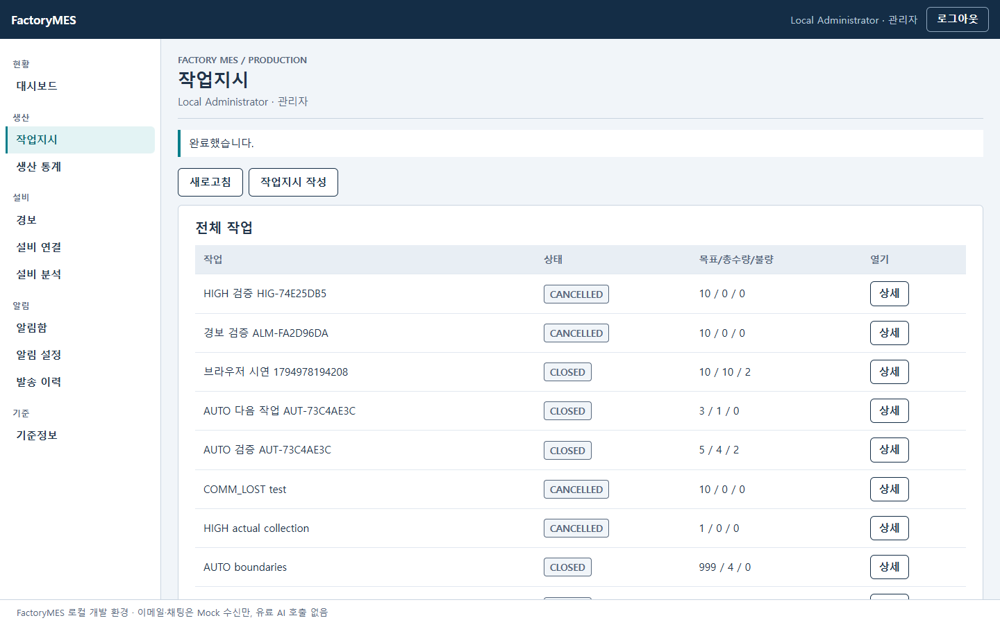
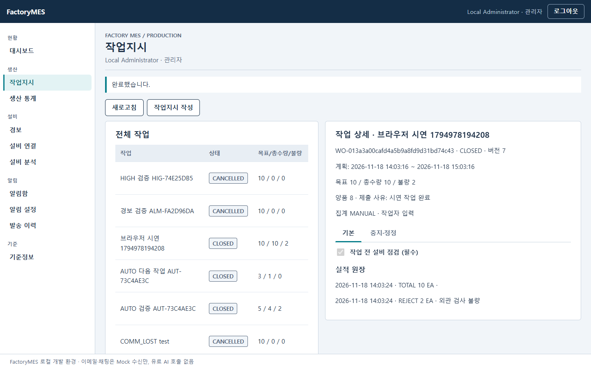

# 작업지시·생산실적

## 개요

관리자가 작업지시를 작성·배포하면 담당 작업자가 시작·중지·재개·실적 입력·제출을 진행하고,
관리자가 검토 후 마감합니다. 생산 수량은 작업자가 직접 입력하는 MANUAL 방식과 설비 카운터로 집계하는
AUTO 방식 중 작업별로 하나를 사용합니다. 모든 수량은 원장에 누적하고, 정정은 수정·삭제 대신 역분개로
처리합니다.

```text
관리자: 작성(DRAFT) → 배포(RELEASED)
작업자: 시작(RUNNING) ⇄ 중지(PAUSED) → 실적 입력 → 제출(SUBMITTED)
관리자: 검토 → 마감(CLOSED) → 일별 생산 집계
```

## 구성



| 테이블 | 역할 |
|---|---|
| WORK_ORDER | 작업지시와 현재 상태·버전, 담당자·설비·품목 |
| PRODUCTION_ENTRY | 총수량·불량·역분개·하향 조정을 누적하는 실적 원장 |
| ORDER_TRANSITION | 상태 전이 이력 |
| WORK_PAUSE | 중지 구간과 사유 |
| CORRECTION_REQUEST | 제출 후 관리자 정정 요청 |
| AUTO_COUNTER_STATE | AUTO 작업의 카운터 기준값과 마지막 반영 위치 |

## 상태 전이



| 전이 | 검사 |
|---|---|
| 배포 | 품목·설비·담당자가 사용 중인지 다시 확인 |
| 시작 | 필수 점검 완료, 같은 설비의 RUNNING·PAUSED 작업 없음 |
| 제출 | AUTO 준비 상태, 불량 ≤ 총수량, 목표와 다르면 사유 필수, 열린 중지 구간 종료 |
| 마감 | 본인 담당 작업 마감 불가, 검토 사유 필수, 미처리 정정 요청 없음 |

## 설계

### 설비 동시 사용 방지

서로 다른 작업지시가 같은 설비에서 동시에 시작되면 실적이 어느 작업의 것인지 구분할 수 없습니다.
시작 시 작업지시 행과 설비 행을 함께 잠그고 같은 설비의 진행 중 작업을 확인해, 동시에 들어온 시작 요청도
순서대로 처리되도록 했습니다.

### 실적 중복 전송 방지

네트워크 재시도로 같은 실적이 두 번 들어오면 수량이 늘어납니다. 실적마다 클라이언트 UUID와 본문 해시를
저장해, 같은 UUID·같은 본문이면 기존 결과를 반환하고 본문이 다르면 409로 거절합니다.

### 역분개 기반 정정

실적을 수정·삭제하면 누가 언제 왜 고쳤는지가 남지 않습니다. 원본은 그대로 두고 같은 수량의 역분개를
추가하는 방식으로 정정하며, 원본당 한 번만 허용하고 역분개의 역분개는 금지했습니다. 합계는 항상 원장에서
계산합니다.

```text
총수량 = TOTAL − (TOTAL 원본의 REVERSAL) − TOTAL_ADJUST_DOWN
불량   = REJECT − (REJECT 원본의 REVERSAL)
```

### AUTO 수량 집계

처음에는 종료 카운터에서 시작 카운터를 빼는 방식을 검토했지만, 이 방식으로는 중지 중 증가, 카운터 리셋,
작업 전환을 구분할 수 없었습니다. 수집 이벤트마다 증분을 원장에 기록하는 방식으로 바꿨고, 원시 측정·AUTO
원장·카운터 상태를 같은 트랜잭션에 저장해 재전송 시에도 중복이 생기지 않게 했습니다.

| 상황 | 처리 |
|---|---|
| 시작 직후 첫 정상 측정 | 기준값만 확정, 수량 0 |
| 카운터 감소(리셋) | 합산 중지 후 사유와 함께 기준 재확인 |
| AUTO 작업의 수동 입력 | 불량만 허용, 총수량 수동 입력 거절 |

## 화면

<div class="screen" markdown="1">

### 작업지시 목록



관리자는 전체 작업, 작업자는 본인 담당 작업만 조회합니다. 목록에서 목표·총수량·불량을 함께 보여줘
상세를 열지 않고도 진행 상황을 확인할 수 있게 했습니다. 상태는 API·DB 값과 같은 코드로 표시합니다.

<a class="source-link" href="https://github.com/nkpFactoryMES/factorymes-web/blob/2d05837500b6de42f46230227fc593291856e0ff/services/web-client/Pages/Orders.razor#L151-L191">소스 보기</a>

</div>

<div class="screen" markdown="1">

### 작업지시 작성


품목·설비·담당자·목표 수량·집계 방식을 한 화면에서 입력합니다. 작성된 지시는 DRAFT 상태로 저장되어
배포 전까지 수정할 수 있고, 시작 전까지 사유와 함께 취소할 수 있습니다.

<a class="source-link" href="https://github.com/nkpFactoryMES/factorymes-web/blob/2d05837500b6de42f46230227fc593291856e0ff/services/web-client/Pages/Orders.razor#L53-L150">소스 보기</a>
<a class="source-link" href="https://github.com/nkpFactoryMES/factorymes-backend/blob/35b21c06298e68430fe08a6b5c3cd4ab1a683cf6/services/mes-backend/Features/Orders/OrderService.cs#L217-L306">작성 API</a>

</div>

<div class="screen" markdown="1">

### AUTO 작업 상세


카운터 매핑, 시작 카운터, 최근 카운터, 마지막 측정 시각, 수집 순번을 함께 표시해 자동 집계 수량의 근거를
작업자와 관리자가 같은 값으로 확인할 수 있게 했습니다. 설비가 보낸 수량은 원장에 "설비 자동"으로 기록되며
수동으로 수정·취소할 수 없습니다.

<a class="source-link" href="https://github.com/nkpFactoryMES/factorymes-web/blob/2d05837500b6de42f46230227fc593291856e0ff/services/web-client/Components/AutoCounterStatus.razor#L1-L53">소스 보기</a>
<a class="source-link" href="https://github.com/nkpFactoryMES/factorymes-backend/blob/35b21c06298e68430fe08a6b5c3cd4ab1a683cf6/services/mes-backend/Features/Orders/AutoProductionService.Consume.cs#L12-L255">카운터 증분 반영</a>

</div>

<div class="screen" markdown="1">

### MANUAL 작업 상세



작업자가 총수량과 불량을 추가하면 기존 값을 덮어쓰지 않고 원장에 한 줄씩 누적됩니다. 제출 전 잘못 입력한
실적은 본인이 역분개로 취소하고, 제출 후에는 관리자 정정 요청을 거칩니다.

<a class="source-link" href="https://github.com/nkpFactoryMES/factorymes-backend/blob/35b21c06298e68430fe08a6b5c3cd4ab1a683cf6/services/mes-backend/Features/Orders/OrderService.Entries.cs#L10-L210">소스 보기</a>
<a class="source-link" href="https://github.com/nkpFactoryMES/factorymes-backend/blob/35b21c06298e68430fe08a6b5c3cd4ab1a683cf6/services/mes-backend/Features/Orders/OrderService.cs#L384-L415">원장 합계 계산</a>

</div>

<div class="screen" markdown="1">

### 작업자 화면


작업자에게는 본인 작업과 생산·경보·알림 메뉴만 표시됩니다. 서버에서도 작업자 역할만 생산 명령을 수행할 수
있고, 관리자의 대리 실적 입력은 허용하지 않습니다.

<a class="source-link" href="https://github.com/nkpFactoryMES/factorymes-backend/blob/35b21c06298e68430fe08a6b5c3cd4ab1a683cf6/services/mes-backend/Features/Orders/OrderService.cs#L117-L133">담당 범위 검사</a>

</div>

## 주요 코드

<div class="screen" markdown="1">

작업 시작: 필수 점검 확인 → 설비 행 잠금 → 같은 설비의 진행 중 작업 확인 → RUNNING.

<a class="source-link" href="https://github.com/nkpFactoryMES/factorymes-backend/blob/35b21c06298e68430fe08a6b5c3cd4ab1a683cf6/services/mes-backend/Features/Orders/OrderService.cs#L510-L544">소스 보기</a>

</div>

<div class="screen" markdown="1">

제출: AUTO 준비 상태, 불량 ≤ 총수량, 목표 차이 사유, 열린 중지 구간 종료.

<a class="source-link" href="https://github.com/nkpFactoryMES/factorymes-backend/blob/35b21c06298e68430fe08a6b5c3cd4ab1a683cf6/services/mes-backend/Features/Orders/OrderService.cs#L545-L575">소스 보기</a>

</div>

## 검증과 한계

- 상태 전이, 권한, 중복 전송, 역분개 규칙을 실제 Oracle 대상 API 검증과 브라우저 검증으로 확인
- 상세 문서: [수동 작업 흐름](https://github.com/nkpFactoryMES/factorymes-system/blob/de9e542d9e362add9f5aec3293986d4744c13b12/docs/manual-workflow.md),
  [제출 전 역분개](https://github.com/nkpFactoryMES/factorymes-system/blob/de9e542d9e362add9f5aec3293986d4744c13b12/docs/pre-submit-reversal-workflow.md),
  [AUTO 생산 설계](https://github.com/nkpFactoryMES/factorymes-system/blob/de9e542d9e362add9f5aec3293986d4744c13b12/docs/auto-production-design.md)
- 카운터 넘침(wrap)은 PLC별 규격이 없어 자동 추정하지 않음
- 마감 후 정정, 실제 재작업, 복수·교대 담당은 범위 밖
