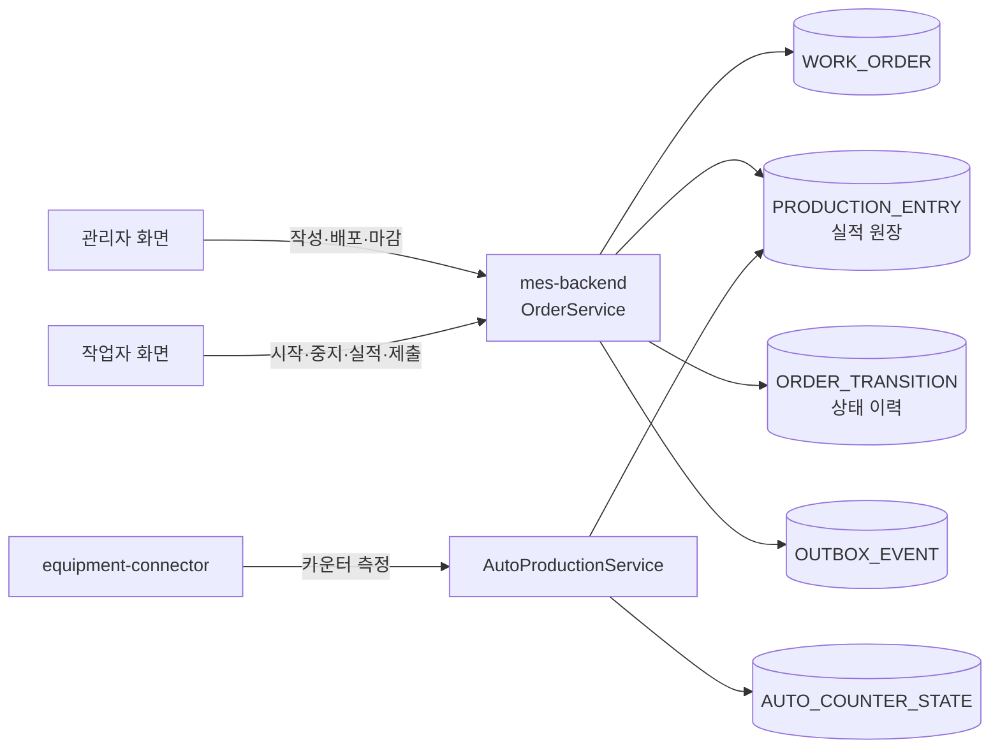
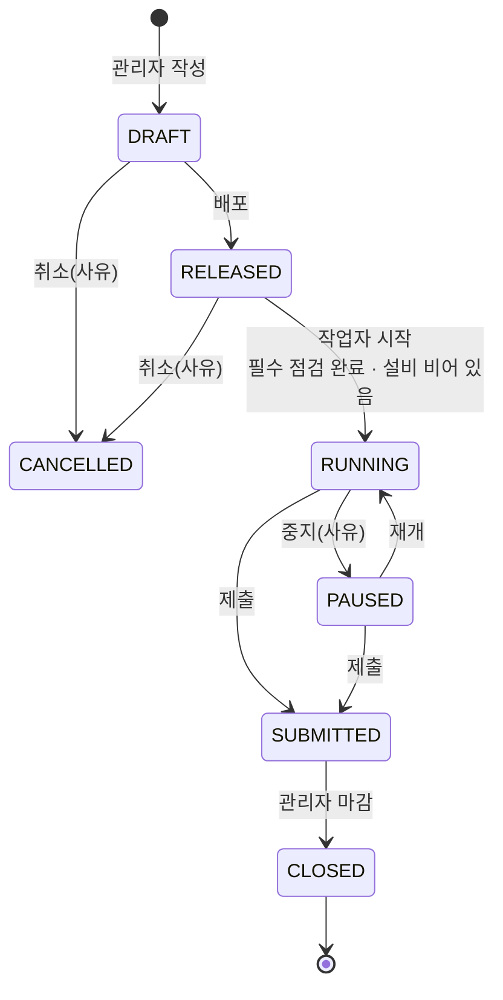
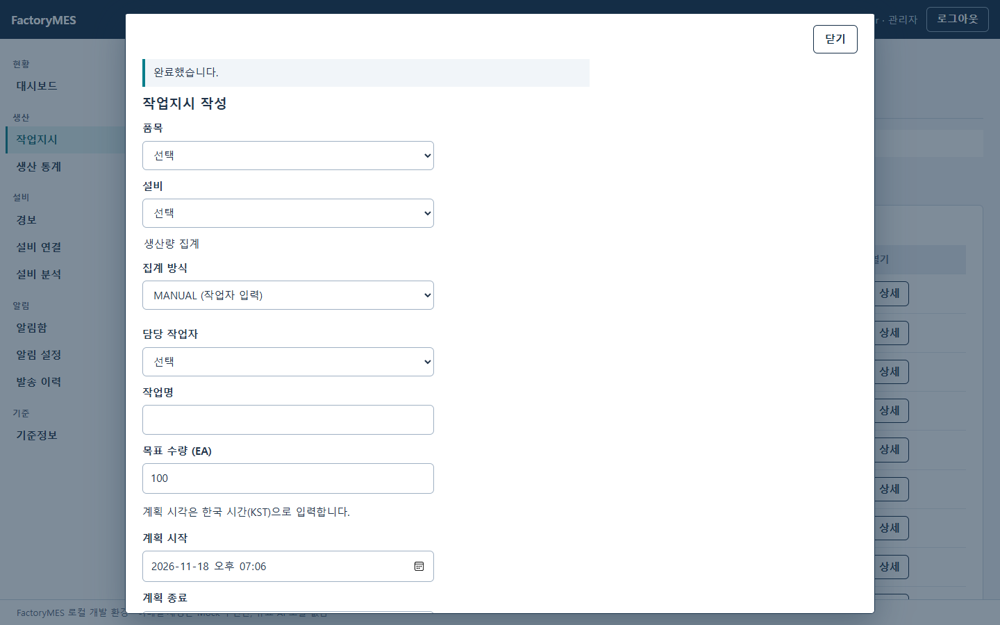
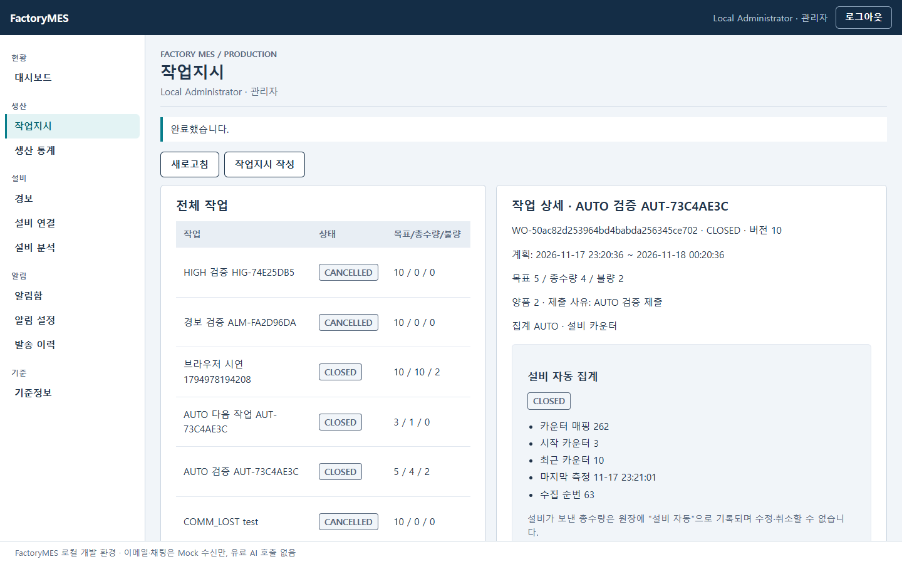
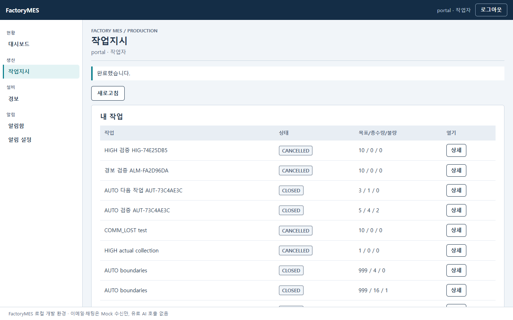

# 작업지시·생산실적

관리자가 작업지시를 만들어 배포하면, 담당 작업자가 시작·중지·재개·제출하고 관리자가 마감합니다.
생산 수량은 작업자가 직접 입력(MANUAL)하거나 설비 카운터로 자동 집계(AUTO)합니다.

## 구성도

## 상태 흐름

## 설계

### 문제
- 같은 설비에서 두 작업이 동시에 돌면 실적이 어느 작업 것인지 알 수 없습니다.
- 작업자가 네트워크 문제로 같은 실적을 두 번 보내면 수량이 두 배가 됩니다.
- 잘못 입력한 실적을 지우면 "누가 언제 왜 고쳤는지"가 사라집니다.
- 설비 카운터와 작업자 입력을 섞으면 같은 수량을 두 번 셀 수 있습니다.

### 검토한 안과 선택

| 고민 | 비교한 안 | 선택과 이유 |
|---|---|---|
| 설비 동시 사용 | 화면에서 막기 / DB 행 잠금 | **작업지시와 설비 행을 함께 잠그고** 같은 설비의 RUNNING·PAUSED 작업이 있으면 거절. 서로 다른 지시가 동시에 시작해도 순서가 정해집니다. |
| 중복 전송 | 요청마다 새로 저장 / 클라이언트 UUID | **실적마다 UUID + 본문 해시**. 같은 UUID·같은 본문이면 기존 결과를 돌려주고, 본문이 다르면 409. |
| 정정 | 수정·삭제 / 역분개 | **원본은 그대로 두고 같은 수량의 역분개를 추가**. 원본당 한 번, 역분개의 역분개는 금지. |
| AUTO 수량 | 종료값 − 시작값 / 측정마다 증분 원장 | **증분 원장**. 중지·카운터 리셋·작업 전환을 차이값 하나로는 구분할 수 없습니다. |
| AUTO·MANUAL 혼합 | 둘 다 허용 / 작업별 하나만 | **작업별 하나만**. AUTO 작업에서 작업자는 불량만 입력합니다. |

## 화면

### 작업지시 목록 (관리자)

관리자는 전체 작업을, 작업자는 본인 담당 작업만 봅니다. 목록에 **목표/총수량/불량**을 바로 보여줘서
상세를 열지 않아도 진행 정도를 알 수 있게 했습니다. 상태는 영문 코드 그대로 표시해 API·DB 값과
화면 값이 같도록 했습니다.

<a class="source-link" href="https://github.com/nkpFactoryMES/factorymes-web/blob/2d05837500b6de42f46230227fc593291856e0ff/services/web-client/Pages/Orders.razor#L151-L191">소스 보기</a>

### 작업지시 작성

품목·설비·담당자·목표 수량·집계 방식을 한 번에 정합니다. 처음에는 **초안(DRAFT)**으로 저장되고,
배포 전에는 수정할 수 있고, 시작 전까지는 사유와 함께 취소할 수 있습니다. 배포 순간에 품목·설비·담당자가 아직 사용 중인지
서버에서 다시 확인합니다.

<a class="source-link" href="https://github.com/nkpFactoryMES/factorymes-web/blob/2d05837500b6de42f46230227fc593291856e0ff/services/web-client/Pages/Orders.razor#L53-L150">소스 보기</a>
<a class="source-link" href="https://github.com/nkpFactoryMES/factorymes-backend/blob/35b21c06298e68430fe08a6b5c3cd4ab1a683cf6/services/mes-backend/Features/Orders/OrderService.cs#L217-L306">작성 API</a>

### 작업 상세 · AUTO 작업

AUTO 작업은 **설비 카운터 매핑, 시작 카운터, 최근 카운터, 마지막 측정 시각, 수집 순번**을 그대로
보여줍니다. 수량이 왜 이렇게 나왔는지 작업자와 관리자가 같은 근거를 보게 하려는 것입니다.
설비가 보낸 수량은 원장에 "설비 자동"으로 기록되어 사람이 수정·취소할 수 없습니다.

<a class="source-link" href="https://github.com/nkpFactoryMES/factorymes-web/blob/2d05837500b6de42f46230227fc593291856e0ff/services/web-client/Components/AutoCounterStatus.razor#L1-L53">소스 보기</a>
<a class="source-link" href="https://github.com/nkpFactoryMES/factorymes-backend/blob/35b21c06298e68430fe08a6b5c3cd4ab1a683cf6/services/mes-backend/Features/Orders/AutoProductionService.Consume.cs#L12-L255">카운터 증분 반영</a>

### 작업 상세 · MANUAL 작업과 실적 원장

MANUAL 작업은 작업자가 **총수량·불량을 추가**하는 방식입니다. 기존 값을 덮어쓰지 않고 원장에
한 줄씩 쌓이며, 합계는 원장에서 계산합니다. 잘못 넣은 실적은 제출 전이면 본인이 역분개로 취소하고,
제출 후에는 관리자 정정 요청을 거칩니다.

<a class="source-link" href="https://github.com/nkpFactoryMES/factorymes-backend/blob/35b21c06298e68430fe08a6b5c3cd4ab1a683cf6/services/mes-backend/Features/Orders/OrderService.Entries.cs#L10-L210">소스 보기</a>
<a class="source-link" href="https://github.com/nkpFactoryMES/factorymes-backend/blob/35b21c06298e68430fe08a6b5c3cd4ab1a683cf6/services/mes-backend/Features/Orders/OrderService.cs#L384-L415">원장 합계 계산</a>

### 작업자 화면

작업자에게는 **"내 작업"과 생산·경보·알림 메뉴만** 보입니다. 메뉴만 숨기는 것이 아니라
서버 정책에서도 작업자 역할만 생산 명령을 할 수 있고, 관리자는 작업자 대신 실적을 넣을 수
없습니다(대리 입력 금지).

<a class="source-link" href="https://github.com/nkpFactoryMES/factorymes-backend/blob/35b21c06298e68430fe08a6b5c3cd4ab1a683cf6/services/mes-backend/Features/Orders/OrderService.cs#L117-L133">담당 범위 검사</a>

## 핵심 코드

작업 시작: 필수 점검 확인 → 설비 행 잠금 → 같은 설비의 진행 중 작업 확인 → RUNNING.

<a class="source-link" href="https://github.com/nkpFactoryMES/factorymes-backend/blob/35b21c06298e68430fe08a6b5c3cd4ab1a683cf6/services/mes-backend/Features/Orders/OrderService.cs#L510-L544">소스 보기</a>

제출: AUTO 준비 상태, 불량 ≤ 총수량, 목표와 다르면 사유 필수, 열린 중지 구간 닫기.

<a class="source-link" href="https://github.com/nkpFactoryMES/factorymes-backend/blob/35b21c06298e68430fe08a6b5c3cd4ab1a683cf6/services/mes-backend/Features/Orders/OrderService.cs#L545-L575">소스 보기</a>

## 검증과 한계

- 상태 전이, 권한, 중복 전송, 역분개 규칙을 실제 Oracle에 대한 API 검증과 브라우저 검증으로
  확인했습니다. 상세: [수동 작업 흐름](https://github.com/nkpFactoryMES/factorymes-system/blob/de9e542d9e362add9f5aec3293986d4744c13b12/docs/manual-workflow.md),
  [제출 전 역분개](https://github.com/nkpFactoryMES/factorymes-system/blob/de9e542d9e362add9f5aec3293986d4744c13b12/docs/pre-submit-reversal-workflow.md),
  [AUTO 생산 설계](https://github.com/nkpFactoryMES/factorymes-system/blob/de9e542d9e362add9f5aec3293986d4744c13b12/docs/auto-production-design.md)
- 카운터 리셋은 자동으로 추정하지 않고 합산을 멈춘 뒤 사유와 함께 다시 기준을 잡게 했습니다.
  PLC별 카운터 넘침(wrap) 규격이 없어서입니다.
- 마감 후 정정, 실제 재작업, 복수·교대 담당은 범위 밖입니다.
- 스크린샷의 작업 이름은 검증 과정에서 생긴 데이터입니다.
