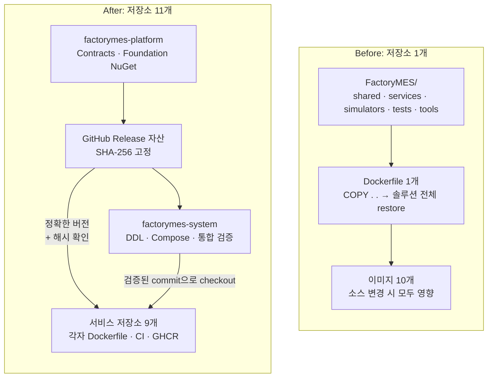

# 레포 분리 리팩터링

## 개요

하나의 저장소로 개발하던 FactoryMES를 서비스별 공개 저장소 11개로 분리했습니다. 서비스 프로세스와 HTTP·토큰
경계는 이미 나뉘어 있었지만, 빌드 경계가 하나로 묶여 있어 한 서비스만 수정해도 전체 이미지의 빌드 입력이
함께 바뀌는 문제가 있었습니다. 서비스 동작과 데이터 소유는 그대로 두고 저장소·패키지·이미지의 빌드 입력만
분리해, 변경된 서비스만 빌드·배포할 수 있는 구조로 바꿨습니다.

```text
Before: 저장소 1개 → Dockerfile 1개(COPY . . → 솔루션 전체 restore) → 이미지 10개
After : platform → GitHub Release 패키지(SHA-256 고정)
          → 서비스 저장소 9개(각자 Dockerfile·CI·GHCR)
          → system 저장소(DDL·Compose·통합 검증, 검증된 commit으로 checkout)
```

## 구성



| 항목 | Before | After |
|---|---:|---:|
| 저장소 | 1 | 11 |
| Dockerfile | 1 | 10 |
| 다른 저장소 소스를 참조하는 ProjectReference | - | 0 |
| 저장소 밖 소스를 포함하는 Compile | - | 0 |
| 공통 코드 참조 | 소스 ProjectReference | 정확한 버전 NuGet 패키지 |
| 서비스 소스 변경 시 영향받는 이미지(구조 기준) | 10 | 1 |
| Oracle 데이터 소유 | 백엔드 | 백엔드 |

영향받는 이미지 수는 Dockerfile 구조로 산정한 값이며, 실제 재빌드 시간이나 캐시 적중률은 측정하지 않았습니다.

## 설계

### 분리 범위

업무 백엔드를 도메인별로 나누거나 DB를 분리하는 것은 이번 범위에서 제외했습니다. 서비스 책임과 동작은 유지하고,
저장소·패키지·이미지의 빌드 입력을 독립시키는 데 집중했습니다.

### 공통 코드 배포

| 항목 | 결정 | 이유 |
|---|---|---|
| 공통 코드 | Contracts·Foundation을 버전 NuGet 패키지로 전환 | 소비 저장소가 버전을 올리기 전까지 빌드 입력이 바뀌지 않음 |
| 배포 위치 | 공개 GitHub Release 자산 | 서비스 CI가 다른 저장소를 읽는 토큰 없이 패키지를 받을 수 있음 |
| 무결성 | 저장소별 `build/package-lock.json`에 SHA-256 고정 | 같은 버전이 다른 바이트로 바뀌지 않았는지 복원 시 확인 |
| 버전 범위 | 중앙 패키지 관리에서 정확한 버전 `[x.y.z]` 고정 | 의도하지 않은 버전 혼입 방지 |
| 패키지 출처 | packageSourceMapping으로 `FactoryMES.*`는 로컬 고정 폴더에서만 | 다른 소스의 같은 이름 패키지 차단 |
| 캐시 | 저장소별 NuGet 캐시 | 전역 캐시의 임시 패키지가 잘못된 해시를 가리는 문제 방지 |

공통 패키지를 바꿔도 각 서비스는 버전을 명시적으로 올릴 때만 영향을 받습니다. 호환성 관리가 없어진 것이 아니라
업그레이드 시점을 서비스별로 선택하는 구조입니다.

### 서비스 Dockerfile

설정 파일, 잠금 파일, 고정 패키지만 먼저 복사해 `--locked-mode`로 복원하고, 그다음 자기 서비스 소스만 복사해
`--no-restore`로 빌드합니다. 서비스 소스 변경은 해당 이미지에만 영향을 주고, 패키지 구성이 그대로라면 복원
계층을 재사용할 수 있습니다.

```dockerfile
COPY global.json Directory.Build.props Directory.Packages.props NuGet.Config ./
COPY .packages/ ./.packages/
COPY services/mes-backend/*.csproj services/mes-backend/packages.lock.json ./services/mes-backend/
RUN dotnet restore services/mes-backend/FactoryMES.Backend.csproj --locked-mode
COPY services/mes-backend/ ./services/mes-backend/
RUN dotnet publish services/mes-backend/FactoryMES.Backend.csproj -c Release --no-restore -o /out
```

## 진행 중 발생한 문제

| 문제 | 원인 | 해결 |
|---|---|---|
| 잠금 파일 해시 22개 중 19개 불일치 | 전역 NuGet 캐시에 남은 같은 버전의 임시 패키지가 잘못된 해시를 가림 | 캐시 정리, 저장소별 `globalPackagesFolder` 적용, 고정 자산 기준 재생성 |
| 배포 자산 해시와 로컬 패키지 해시 불일치 | CI에서 패키지를 다시 생성해 바이트가 달라짐 | 소비 저장소를 배포 자산 해시로 재고정하고 깨끗한 환경에서 복원 확인 |
| Docker 복원 시 NU1004 | .razor 파일이 있을 때만 SDK가 추가하는 패키지가 잠금 파일과 불일치 | 웹 프로젝트에 `RequiresAspNetWebAssets` 명시 |
| 백엔드 CI 실패 | 테스트 프로젝트만 이전 패키지 버전에 고정 | 버전 수정 후 새 태그 v1.1.1 발행, 배포된 v1.1.0 태그는 변경하지 않음 |

## 주요 코드

<div class="screen" markdown="1">

서비스 Dockerfile.

<a class="source-link" href="https://github.com/nkpFactoryMES/factorymes-backend/blob/35b21c06298e68430fe08a6b5c3cd4ab1a683cf6/Dockerfile#L1-L18">소스 보기</a>

</div>

<div class="screen" markdown="1">

패키지 잠금: 패키지 ID·버전·파일·릴리스 태그·SHA-256.

<a class="source-link" href="https://github.com/nkpFactoryMES/factorymes-backend/blob/35b21c06298e68430fe08a6b5c3cd4ab1a683cf6/build/package-lock.json#L1-L21">소스 보기</a>

</div>

<div class="screen" markdown="1">

중앙 패키지 관리의 정확한 버전 고정.

<a class="source-link" href="https://github.com/nkpFactoryMES/factorymes-backend/blob/35b21c06298e68430fe08a6b5c3cd4ab1a683cf6/Directory.Packages.props#L1-L21">소스 보기</a>

</div>

<div class="screen" markdown="1">

`FactoryMES.*` 패키지 출처 제한과 저장소별 캐시.

<a class="source-link" href="https://github.com/nkpFactoryMES/factorymes-backend/blob/35b21c06298e68430fe08a6b5c3cd4ab1a683cf6/NuGet.Config#L1-L19">소스 보기</a>

</div>

## 검증과 한계

- 공개 직후 11개 저장소의 원격 CI 통과
- 빈 폴더에서 고정 commit checkout → 공개 패키지 해시 확인 → locked restore → 검증 도구 빌드 재현
- 알림 라우팅 배포 시 platform·backend·web·system CI 재통과, backend·web 이미지 GHCR 게시
- 통합 검증 도구는 내부 로직 검증을 위해 TestSupport 패키지를 사용하므로 화이트박스 검증 결합은 유지
- Oracle 스키마는 서비스 간 공유 상태
- 운영 서버가 없어 자동 운영 배포는 미적용, 재빌드 시간·캐시 적중률은 미측정
