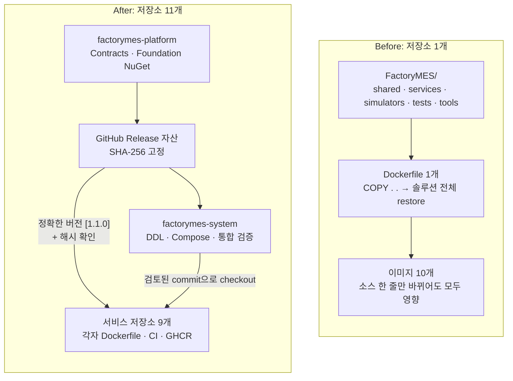

# 레포 분리 리팩터링

기능을 다 만든 뒤, 회사처럼 **바뀐 서비스만 빌드·배포**되게 하자는 제 결정으로 하나의 저장소를 **서비스별 공개 저장소 11개**로 나눴습니다.
런타임 구조(서비스·HTTP·토큰 경계)는 이미 나뉘어 있었고, 문제는 **빌드 경계**였습니다.

## Before / After

| 항목 | Before | After |
|---|---:|---:|
| 저장소 | 1 | 11 |
| Dockerfile | 1 | 10(서비스별) |
| 다른 저장소 소스를 참조하는 ProjectReference | 해당 경계 없음 | 0 |
| 저장소 밖 소스를 끌어오는 Compile | 측정 안 함 | 0 |
| 공유 코드 참조 방식 | 소스 ProjectReference | 정확한 버전 NuGet 패키지 |
| 한 서비스 소스 변경 시 영향받는 이미지 | 10/10(정적 추론) | 해당 서비스 1개(정적 추론) |
| Oracle 데이터 소유 | 백엔드 | 백엔드(변경 없음) |

> 영향받는 이미지 수는 Dockerfile 구조로 추론한 값입니다. 실제 재빌드 시간이나 캐시 적중률은 측정하지 않았습니다.

## 설계

### 문제
- 루트 Dockerfile이 저장소 전체를 복사한 뒤 솔루션을 restore해서, 한 서비스만 고쳐도 10개 이미지의
  빌드 입력이 함께 바뀌었습니다.
- 공유 코드와 검증 도구가 다른 서비스 소스를 직접 참조해서, 서비스 하나만 따로 빌드할 수 없었습니다.

### 검토한 안과 선택

| 고민 | 비교한 안 | 선택과 이유 |
|---|---|---|
| 범위 | 백엔드를 업무 도메인별로 쪼개기 / **빌드 입력만 분리** | 동작을 바꾸지 않고 저장소·패키지·이미지만 나눴습니다. DB 분리는 범위 밖입니다. |
| 공유 코드 | 소스 ProjectReference 유지 / **버전 NuGet 패키지** | 소비자가 버전을 올리기 전까지 빌드 입력이 바뀌지 않습니다. 호환성 책임이 사라진 게 아니라 업그레이드를 명시적으로 고르게 된 것입니다. |
| 패키지 배포 | **공개 GitHub Release 자산 + SHA-256 잠금** | 서비스 CI가 다른 저장소를 읽는 토큰 없이 받을 수 있고, 해시로 같은 바이트인지 확인합니다. 같은 버전을 다른 바이트로 다시 올리지 않습니다. |
| 버전 범위 | 범위 허용 / **정확한 버전 [x.y.z]** | 의도하지 않은 버전이 섞이지 않습니다. 중앙 패키지 관리(Directory.Packages.props)로 한 곳에서 고정합니다. |
| 패키지 출처 | 아무 소스 / **packageSourceMapping** | `FactoryMES.*`는 로컬 고정 폴더에서만 받습니다. |
| NuGet 캐시 | 전역 캐시 / **저장소별 캐시** | 아래 문제를 겪고 바꿨습니다. |

## 진행 중 겪은 문제

| 문제 | 원인 | 해결 |
|---|---|---|
| 잠금 파일 해시 22개 중 19개 불일치 | 전역 NuGet 캐시에 같은 버전의 임시 패키지가 남아 있어 잘못된 해시를 가렸습니다 | 캐시 정리, 저장소별 `globalPackagesFolder`로 변경, 고정 자산 기준으로 재생성 |
| 배포된 자산 해시가 로컬 pack과 다름 | CI가 패키지를 다시 만들어 바이트가 달라졌습니다 | 소비 저장소를 배포된 자산 해시로 다시 고정하고 깨끗한 복사본에서 확인 |
| Docker restore NU1004 | .razor 파일이 있을 때만 SDK가 추가하는 패키지가 잠금 파일과 어긋났습니다 | 웹 프로젝트에 `RequiresAspNetWebAssets` 명시 |
| 백엔드 CI 실패 | 테스트 프로젝트만 옛 버전 [1.0.0]에 고정돼 있었습니다 | [1.1.0]으로 고치고 새 태그 v1.1.1 발행. **이미 배포한 v1.1.0 태그는 옮기지 않았습니다** |

## 코드

서비스 Dockerfile: 설정·잠금·고정 패키지만 먼저 복사해 `--locked-mode`로 restore하고, 그다음 자기 소스만 복사합니다.

<a class="source-link" href="https://github.com/nkpFactoryMES/factorymes-backend/blob/35b21c06298e68430fe08a6b5c3cd4ab1a683cf6/Dockerfile#L1-L18">소스 보기</a>

패키지 잠금: 패키지 ID·버전·파일·릴리스 태그·SHA-256.

<a class="source-link" href="https://github.com/nkpFactoryMES/factorymes-backend/blob/35b21c06298e68430fe08a6b5c3cd4ab1a683cf6/build/package-lock.json#L1-L21">소스 보기</a>

정확한 버전 고정(중앙 패키지 관리).

<a class="source-link" href="https://github.com/nkpFactoryMES/factorymes-backend/blob/35b21c06298e68430fe08a6b5c3cd4ab1a683cf6/Directory.Packages.props#L1-L21">소스 보기</a>

`FactoryMES.*`는 로컬 고정 폴더에서만, 캐시는 저장소 안에.

<a class="source-link" href="https://github.com/nkpFactoryMES/factorymes-backend/blob/35b21c06298e68430fe08a6b5c3cd4ab1a683cf6/NuGet.Config#L1-L19">소스 보기</a>

## 검증과 한계

- 저장소마다 자기 소스만 빌드하는 CI가 있습니다. 알림 라우팅을 배포할 때 platform·backend·web·system CI가 공개
  Ubuntu runner에서 통과했고, backend·web 이미지가 GHCR에 게시됐습니다.
- 운영 서버가 없어서 자동 운영 배포까지 했다고는 말하지 않습니다.
- 통합 검증 도구는 백엔드·설비 커넥터 내부 로직을 보려고 **TestSupport 패키지**를 씁니다. 저장소 간 소스 결합은
  없앴지만, 내부 타입에 기대는 화이트박스 검증 결합까지 없앤 것은 아닙니다.
- Oracle 스키마는 여전히 서비스들이 공유합니다.
- 실제 재빌드 시간·캐시 적중률은 측정하지 않았습니다.
