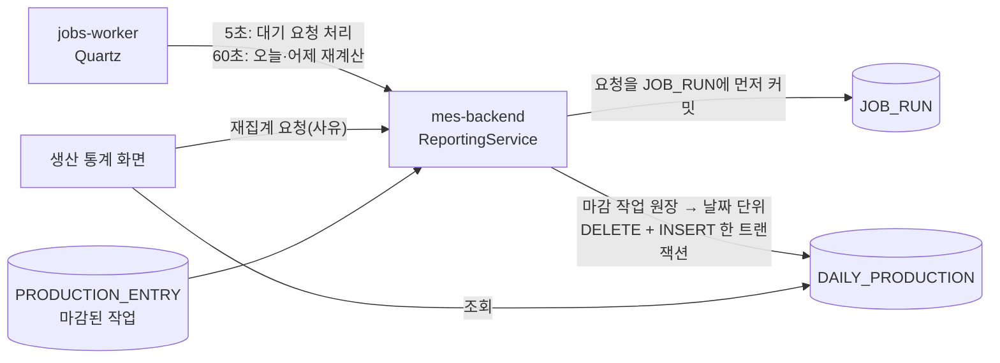
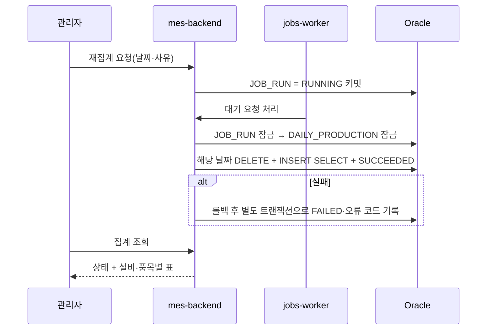
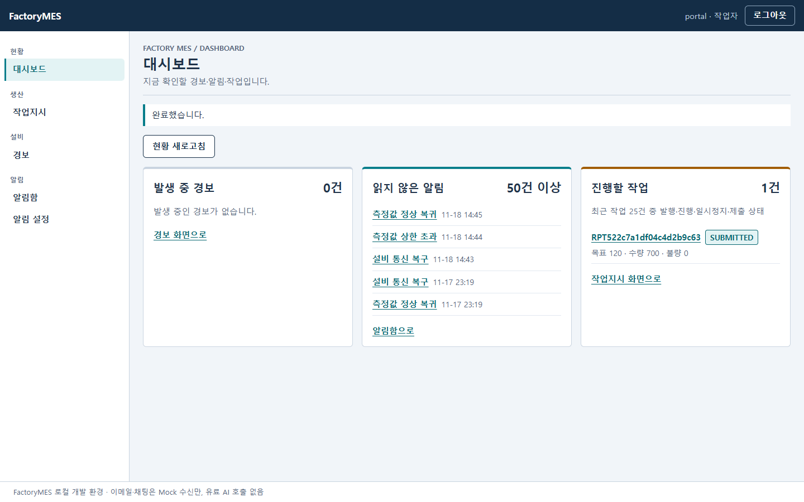

# 생산 통계·대시보드

## 개요

생산 통계는 마감된 작업의 실적 원장을 한국 영업일 기준으로 집계해 설비·품목별 총량, 불량, 양품, 불량률을
제공합니다. 집계는 Quartz가 주기적으로 실행하고, 관리자는 사유를 입력해 특정 날짜의 재집계를 요청할 수
있습니다. 대시보드는 로그인 직후 확인해야 할 발생 중 경보, 읽지 않은 알림, 진행할 작업을 보여줍니다.

```text
작업 마감(CLOSED) → 실적 원장
Quartz 60초: 오늘·어제 재계산 / 5초: 대기 중인 재집계 요청 처리
  → JOB_RUN 잠금 → 날짜 단위 DELETE + INSERT SELECT → DAILY_PRODUCTION
관리자 화면 → 집계 상태 + 설비·품목별 실적 조회
```

## 구성



| 테이블 | 역할 |
|---|---|
| PRODUCTION_ENTRY | 집계 원본(총수량·불량·역분개·하향 조정) |
| DAILY_PRODUCTION | 영업일·설비·품목별 집계 결과 |
| JOB_RUN | 집계 요청과 실행 상태·처리 행 수·오류 코드 |

## 처리 흐름



## 설계

### 집계 기준

```text
대상: 상태가 CLOSED인 작업(MANUAL·AUTO), 미마감·취소 제외
귀속 날짜: 작업 마감 시각의 한국 영업일 [00:00, 다음 날 00:00)
총량 = TOTAL − (TOTAL 원본의 REVERSAL) − TOTAL_ADJUST_DOWN
불량 = REJECT − (REJECT 원본의 REVERSAL)
```

이 지표는 그날 마감된 생산량이며, 시간대별 생산량과는 다른 지표라는 점을 화면에 함께 표시합니다.

### 집계 방식

| 항목 | 검토한 방식 | 결정 |
|---|---|---|
| 계산 방식 | 증분 가산 / 날짜 단위 원장 재계산 | 재계산. 증분은 빠르지만 정정·역분개·재실행에서 중복과 누락을 별도로 관리해야 함 |
| 조회 방식 | 조회 시 원장 계산 / 브라우저 합산 / 집계 테이블 | 집계 테이블. 원장과 조회의 역할을 분리 |
| 요청 보관 | 프로세스 메모리 큐 / JOB_RUN 선저장 | JOB_RUN 선저장. 재시작 후에도 요청 유지 |
| 실행 주체 | Quartz가 DB 직접 갱신 / 백엔드 내부 API | 내부 API. DB 소유권과 업무 규칙을 백엔드에 유지 |
| 동시 실행 | 제한 없음 / 테이블 잠금 직렬화 | 직렬화. 로컬 규모에서 단순하고 명확한 선택 |

집계 도중 실패하면 삭제와 부분 합계를 모두 롤백하고, 조회는 커밋 전까지 이전 성공 데이터를 그대로 봅니다.

## 화면

<div class="screen" markdown="1">

### 생산 통계


화면 상단에 집계 대상과 기준(마감된 MANUAL·AUTO 작업의 순수량, 한국 영업일, 미마감·취소 제외)을 표시했습니다.
상태 영역은 미집계·집계 완료·진행 중·실패를 구분하고, 표의 마지막 갱신 시각과 최근 작업 시점이 다를 수 있음을
안내합니다. 막대 길이는 화면 내 최대 총량 대비 상대 크기입니다.

<a class="source-link" href="https://github.com/nkpFactoryMES/factorymes-web/blob/2d05837500b6de42f46230227fc593291856e0ff/services/web-client/Pages/Reports.razor#L29-L195">소스 보기</a>

</div>

<div class="screen" markdown="1">

### 집계 작업 이력


자동·수동 집계 실행을 모두 기록해 표가 언제 어떤 요청으로 갱신됐는지 확인할 수 있습니다. 재집계는 사유를
입력해야 요청됩니다.

<a class="source-link" href="https://github.com/nkpFactoryMES/factorymes-web/blob/2d05837500b6de42f46230227fc593291856e0ff/services/web-client/Pages/Reports.razor#L196-L296">소스 보기</a>

</div>

<div class="screen" markdown="1">

### 대시보드(관리자)


새 데이터를 만들지 않고 기존 경보·알림·작업 API를 모아 보여줍니다. 카드마다 건수, 최근 항목, 해당 화면 링크만
두어 다음에 처리할 일을 바로 선택할 수 있게 했습니다.

<a class="source-link" href="https://github.com/nkpFactoryMES/factorymes-web/blob/2d05837500b6de42f46230227fc593291856e0ff/services/web-client/Pages/Dashboard.razor#L1-L128">소스 보기</a>

</div>

<div class="screen" markdown="1">

### 대시보드(작업자)



같은 화면이지만 작업자에게는 담당 설비의 경보와 본인 작업만 집계됩니다. 범위는 서버가 역할에 따라 나눠
반환합니다.

<a class="source-link" href="https://github.com/nkpFactoryMES/factorymes-web/blob/2d05837500b6de42f46230227fc593291856e0ff/services/web-client/Pages/Dashboard.razor#L129-L239">소스 보기</a>

</div>

## 주요 코드

<div class="screen" markdown="1">

집계 실행: 잠금 순서, 날짜 단위 삭제·재삽입, 성공·실패 기록.

<a class="source-link" href="https://github.com/nkpFactoryMES/factorymes-backend/blob/35b21c06298e68430fe08a6b5c3cd4ab1a683cf6/services/mes-backend/Features/Reporting/ReportingService.Execution.cs#L153-L313">소스 보기</a>

</div>

<div class="screen" markdown="1">

재집계 요청: 실행 전 요청 선저장.

<a class="source-link" href="https://github.com/nkpFactoryMES/factorymes-backend/blob/35b21c06298e68430fe08a6b5c3cd4ab1a683cf6/services/mes-backend/Features/Reporting/ReportingService.cs#L310-L449">소스 보기</a>

</div>

## 검증과 한계

- 집계 단계에서 실제 Oracle·API 42개, 브라우저 8개 항목 통과
- 역분개·하향 조정이 반영된 순수량을 원장과 대조
- 상세 문서: [일별 생산 집계](https://github.com/nkpFactoryMES/factorymes-system/blob/de9e542d9e362add9f5aec3293986d4744c13b12/docs/daily-production-reporting.md)
- 재시작 복구는 미완료 요청을 미리 넣는 방식으로 확인, 프로세스 강제 종료 부하 실험은 미진행
- 계획 정지·표준 사이클 타임 등 근거 데이터가 없어 OEE는 미산출
- 테이블 잠금 직렬화는 집계 규모가 커지면 실행 키·행 단위 잠금으로 범위 축소 필요
