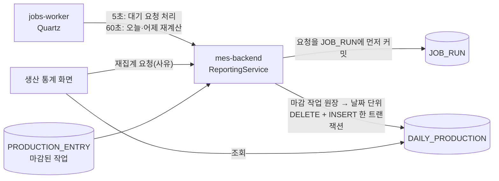
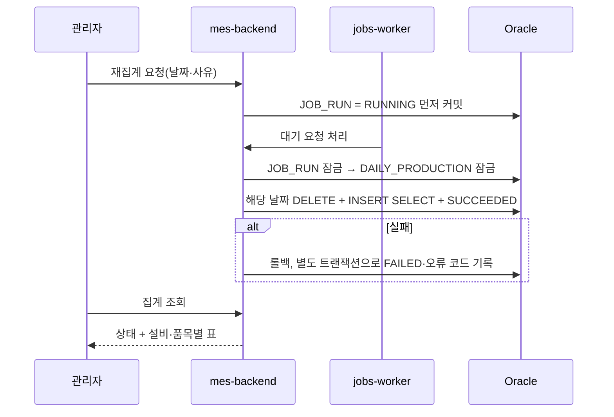
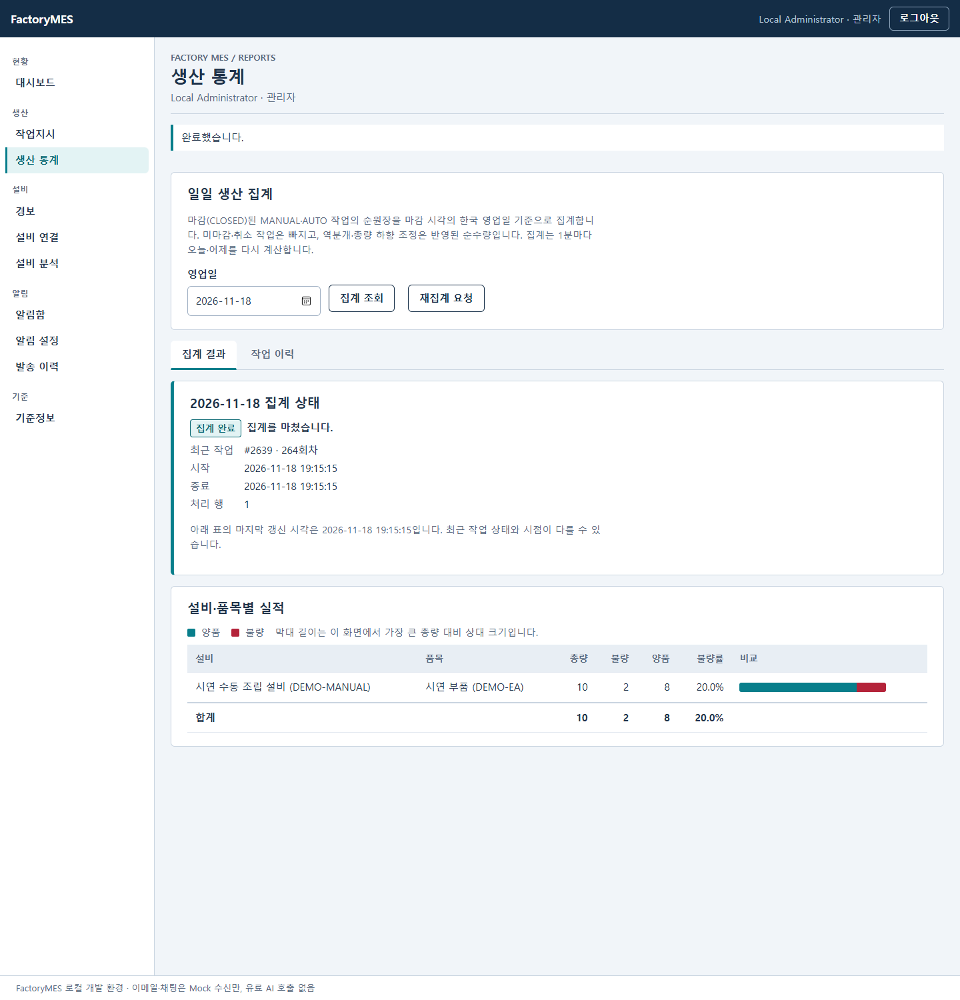
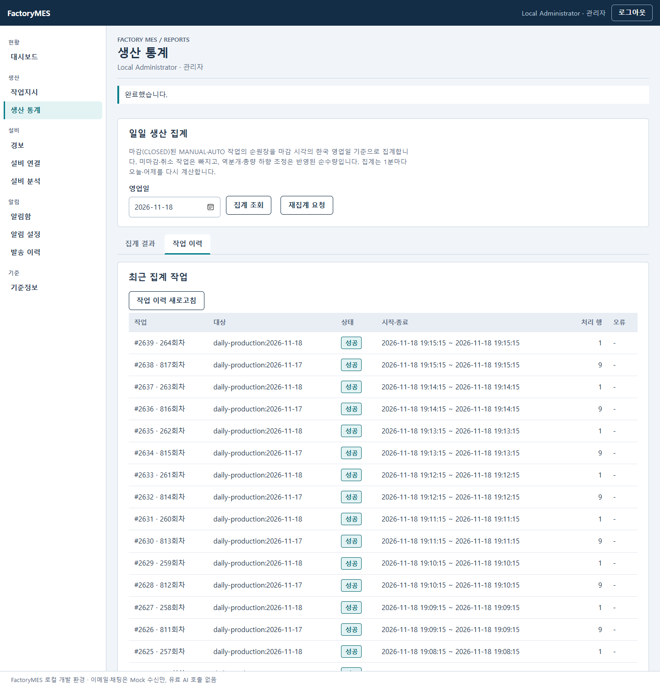
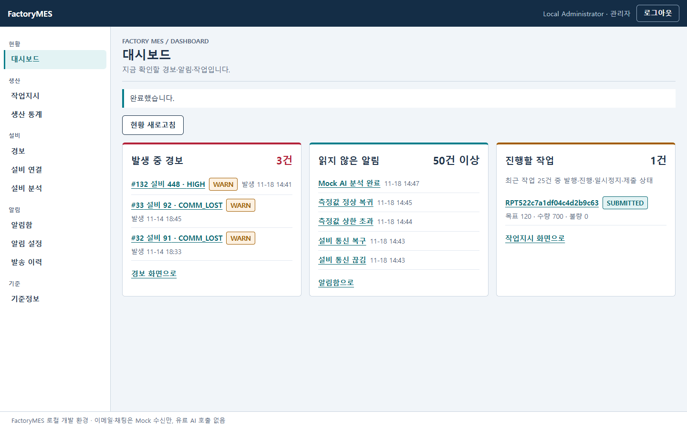

# 생산 통계·대시보드

관리자는 영업일을 골라 마감된 작업의 설비·품목별 총량·불량·양품·불량률을 봅니다.
대시보드는 로그인하자마자 "지금 확인할 것"(발생 중 경보, 읽지 않은 알림, 진행할 작업)을 보여줍니다.

## 구성도

## 흐름도

## 설계

### 문제
- 실적은 역분개·하향 조정이 있어서 "더하기만" 하면 맞지 않습니다.
- 화면을 열 때마다 원장을 계산하면 느리고, 브라우저에서 합산하면 규칙이 두 곳에 생깁니다.
- 집계 도중 실패하면 반쯤 바뀐 표가 보이면 안 됩니다.

### 검토한 안과 선택

| 고민 | 비교한 안 | 선택과 이유 |
|---|---|---|
| 집계 방식 | 증분 가산 / **날짜 단위 원장 재계산** | 증분은 빠르지만 정정·역분개·재실행에서 중복·누락을 따로 관리해야 합니다. 지금 규모에서는 재계산이 단순하고 검증하기 쉽습니다. |
| 귀속 날짜 | 실적 발생 시각 / **작업 마감 시각(한국 영업일)** | 이 지표는 "그날 마감된 생산"입니다. 시간대별 생산량과는 다른 지표라고 화면에 적었습니다. |
| 요청 보관 | 메모리 큐 / **JOB_RUN에 먼저 커밋** | 프로세스가 재시작돼도 요청이 사라지지 않습니다. |
| 실행 주체 | Quartz가 DB 직접 갱신 / **백엔드 내부 API** | DB 소유권을 백엔드에 둡니다. |
| 동시 실행 | 제한 없음 / **테이블 잠금으로 직렬화** | 로컬 규모에서 명확한 선택입니다. 규모가 커지면 실행 키·행 단위 잠금으로 범위를 줄여야 합니다. |

## 화면

### 생산 통계

맨 위에 **무엇을 집계하는지**(마감된 MANUAL·AUTO 작업의 순원장, 한국 영업일, 미마감·취소 제외)를 적었습니다.
상태 상자는 미집계·집계 완료·진행 중·실패를 구분하고, 표의 마지막 갱신 시각과 최근 작업 시점이 다를 수
있다고 안내합니다. 막대는 이 화면에서 가장 큰 총량 대비 상대 크기라는 점도 적어 두었습니다.

<a class="source-link" href="https://github.com/nkpFactoryMES/factorymes-web/blob/2d05837500b6de42f46230227fc593291856e0ff/services/web-client/Pages/Reports.razor#L29-L195">소스 보기</a>

### 집계 작업 이력

자동·수동 집계 실행을 모두 남겨서, 표가 언제 어떤 요청으로 바뀌었는지 볼 수 있게 했습니다. 재집계는 사유를
입력해야 요청됩니다.

<a class="source-link" href="https://github.com/nkpFactoryMES/factorymes-web/blob/2d05837500b6de42f46230227fc593291856e0ff/services/web-client/Pages/Reports.razor#L196-L296">소스 보기</a>

### 대시보드 (관리자)

새 데이터를 만들지 않고 기존 경보·알림·작업 API만 모아 보여줍니다. 카드마다 건수와 최근 항목, 해당 화면으로
가는 링크만 두어 "다음에 무엇을 할지"를 바로 정할 수 있게 했습니다.

<a class="source-link" href="https://github.com/nkpFactoryMES/factorymes-web/blob/2d05837500b6de42f46230227fc593291856e0ff/services/web-client/Pages/Dashboard.razor#L1-L128">소스 보기</a>

### 대시보드 (작업자)

작업자에게는 본인 담당 설비의 경보와 본인 작업만 셉니다. 같은 화면이지만 서버가 역할에 따라 범위를 나눠서
돌려줍니다.

<a class="source-link" href="https://github.com/nkpFactoryMES/factorymes-web/blob/2d05837500b6de42f46230227fc593291856e0ff/services/web-client/Pages/Dashboard.razor#L129-L239">소스 보기</a>

## 핵심 코드

집계 실행: 잠금 순서, 날짜 단위 삭제·재삽입, 성공·실패 기록.

<a class="source-link" href="https://github.com/nkpFactoryMES/factorymes-backend/blob/35b21c06298e68430fe08a6b5c3cd4ab1a683cf6/services/mes-backend/Features/Reporting/ReportingService.Execution.cs#L153-L313">소스 보기</a>

재집계 요청 저장: 실행 전에 요청을 먼저 커밋합니다.

<a class="source-link" href="https://github.com/nkpFactoryMES/factorymes-backend/blob/35b21c06298e68430fe08a6b5c3cd4ab1a683cf6/services/mes-backend/Features/Reporting/ReportingService.cs#L310-L449">소스 보기</a>

## 검증과 한계

- 집계 단계에서 실제 Oracle·API 42개, 브라우저 8개 항목을 통과했습니다. 역분개·하향 조정이 반영된 순수량을
  원장과 대조했습니다.
- 상세: [일별 생산 집계](https://github.com/nkpFactoryMES/factorymes-system/blob/de9e542d9e362add9f5aec3293986d4744c13b12/docs/daily-production-reporting.md)
- 프로세스를 강제 종료하는 부하 실험은 하지 않았습니다. 재시작 복구는 미완료 요청을 미리 넣어 두는 방식으로 확인했습니다.
- OEE는 근거 데이터(계획 정지, 표준 사이클 타임)가 없어서 계산하지 않았습니다.
